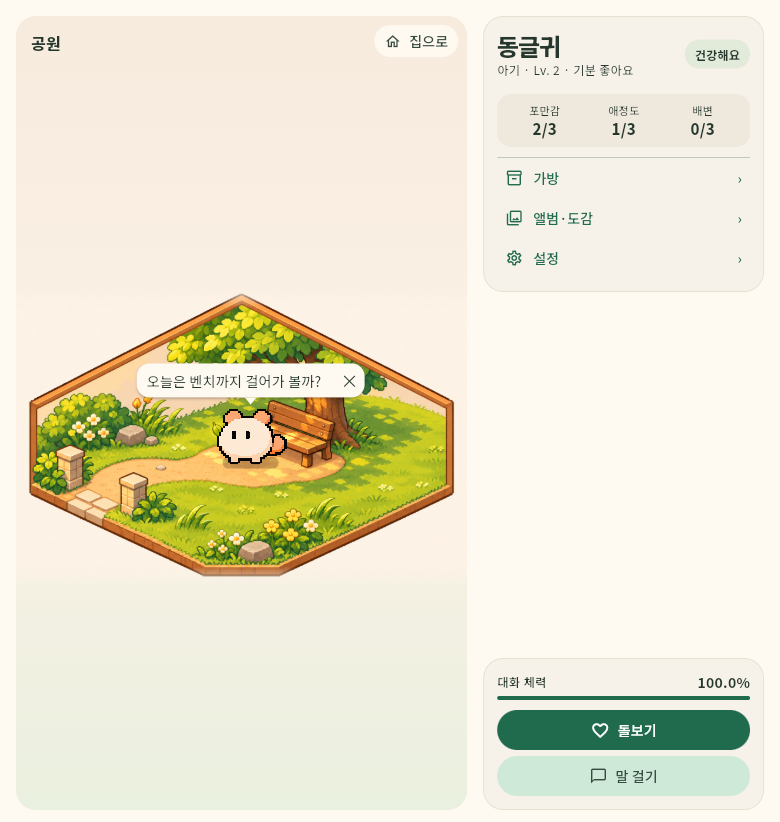

# 돌보고 이야기하며 키우는 로컬 LLM 펫 기획서

작은 방에서 펫을 돌보고, 같이 놀고, 말을 건다. 펫은 어제 함께한 일을 기억해 먼저 이야기를 꺼낸다. 사진 속 사물은 먹거리나 놀이에 쓸 아이템의 재료가 된다. **첫 시연에서는 펫 한 마리에게 사진에서 얻은 사과를 먹이고 원반으로 함께 논 뒤, 다음 날 펫이 그 추억을 먼저 꺼내는 흐름을 보여준다.**

첫 버전은 **Android와 iOS를 모두 대상으로** 한다. 동글귀 전용 Flutter 프로젝트에서 Kanana 모델 다운로드와 기기 내 추론을 사용한다. 한국어로 대화하는 도트 펫 세 종류를 발견할 수 있고, 2.5D 도트 방에서는 한 번에 한 마리를 키운다.

## Android와 iOS의 구현 범위

2.5D 방, 스프라이트, 아이템 가방, 돌보기와 생존 규칙, 추억과 선택 모델은 Flutter에서 공유한다. 사진 선택, 기기 내 인식, 앱이 다시 열릴 때의 상태 복원은 두 플랫폼에서 각각 점검한다. 사진 분석 결과는 같은 형식의 객체 이름, 위치, 신뢰도로 변환해 공통 아이템 규칙에 전달한다.

첫 시연은 Android 폰 한 대와 iPhone 한 대를 기준으로 한다. iOS는 Mac의 Xcode 서명 빌드 또는 동글귀 TestFlight 워크플로를 사용해 실기기에 설치한다. 모델을 준비한 각 기기에서 사진 선택부터 다음 날의 추억 인사까지 비행기 모드로 재현하고, 사진 탐지와 대사 생성 시간을 따로 측정한다.

새로 설치한 사용자는 모델을 받기 전에도 방에 들어가 부화, 기본 먹이, 톡 눌러 돌아보기, 보유 물건으로 놀기를 할 수 있다. 동글귀의 다운로드 안내에 약 1.52GB 용량과 진행 상태를 보여주고, 받는 동안에도 방으로 돌아갈 수 있다. 다운로드를 중단하고 앱을 다시 열면 돌보던 펫과 다운로드 진행을 복원한다. 모델이 준비되면 자유 대화가 열린다. 준비 전 추억 인사에는 저장한 제목을 사용한 기본 대사를 보여준다.

## 첫 시연에서 보여줄 이틀

동글귀 한 마리, 2.5D 방 한 칸, 사진 한 장에서 얻는 사과·원반·추억 카드만 사용한다. 첫 펫은 포만감 2칸으로 시작한다. 원반 놀이나 먹이기의 결과는 즉시 도트 애니메이션으로 확인할 수 있다.

| 시점 | 사용자 행동 | 펫의 반응 |
| --- | --- | --- |
| 첫날 저녁 | **가방 → 아이템 얻기 → 사진 선택**에서 사과와 원반이 있는 사진을 고르고 추억 제목을 ‘공원 소풍’으로 확인한다. | 소풍 추억, 사과, 원반이 가방에 들어온다. |
| 같은 방문에서 먹이기 | 가방의 사과를 바로 먹인다. | 펫이 받아먹고 포만감이 2칸에서 3칸으로 오른다. 첫 돌보기로 애정도 1을 얻고 사과 한 개가 줄어든다. |
| 같은 방문에서 놀기 | 원반 던지기를 누른다. 놀이가 끝나면 앱을 닫는다. | 펫이 달려가 원반을 받아 돌아오고 첫 놀이로 애정도 1을 더 얻는다. 원반은 가방에, 소풍 추억은 기기에 남는다. |
| 다음 날 오전 9시쯤, **15시간 뒤** | 앱을 열고 아무 말도 입력하지 않는다. | 포만감 1칸, 배변 1개, 건강함이다. 펫이 “어제 남긴 ‘공원 소풍’ 기억나. 오늘도 원반으로 놀까?”처럼 전날 추억을 먼저 꺼낸다. |
| 다음 날 저녁 6시쯤, **24시간 뒤** | 앱을 열고 급한 도움 요청을 본 뒤 먹이 하나를 준다. | 포만감 0칸, 배변 1개다. 굶주린 지 6시간이라 돌볼 수 있다. 펫이 먼저 먹이를 청하고, 먹이를 먹어 포만감이 1칸으로 회복되면 먹는 동작 직후 “이제 좀 살겠다. 어제 남긴 ‘공원 소풍’ 기억나?”처럼 미뤄 둔 추억을 꺼낸다. |
| 같은 날 재방문 | 위 시나리오에서 추억 인사를 들은 뒤 다시 연다. | 오늘 보여준 인사를 불러온다. 위기 중에 다시 열면 당장 필요한 돌봄 표시와 남은 시간이 보인다. |

첫날 마지막 먹이를 **18시쯤** 준다. 15시간과 24시간 시나리오는 각각 같은 첫날 상태에서 독립 실행한다. 24시간 시나리오에는 오전 접속이나 중간 돌봄이 없다. 개발 중에는 테스트용 시계로 두 흐름을 반복하고, Android와 iPhone 첫 시연에서 두 시간 간격을 모두 확인한다.

첫 시연을 마치면 같은 돌보기 규칙을 바탕으로 **공원 산책**, 책·인형·별 보기, 캐릭터 세 종류, 무작위 성격, 도감과 멀티엔딩을 연결한다. 추억 선호 학습은 기본 선택 규칙을 기준으로 별도 비교한다.

## 모바일 메뉴와 화면 이동

앱을 열면 **방**이 바로 보인다. 방과 공원은 기존 2.5D 배경의 비율을 유지해 양 끝이 잘리지 않도록 표시한다. 장면 위에는 현재 장소와 **공원 산책** 또는 **집으로** 버튼을 둔다. **포만감·애정도·배변**은 장면과 함께 보이는 상태 줄에 `2/3`처럼 표시한다. 키·몸무게와 다음 성장 단계까지의 시간은 펫 정보에서 확인한다.

| 화면 | 배치 |
| --- | --- |
| **일반 iPhone** | 펫 이름·레벨·기분·건강을 위에 두고, 장면 아래에 상태와 대화 체력을 표시한다. **돌보기 · 말 걸기**는 나란히, **가방 · 앨범·도감 · 설정**은 그 아래에 바로 노출한다. |
| **접힌 iPhone Duo** | 오른쪽에 세로 시스템 막대가 생기면, 상태 표시 아래에 iOS 네이티브 툴바로 **돌보기 · 말 걸기 · 가방 · 앨범·도감 · 설정**을 둔다. 방과 상태에는 시스템 안전 영역의 전체 너비를 사용한다. 네이티브 툴바가 없는 화면은 일반 iPhone 배치를 사용한다. |
| **펼친 iPhone Duo** | 왼쪽에 방이나 공원, 오른쪽에 조작 영역을 나란히 배치한다. 조작 영역 위쪽에는 펫 정보·상태·가방·앨범·도감·설정, 아래쪽에는 대화 체력·돌보기·말 걸기를 모은다. 시스템 막대가 어느 쪽에 있든 조작 영역은 안전 영역 안의 오른쪽에 놓인다. |



화면 배치는 사용할 수 있는 공간을 기준으로 바꾼다. 프로토타입은 안전 영역 안의 너비가 논리 픽셀 620 이상이면 장면과 조작 영역을 나란히 놓는다. 게임 화면과 가방·아이템 확인 시트는 시스템 막대와 홈 표시 영역을 피한다. [Apple의 iPhone Duo 디자인 가이드](https://developer.apple.com/design/human-interface-guidelines/designing-for-iphone-duo)

| 메인 화면 버튼 | 누른 뒤 동작 |
| --- | --- |
| **돌보기** | 포만감과 방 상태를 보고 **먹이기**와 **청소하기**를 연다. 먹이기를 선택하면 보유 먹거리에서 하나를 고른다. |
| **말 걸기** | 접힌 화면에서는 장면 아래, 펼친 화면에서는 조작 영역 아래에 입력창과 보내기 버튼을 연다. 펫의 답장은 장면 안의 말풍선에 뜨고, 같은 자리에서 다음 말을 보낼 수 있다. |
| **가방** | 사과 **먹이기**, 원반 **던지기**, 책 **같이 읽기**, 곰인형 **옆에 두기**를 실행한다. 이곳의 **아이템 얻기**에서 사진을 선택하거나 글 간식을 만든다. 사진을 확인해 담으면 새 아이템이 가방에 바로 보인다. 먹이기나 던지기를 누르면 패널이 닫히고 같은 방에서 펫이 반응한다. |
| **앨범·도감** | 사진과 글에서 만든 추억, 발견한 아이템과 캐릭터를 확인한다. |
| **설정** | 모델 관리와 앱 설정을 연다. |

Flutter에서 화면 배치와 기능 이름을 공유하고, iOS의 iPhone 스타일과 Android의 Material 3 스타일을 따른다. 가방은 게임 화면 위에 시트로 열리고, 닫으면 같은 장면으로 돌아온다. [Apple 버튼 가이드](https://developer.apple.com/design/human-interface-guidelines/buttons) · [Android 하단 패널 가이드](https://developer.android.com/develop/ui/compose/components/bottom-sheets)

**청소하기**는 방에 치울 똥이 있을 때 표시한다. 위기 상황에는 필요한 먹이기·청소 동작과 남은 시간을 방 위쪽에서 보여준다. **별 보기**는 방 안의 별 관찰 자리에서 열고, 펫 이름을 누르면 **펫 정보**에서 성격, 성장 단계, 키와 몸무게를 확인한다.

**첫 시연에서는 가방에서 아이템을 얻고 곧바로 펫을 돌보고 노는 흐름을 검증**한다. 사진 확인 화면에서 제목을 저장하면 다음 날 펫 머리 위 말풍선에 추억이 나타난다. 자유 대화의 답장도 같은 말풍선을 사용한다. 앨범·도감과 지난 펫의 콘텐츠, 글 간식, 전체 대화와 엔딩은 첫 버전 확장에서 연결한다. 푸시 알림과 여러 기기 동기화는 후속 범위다.

## 사진에서 아이템 찾기

1. **찾기** — 기기에서 인식한 글자와 장면 분류를 추억 제목 제안에 활용한다. Android는 ML Kit, iOS는 Apple Vision 경로를 재사용한다. 사진 속 사과와 원반을 따로 찾고 위치를 표시하는 데는 두 플랫폼의 MediaPipe Object Detector에서 동일한 EfficientDet-Lite0 모델을 첫 후보로 시험한다. [Google AI Edge 객체 탐지 문서](https://developers.google.com/edge/mediapipe/solutions/vision/object_detector)
2. **고르기** — 사진 미리보기에서 감지된 물건에 테두리를 표시하고, 장면에서 만든 추억 한 장과 먹거리·물건 후보를 최대 하나씩 제안한다. 예를 들어 사과는 먹거리, 원반은 물건으로 바꾼다. 게임에서 지원하는 탐지 라벨만 자동 제안에 쓰고, 사용자는 저장 전에 후보를 빼거나 이름을 고칠 수 있다.
3. **담기** — 확인한 아이템을 가방에 넣는다. 감지에 실패하면 사진을 미리 보며 **직접 고르기**로 음식이나 물건이 있는 부분을 가리키고, 지원 목록에서 해당 아이템을 선택할 수 있다. 수동 선택에도 사진당 먹거리·물건 하나씩이라는 같은 한도를 적용한다. 추억 제목은 직접 적을 수 있고, 먹을 만한 물건을 고르기 어려우면 기본 사진 간식을 선택할 수 있다. 글은 최대 500자까지 받고 글 간식과 짧은 추억을 만들 수 있다.

## 아이템을 쓰는 법과 성장

| 종류 | 예시 | 가방에서 할 수 있는 일 |
| --- | --- | --- |
| 추억 | 공원 소풍 | **같이 떠올리기**를 누르면 펫이 추억을 한마디로 이야기한다. 이후 첫 인사의 후보로도 남는다. |
| 먹거리 | 기본 먹이, 사과, 글 간식 | **먹이기**를 누르면 포만감이 1칸 오른다. 그날 첫 돌보기라면 애정도도 1 오른다. 먹인 아이템 한 개가 가방에서 줄어든다. 포만감이 가득 찼으면 다음에 먹일 수 있다. |
| 물건 | 원반, 책, 곰인형 | 원반은 **던지기**, 책은 **같이 읽기**, 곰인형은 **옆에 두기**로 쓴다. 물건은 가방에 남아 다시 쓸 수 있다. |

가방에 아이템을 담는 순간에는 발견 애니메이션을, 실제 먹이는 순간에는 받아먹는 모습을 보여준다. 첫 시연에서는 먹이기와 원반 놀이로 애정도가 각각 오르는 것까지 확인한다.

아이템은 공용 게임 아이콘과 짧은 이름으로 표시한다. 사진 원본과 글 전체는 펫 기록에 보관하지 않으며, 분석용 임시 사본은 완료나 취소 후 정리한다. 추억 제목은 최대 60자이고, 추억과 관련 인사는 30일을 넘기면 정리한다. 먹거리는 먹이거나 직접 정리할 때까지, 물건은 직접 정리할 때까지 남는다. 누적 성장도 유지된다.

## 성장 곡선과 레벨

성장은 **부화 후 함께 지낸 시간과 누적 애정도**를 함께 본다. 나이는 앱을 닫아 둔 동안에도 흐르고, 애정도는 실제로 함께한 행동에서 얻는다. 성장에 필요한 최소 애정도를 넘기면 애정도가 높을수록 다음 외형까지의 대기 시간이 줄어든다. 외형이 바뀌는 순간에는 펫이 건강해야 한다. 아래 시간과 애정도는 첫 버전의 초기값이다.

| 레벨 | 부화 후 성장 시간 | 최소 누적 애정도 | 최대 포만감 | 최대 대화 체력 | 화면에서 보이는 변화 |
| --- | --- | --- | --- | --- | --- |
| Lv. 1 | 부화 직후 | 0 | 3칸 | 384토큰 | 아기 모습으로 시작한다. |
| Lv. 2 | 부화 직후 | 1 | 3칸 | 448토큰 | 첫 애정도 1점을 얻으면 레벨이 오른다. |
| Lv. 3 | 30시간에서 최단 24시간 | 3 | 4칸 | 512토큰 | 꼬마가 되어 몸집과 표정이 달라진다. |
| Lv. 4 | 36시간 | 5 | 4칸 | 576토큰 | 같은 방의 두 번째 원반 착지점이 열린다. 펫 정보에서 성체까지 남은 시간과 애정도를 확인할 수 있다. |
| Lv. 5 | 96시간에서 최단 72시간 | 8 | 5칸 | 640토큰 | 성체가 되어 보폭과 착지가 달라진다. 건강하면 마무리 장면을 선택할 수 있다. |

성장할 때는 포만감의 최대치가 한 칸 늘고, 채워져 있던 칸 수와 다음 감소 시각은 그대로 유지된다. 예를 들어 아기가 `포만감 2/3`에서 꼬마가 되면 `2/4`로 바뀐다. 새로 열린 칸에는 먹이로 채울 수 있다.

| 외형 변화 | 최소 애정도일 때 | 애정도에 따른 단축 |
| --- | --- | --- |
| 꼬마 | 애정도 3 → 부화 후 30시간 | 3점을 초과한 1점마다 3시간 단축. 애정도 4면 27시간, 5 이상이면 최단 24시간이다. |
| 성체 | 애정도 8 → 부화 후 96시간 | 8점을 초과한 1점마다 6시간 단축. 애정도 9면 90시간, 10이면 84시간, 12 이상이면 최단 72시간이다. |

남은 시간은 현재 애정도에 따른 성장 시간에서 부화 후 경과 시간을 빼서 구한다. 예를 들어 부화 후 26시간 된 건강한 아기는 애정도 4일 때 1시간이 남지만, 놀이로 5점이 되는 순간 성장 시간이 24시간으로 줄어 바로 꼬마가 된다. 같은 행동을 그날 여러 번 해도 기존 하루 애정도 한도가 적용된다.

애정도는 다음 세 종류에서 **하루 각각 1점씩, 최대 3점**을 얻는다. 날짜별로 완료한 종류를 저장한다.

- **돌보기** — 실제로 먹이를 주거나 바닥을 치웠을 때.
- **놀이** — 원반 놀이, 책 같이 읽기, 별 보기 중 하나를 마쳤을 때.
- **교감** — 펫을 톡 눌러 돌아보는 반응을 보거나 대화를 한 번 나눴을 때.

**돌보기**에서는 기본 먹이와 보유한 간식을 바로 쓸 수 있고, 그날 처음 방에 들어올 때 기본 먹이 재고를 현재 성장 단계의 포만감 최대치까지 보충한다. 아기는 3개, 꼬마는 4개, 성체는 5개까지다. 기본 먹이와 사진 간식은 돌보기 점수가 같다. 같은 날 같은 종류의 행동을 반복하면 행동 자체는 계속 할 수 있고 애정도는 그날 첫 완료에서만 오른다. 애정도 계산과 성장 단계 변경은 게임 로직으로 처리해 기존 도트 동작을 재사용하고 LLM을 추가로 호출하지 않는다.

메인 화면에는 애정도 기준에 도달하기 전까지 **애정도 2/3**처럼 현재 점수와 필요한 점수를 표시한다. 기준에 도달하면 **애정도 4**처럼 누적 점수를 표시한다. 펫 정보에서는 **꼬마까지 1시간 · 애정도로 3시간 단축**처럼 남은 시간과 이미 줄어든 시간을 보여준다. 최소 애정도가 부족하면 필요한 점수도 함께 표시한다. 성장 직전에 현재 건강을 확인하고, 아프다면 돌본 뒤 조건을 다시 확인한다. 외형 변화는 같은 단계에서 한 번만 재생한다. 성체가 된 뒤에는 계속 키우거나 열린 엔딩을 고를 수 있다.

### 키와 몸무게 기록

펫 정보에는 **현재 키, 현재 몸무게, 성장 기록**을 함께 보여준다. 같은 종과 성장 단계라도 개체마다 체격이 다르다. 아래 동글귀의 초기 범위는 이웃한 단계끼리 일부 겹친다. 예를 들어 키 9.8 cm인 아기가 키 9.3 cm인 꼬마보다 클 수 있다.

| 성장 단계 | 키 범위 | 기준 몸무게 범위 |
| --- | --- | --- |
| 아기 | 7.0~10.0 cm | 0.32~0.58 kg |
| 꼬마 | 9.0~14.0 cm | 0.52~1.02 kg |
| 성체 | 13.0~19.0 cm | 0.95~1.65 kg |

부화할 때 키와 기준 몸무게가 각 범위의 어느 지점에 해당하는지 하나씩 무작위로 정해 저장한다. 꼬마와 성체가 될 때도 그 위치를 새 단계의 범위에 그대로 적용한다. 예를 들어 키가 항상 범위의 중간인 동글귀는 **8.5 → 11.5 → 16.0 cm**로 자란다. 같은 펫은 단계마다 키와 기준 몸무게가 증가하며, 앱을 다시 열 때마다 같은 값이 나온다.

기준 몸무게는 포만감 2칸일 때의 값이다. 포만감이 기준에서 한 칸 달라질 때 현재 몸무게는 0.05 kg만큼 변한다. 펫 정보에는 내 펫의 현재 수치를, 도감에는 종류와 성장 단계별 범위를 보여준다.

부화와 외형 변화 때 날짜·단계·키·기준 몸무게를 성장 기록에 한 줄씩 남긴다. 예전 성장 기록은 이후 먹이에 따라 달라지지 않는다. 엔딩을 맞은 뒤에도 지난 펫에서 성장 기록을 볼 수 있다. 계산은 게임 로직에서 처리하며, 외형은 기존 성장 단계별 도트 프레임을 재사용한다. 키와 몸무게는 성장의 변화를 보여주는 정보이며, 성장 조건은 시간·애정도·건강으로 판정한다.

## 며칠 동안 할 수 있는 놀이와 수집

사진은 새 물건을 발견하는 데 쓰고, 한 번 얻은 물건은 다음 날에도 플레이에 쓰인다. 첫 시연은 방 한 칸에서 시작하고, 첫 버전에서는 집과 공원을 오가며 놀이를 바꿀 수 있다.

| 콘텐츠 | 사용자와 펫이 하는 일 | 다시 할 이유 |
| --- | --- | --- |
| 원반 던지기 | 첫 시연에서는 안쪽 오른편의 기본 착지점으로 던진다. 펫은 의자를 돌아 달려가서 뛰어 받은 뒤 걸어 돌아온다. | Lv. 4부터 안쪽 왼편의 두 번째 착지점도 고를 수 있다. 세 번 놀면 펫이 가끔 원반 옆에서 기다린다. |
| 책 같이 읽기 | 책을 방의 정해진 자리에 놓으면 펫이 옆으로 걸어와 대기한다. 사용자가 책 이름이나 오늘 읽은 한 줄을 남기면 글 추억으로 저장할 수 있다. | 다음 날 펫이 그 제목으로 먼저 말을 걸 수 있다. 같은 책으로 다른 날의 이야기를 남길 수 있다. |
| 곰인형 옆에 두기 | 방의 정해진 자리 한 곳에 인형을 놓는다. 펫은 성향과 아이템 사용 기록에 따라 한가할 때 옆에 와서 기존 대기 동작으로 쉰다. | 내가 가져온 물건과 펫 성격에 따라 평소 펫이 머무는 곳이 달라진다. |
| 별 보기 | 바닥 한쪽으로 함께 걸어가면 가상의 별 모양 하나가 나온다. 모양은 기본 도안 세 개에서 순서대로 바뀌고, 원하는 날에는 이름을 붙여 추억으로 남길 수 있다. | 앱을 다시 여는 횟수와 관계없이 하루에 한 모양을 볼 수 있다. 전에 붙인 이름은 나중에 펫이 꺼낼 수 있다. |

가방의 **발견한 물건**에서는 원반, 책, 곰인형 중 처음 발견한 종류와 사용법을 확인한다. 모으는 목표는 아이템 수량 대신 새로 할 수 있는 행동이다. 처음 얻는 날에만 종류를 기록하므로 같은 물건을 반복 사진으로 가져와도 도감 항목이 늘어나지 않는다.

새 놀이에는 방과 방향별 스프라이트를 재사용한다. 추가 그림 범위는 책·인형 아이콘과 별 모양 도안이며, 이동·배치·별 모양 선택·추억 저장·도감 갱신은 모두 게임 로직에서 처리한다. 책이나 별 추억은 이후 기존 인사와 대화에서 사용할 수 있다.

### 짧게 들어와도 할 일이 있는 방

포만감과 성장은 현실 시간에 따라 바뀐다. 앱을 열면 지금 할 수 있는 돌봄, 놀이, 교감을 바로 시작할 수 있다. 한 번 방문했을 때 **30초 안에 돌보거나 교감하고, 원하면 1~3분 정도 놀이를 이어가는 흐름**을 첫 체험 목표로 삼는다.

| 시점 | 화면에서 일어나는 일 |
| --- | --- |
| **방을 열었을 때** | 펫이 쉬거나 방을 걸으며 성격을 보여준다. 톡 누르면 기존 방향 전환과 대기 동작으로 반응한다. 돌봄이 급할 때는 첫 화면에서 필요한 행동과 남은 시간이 보인다. |
| **돌봄을 마쳤을 때** | 두 가지 문제가 있으면 같은 **돌보기** 패널에서 먹이기와 청소를 각각 바로 끝낼 수 있다. 펫이 회복하면 미뤄 둔 첫 추억 인사가 이어진다. 추억을 꺼낸 뒤에는 그날 할 수 있는 놀이 하나를 보여준다. |
| **지금 함께 놀 때** | 안전하고 실행 가능한 활동 중 최근 두 번 완료한 것과 다른 활동을 먼저 제안한다. 후보가 여럿이면 펫 성격에 맞는 것을 우선한다. 원반이나 책이 없어도 별 보기와 톡 누르기가 가능하다. |
| **한 번 놀고 난 뒤** | 원반을 받아오면 방에서 **한 번 더 던지기**를 바로 눌러 놀 수 있다. 가방을 다시 열 필요 없이 원래 위치에서 다음 놀이를 시작한다. Lv. 4부터는 착지점을 바꿔 다른 길로 뛰게 할 수 있다. |
| **같은 날 다시 왔을 때** | 첫 인사를 들은 펫은 다시 인사하는 대신, 현재 상태와 놓인 물건에 따라 창가·원반·인형 중 갈 수 있는 자리에서 기존 걷기와 대기 동작을 보인다. |

놀이 제안과 재시작 버튼, 방 안의 이동은 게임 규칙과 기존 도트 프레임으로 처리한다. 대화 체력이 떨어져도 버튼으로 놀 수 있다. 애정도는 기존과 같이 종류별 첫 완료만 올리고, 이후에는 펫의 몸짓과 반응으로 놀이 결과를 보여준다. 놀이 제안은 넘길 수 있고, 별 보기나 수집을 건너뛴 날에도 기존 돌보기 규칙대로 플레이할 수 있다.

### 집에서 공원으로 산책

방의 문을 톡 누르면 **공원 산책**을 시작한다. 공원은 방과 같은 2.5D 시점의 한 화면이다. 입구에서 벤치와 나무를 지나 작은 잔디밭으로 이어지는 짧은 길이 있고, 펫은 길을 따라 걷거나 벤치 곁에 잠깐 머문다. **집으로**를 누르면 원래 방으로 돌아온다.


공원 아이들링은 펫이 벤치 옆에 잠깐 멈춰 꼬리를 느리게 흔드는 모습이다. 배경에서는 나뭇잎이나 풀 끝이 가끔 흔들린다. 펫의 대기 프레임과 배경의 짧은 반복 동작은 서로 다른 박자로 재생한다.

#### 장소별 행동

| 어디서 | 행동 | 장소에 따라 달라지는 점 |
| --- | --- | --- |
| **집에서만** | 밥자리에서 먹이기, 배변 청소, 책 읽기, 인형 놓기, 창가에서 별 보기, 러그에서 밤잠 자기 | 펫을 돌보고, 쉬는 자리와 방에 두는 물건을 정한다. |
| **공원에서만** | 입구에서 벤치까지 산책, 벤치 옆에서 쉬기 | 그날 첫 산책을 추억으로 남긴다. 낮잠 시간에는 벤치 옆에 몸을 말고 잔다. |
| **두 곳에서** | 펫 톡 누르기, 말 걸기, 원반 던지기 | 대화와 건강 상태는 이어진다. 집에서는 의자를 돌아오는 짧은 원반 놀이를 하고, 공원에서는 잔디밭을 가로질러 뛰어간다. |

공원에서도 같은 펫, 가방, 포만감·애정도·배변 상태를 공유한다. 장소를 옮겨도 돌봄 타이머는 이어진다. 먹이거나 청소할 때는 **집으로** 돌아오며, 급한 돌봄이 필요한 경우에는 공원에서도 상태와 남은 시간을 볼 수 있다. 사용자가 찍은 사진에서 기억한 소풍과 게임 속 산책은 각각 발생한 날짜와 이름으로 저장한다. 다음 날 펫은 “어제 벤치 옆에서 쉬었지. 오늘도 나갈래?”처럼 실제 산책 기록을 먼저 꺼낼 수 있다.

새 그림은 공원 바닥·나무·벤치에 집중한다. 걷기·대기·달리기·점프와 원반 놀이 로직은 공유하고 공원용 이동 경로와 착지점만 지정한다. 장소 이동과 산책 기록 자체는 LLM을 호출하지 않는다.

## 캐릭터를 발견하고 모으기

첫 펫은 크림색 몸에 살구색 귀와 짧은 꼬리가 달린 **동글귀**다. 32×32 도트에서 시작하는 둥근 몸을 공통으로 쓰고, 귀와 꼬리 모양으로 나머지 두 캐릭터를 구분한다. 아래 이름과 발견 조건은 첫 버전의 초안이다.

| 캐릭터 | 생김새와 말투 | 발견 조건 |
| --- | --- | --- |
| 동글귀 | 둥근 귀와 도톰한 꼬리. 장난기가 많아서 원반을 보면 먼저 놀자고 말한다. | 첫 펫으로 만난다. |
| 잎귀 | 연두색 잎처럼 끝이 갈라진 귀. 새로운 것을 보면 궁금한 점을 한마디씩 묻는다. | 펫과 책을 읽고 첫 책 추억을 남긴다. |
| 별꼬리 | 남색 몸에 별 모양 꼬리 끝. 말수가 적고 차분하게 그날의 장면을 이야기한다. | 서로 다른 별 모양 세 개를 함께 본다. |

**캐릭터 도감**에는 발견 조건, 발견한 종류, 직접 키워본 종류를 보여준다. 조건을 채우면 해당 종류의 알이 열리고, 도감에서 그 캐릭터의 모습과 걷기·대기를 바로 미리 볼 수 있다. 미리보기는 기존 도트 동작만 사용한다. 현재 펫이 엔딩을 맞은 뒤 **새 펫 시작**을 선택할 때 열린 알 중 하나를 고른다. 지난 펫 화면에서 마지막 모습과 함께한 추억을 볼 수 있다. 새 펫의 성장과 가방은 새로 시작하지만, 발견한 종류와 키워본 종류는 도감에 남는다.

세 종류는 성장 단계별 몸통 프레임과 발 위치, 걷기·뛰기·점프 타이밍을 공유한다. 귀와 꼬리만 프레임의 공통 기준점에 붙이고 색을 바꿔 표시한다. 캐릭터의 성격은 기존 대사 요청에 함께 넣고, 해금과 도감 갱신은 게임 로직으로 처리한다.

### 아기 펫 3종의 아이들링 시안


동글귀는 둥근 귀를 쫑긋 세우고, 잎귀는 작은 새싹 귀를 기울이며, 별꼬리는 금빛 꼬리 끝을 흔든다. 기본 자세·숨쉬기·깜빡임은 공통으로 사용하고, 마지막 동작으로 각 아기 펫을 구분한다.

### 아기 펫 3종의 8방향 걷기 시안


화살표는 화면에서 펫이 이동하는 방향이다. 정면·앞 대각선·옆면·뒤 대각선·뒷면의 **5가지 원본 방향**을 만들고, 반대쪽 옆면과 대각선 **3가지**는 좌우 반전해 쓴다. 걷다가 멈추면 마지막으로 향하던 방향을 유지한 채 대기 동작으로 이어진다.

### 자라면서 바뀌는 실루엣

아기는 덩어리처럼 둥글고 팔다리가 짧다. 꼬마가 되면 다리와 귀·꼬리의 윤곽이 뚜렷해진다. 성체는 몸통이 넓어지고, 캐릭터마다 알아볼 수 있는 귀와 꼬리 모양이 완성된다. 앱을 다시 열어 크기 비교를 하지 않아도 실루엣으로 성장 단계를 알아볼 수 있게 한다.

| 종류 | 아기 | 꼬마 | 성체 |
| --- | --- | --- | --- |
| **동글귀** | 찹쌀떡 같은 몸, 낮게 붙은 둥근 귀, 조그만 꼬리 | 두 귀가 위로 서고 다리가 또렷해진다. | 둥근 귀가 양옆으로 넓어지고 살구색 꼬리가 도톰해진다. |
| **잎귀** | 연두색 새싹 같은 작은 귀 | 귀 끝이 두 갈래로 갈라진다. | 잎 모양 귀가 좌우로 펼쳐져 걸을 때 실루엣이 길어진다. |
| **별꼬리** | 꼬리 끝에 둥근 밝은 점 | 꼬리 끝이 도톰해지고 작은 모서리가 나타난다. | 꼬리 끝이 별 모양으로 완성되고, 돌아설 때 별 윤곽이 보인다. |

성장 조건을 채우면 기존 점프 동작을 한 번 보여주고, 착지 프레임에서 다음 단계의 몸통·귀·꼬리로 전환한다. 위치 기준점과 성장 단계별 몸통 틀을 캐릭터끼리 공유한다. 캐릭터를 구분하는 귀와 꼬리 부위만 단계별로 그리며, 장면을 확대하지 않아도 형태 변화가 보이게 한다.

### 꼬마 펫 3종의 아이들링과 8방향 걷기 시안


꼬마 동글귀는 귀가 더 높이 서고 꼬리가 길어진다. 잎귀는 잎 끝의 갈라진 윤곽이 보이고, 별꼬리는 둥근 꼬리 끝에 모서리가 생긴다. 같은 카메라에서 아기보다 다리가 뚜렷하게 보인다.


걷기 시안은 방향별 대표 자세를 한 장씩 보여준다. 아기와 같은 방향 기준과 발 위치를 사용하고, 꼬마는 걸음을 내디딜 때 아기보다 발이 조금 더 벌어진다.

### 성체 펫 3종의 아이들링과 8방향 걷기 시안


성체 동글귀는 넓어진 살구색 귀와 도톰한 꼬리, 잎귀는 잎맥이 보이는 넓은 잎 귀, 별꼬리는 꼬리 끝의 완성된 금빛 별로 구분한다. 대기 중에는 넓어진 몸통이 천천히 오르내리고, 마지막 자세에서 종마다 다른 귀나 꼬리 동작을 보여준다.


걷기 시안에는 화면 기준 8방향의 대표 자세를 담았다. 앞을 향할 때는 얼굴, 뒤로 향할 때는 넓어진 몸통과 꼬리가 잘 보이게 그린다. 실제 걷기에서는 아기·꼬마와 같은 방향 기준과 발 위치를 쓰고, 성체 특유의 넓어진 보폭과 묵직한 착지를 표현한다.

### 부화할 때 정해지는 펫 성격

알이 부화할 때 네 가지 성향에서 각각 한쪽을 무작위로 뽑는다. 16가지 조합이 가능하고, 같은 종류라도 다른 성격으로 태어날 수 있다. 펫 정보 화면에서 네 성향을 볼 수 있고, 부화 결과는 해당 펫에 한 번 저장해 재실행 후에도 유지한다. 지난 펫을 볼 때도 그 펫의 성향을 확인할 수 있다.

| 성향 | 대사에 드러나는 차이 | 평소 행동에 드러나는 차이 |
| --- | --- | --- |
| 먼저 제안하기 / 이야기에 호응하기 | 할 일을 먼저 제안하거나, 사용자가 방금 한 말을 받아 이야기를 잇는다. | 중앙 쪽 빈 바닥으로 나와 멈추거나, 지금 있는 자리에서 조금 더 머문다. |
| 활발하게 놀기 / 느긋하게 쉬기 | 원반 놀이를 이야기하거나, 차분하게 같이 쉬자고 한다. | 활발한 펫은 자주 걷고 원반을 우선한다. 느긋한 펫은 대기가 길고 책이나 곰인형을 우선한다. |
| 새로운 것에 끌리기 / 익숙한 것에 끌리기 | 낯선 물건에 관심을 보이거나, 함께 자주 쓰던 물건을 반가워한다. | 취향에 맞는 물건이 여럿이면 최근에 얻은 쪽 또는 사용 횟수가 많은 쪽으로 간다. |
| 바로 말하기 / 상상으로 표현하기 | 기분을 구체적으로 말하거나, 일어난 일을 비유로 표현한다. | 말투에 적용한다. |

같은 동글귀가 같은 원반을 발견해도 활발하고 먼저 제안하는 펫은 “원반이다! 저 안쪽까지 던져 볼래?”라고 말하고, 느긋하고 익숙한 것을 좋아하는 펫은 “우리 늘 놀던 원반이네. 네 옆에 앉아서 잠깐 쉬자.”라고 말할 수 있다. 종류별 말투는 기본으로 두고, 부화 성향은 지금 상황에 어떤 방식으로 반응할지 정하는 데 쓴다.

무작위 선택과 프로필 표시는 게임 로직으로 처리한다. 기존 대사 요청에 성향을 짧게 붙이므로 별도 추론이나 전용 애니메이션이 필요 없다. 배고픔과 건강이 급하면 성향보다 현재 상태를 먼저 대사에 반영한다. 함께한 활동, 펫의 성향, 실제로 생활한 방의 환경은 성장 엔딩에도 반영한다.

## 2.5D 도트 방과 펫의 움직임

작은 방 하나를 **고정된 3/4 시점**으로 비스듬히 내려다본다. 바닥과 벽이 함께 보이고, 펫은 가만히 눈을 깜빡이다가 방 안쪽이나 문 앞까지 스스로 걸어 다닌다. 방과 가구, 펫, 아이템을 같은 도트 크기의 2D 스프라이트로 그린다. 걷기와 달리기는 화면에 투영된 이동 방향에 맞춰 **8방향** 중 하나를 보여준다. 자유 이동에서 대각선으로 갈 때는 인접한 가구 모서리를 통과할 수 없다. 첫 시연의 밥자리와 원반 동선은 지정한 칸과 경로를 따른다.


집에서는 펫이 눈을 깜빡이고 숨을 쉬다 가끔 귀를 움직인다. 창가의 커튼 끝은 펫과 다른 박자로 천천히 흔들린다. 밥그릇은 앞쪽 왼편, 의자는 오른쪽 통로에 둬 먹이기와 원반 놀이 때 움직이는 위치를 찾기 쉽다.

펫의 발이 닿는 바닥 위치로 가구와 펫의 표시 순서를 정한다. 펫이 의자 뒤를 지나면 등받이에 가려지고, 앞으로 돌아오면 다시 드러난다. 의자 자리에는 들어갈 수 없고, 원반은 펫이 갈 수 있는 바닥에 떨어진다. 펫이 뛰어오르면 몸 그림만 위로 올라가고 그림자는 바닥에 남아, 방 안으로 걸어가는 움직임과 공중에 뜨는 움직임을 구분할 수 있다.

### 첫 시연용 방의 배치와 이동

바닥은 **7열 × 5행**으로 잡는다. 제작용 평면에서 A→G는 왼쪽에서 오른쪽, 1→5는 뒷벽에서 화면 앞쪽이다. 플레이 화면에는 격자나 좌표를 그리지 않는다.

```text
뒷벽
     A  B  C  D  E  F  G
 1   .  .  .  .  .  .  .
 2   .  ②  .  .  .  ①  .
 3   #  .  .  .  #  .  .
 4   .  .  .  .  .  .  .
 5   .  밥  먹  대  .  .  .
화면 앞
```

| 지점 | 위치와 쓰임 |
| --- | --- |
| **밥자리** | 밥그릇은 **B5**, 펫이 먹는 칸은 바로 옆 **C5**다. 가방에서 먹이를 고르면 B5를 짧게 표시하고 펫이 C5로 걸어와 먹는다. |
| **놀이 출발·복귀점** | **D5**. 먹기를 마친 직후라면 C5에서 한 칸 걸어와 원반을 기다린다. |
| **기본 착지점 ①** | **F2**. 첫 시연에서 **던지기**를 누르면 이곳으로 바로 던진다. |
| **두 번째 착지점 ②** | **B2**. Lv. 4에서 열린다. 그전에는 빈 바닥으로 보인다. |
| **가구** | 서랍장 **A3**, 의자 **E3**는 펫이 밟지 않는 칸이다. 의자 뒤쪽 통로 **E2**는 통과할 수 있다. |

**기본 착지점으로 달려가기**

D5 → E5 → F5 → F4 → F3 → F2

**원반을 받아 걸어서 돌아오기**

F2 → E2 → D2 → D3 → D4 → D5

펫은 갈 때 의자의 오른쪽을 지나고, 돌아올 때 E2에서 등받이에 잠깐 가려졌다가 D3 쪽에 다시 나타난다. F2에서는 기존 점프 프레임으로 원반을 받고, 복귀가 끝나면 D5에서 원반을 내려놓고 대기한다. 식사나 자율 이동 중 다른 곳에 있다면 빈 칸을 따라 먼저 C5 또는 D5로 이동한다.

**Lv. 4부터** `던지기`를 누르면 방 위에 F2와 B2가 표시되고, 탭한 위치로 원반을 보낸다. 왼쪽 B2로 갈 때는 **D5 → C5 → C4 → C3 → C2 → B2**, 돌아올 때는 **B2 → B3 → B4 → C4 → D4 → D5**를 사용한다. 새 방이나 새 동작 없이 기존 걷기·달리기·점프 프레임을 재사용한다. 대화로 착지점을 지정하지 않고 놀이를 요청하면 기본 F2를 쓴다.

| 동작 | 화면에서 보이는 모습 | 재생 시점 |
| --- | --- | --- |
| 대기 | 제자리에서 숨을 쉬고 가끔 눈을 깜빡인다. | 걷기나 상호작용이 끝난 뒤 반복한다. |
| 걷기 | 향하는 쪽을 바라보고 발을 번갈아 움직인다. | 방 안의 가까운 지점으로 스스로 이동할 때 재생한다. 목적지에서는 다시 대기한다. |
| 달리기 | 보폭을 넓혀 빠르게 달린다. | 원반을 쫓아갈 때 재생한다. 원반에 도착하면 점프로 이어진다. |
| 점프 | 몸을 낮췄다가 뛰어올라 착지한다. | 원반을 받을 때나 성장 순간에 한 번 재생한다. |
| 먹기 | 먹이를 받아 씹고 삼킨다. | 먹이 사용이 확정되면 한 번 재생한다. |
| 잠자기 | 몸을 말고 눈을 감은 채 천천히 숨을 쉰다. | 밤잠이나 낮잠 시간이 되었을 때, 진행 중인 돌보기나 놀이를 마친 뒤 시작한다. |
| 아픔과 회복 | 몸을 웅크리고 느리게 움직이다가, 회복하면 고개를 들고 일어선다. | 굶주림이나 위생 악화가 화면에 드러날 때 재생한다. |

원반 놀이는 **던지기 → 달려가기 → 뛰어 받아오기 → 걸어서 돌아오기** 한 세트로 구성한다. 행동 도중 펫이 아픈 상태가 되면 재생을 멈추고 아픈 모습으로 바뀐다. 회복하면 기본 움직임으로 돌아가고, 죽으면 마지막 화면의 정지 스프라이트가 표시된다. 상태와 위치는 게임 로직에서 결정하고, 도트 프레임은 그 결과를 화면에 보여준다.

성장 단계마다 실루엣과 발 위치가 자연스럽게 이어지도록 스프라이트를 그린다. 아기 때는 종종걸음으로, 다 자라면 보폭이 넓고 착지에 무게가 느껴지게 한다. 스프라이트 시트에는 동작과 방향별 프레임, 반복 여부, 바닥 기준점을 정의한다. 화면에서는 정수 배율과 최근접 보간을 사용해 도트 경계를 선명하게 유지한다.

### 첫 버전의 짧은 교감 동작

- **톡 누르면 돌아보기** — 대기 중이거나 스스로 걷는 펫을 터치하면, 잠깐 멈추고 터치한 쪽을 바라본다. 몸 한가운데를 누르면 화면 앞쪽을 본다. 기존 방향 전환과 대기 프레임으로 짧게 반응하고, 이후 원래 행동으로 돌아간다.
- **좋아하는 물건 옆에서 기다리기** — 자유롭게 돌아다닐 때 원반, 책, 곰인형 중 현재 방에서 쓸 수 있는 물건을 살펴본다. 원반은 소유하고 놀이를 세 번 마치면 후보가 되고, 책과 곰인형은 방의 정해진 자리에 놓여 있을 때 후보가 된다. 활발한 펫은 원반을, 느긋한 펫은 책과 곰인형을 먼저 살핀다. 선호하는 종류가 없으면 다른 후보를 본다. 후보가 여러 개면 새것을 좋아하는 펫은 가장 최근에 얻은 물건을, 익숙한 것을 좋아하는 펫은 함께 사용한 횟수가 가장 많은 물건을 고른다.

예를 들어 활발한 동글귀는 원반 옆으로 걸어가 잠깐 기다리고, 느긋하고 익숙한 것을 좋아하는 동글귀는 자주 쓰던 곰인형 곁에 더 오래 머문다. 물건의 획득 순서와 함께 사용한 횟수만 참고한다. 사용 횟수가 같으면 먼저 얻은 물건을 고르고, 후보가 없으면 방의 평소 이동 경로를 따른다.

돌아보기, 이동 위치, 기다리는 시간은 게임 로직에서 결정한다. 기존 걷기·대기 프레임과 아이템 그림을 재사용하며, 이 동작에서 말풍선을 만들거나 LLM을 호출하지 않는다. 놀이·먹기 같은 진행 중 행동과 아픈 상태가 우선한다. 물건을 치우거나 가방에서 없애면 해당 자리는 이동 후보에서 빠진다.

## 밤잠과 낮잠

수면은 **밤잠과 낮잠으로 나눠서**, 기기의 현지 시각에 맞춰 보여준다. 아래 시간과 구간은 첫 버전 초기값이다.

| 성장 단계 | 밤잠 | 낮잠 | 하루 총 수면 |
| --- | --- | --- | --- |
| 아기 | 23:00~06:00 | 11:30~12:00, 15:00~15:30 | 8시간 |
| 꼬마 | 23:30~06:00 | 14:00~14:30 | 7시간 |
| 성체 | 00:30~06:00 | 14:00~14:30 | 6시간 |

밤잠은 집의 러그에서 자고, 낮잠은 집의 러그나 공원의 벤치 옆에서 잔다. 수면 시간이 시작될 때 놀이·대화·돌보기가 진행 중이면 그 행동을 마친 뒤 잠든다. 그 구간이 이미 끝났다면 다음 수면 구간까지 깨어 있는다.

자는 펫을 톡 누르면 깨워서 바로 돌보거나 놀 수 있다. 사용자가 깨운 구간에서는 다시 잠들지 않고 다음 구간에 평소대로 잔다. 굶주림이나 위생 악화가 발생하면 필요한 돌봄을 먼저 표시한다. 자는 동안에도 포만감·배변·사망 기한과 대화 체력 회복은 기존 시간 규칙을 따른다.

## 굶주림과 위생 그리고 펫의 죽음

펫이 배고프면 배를 잡고, 바닥에 똥이 쌓이면 피해서 걷는다. 위험해지면 움직임이 느려지고, 무엇을 해줘야 하는지와 남은 시간이 화면에 표시된다. 펫이 처음 아파졌을 때는 그 원인에 맞게 먼저 도움을 청한다. 아래 시간은 초기값이다. 하루 한 번 돌보는 경우와 하루를 건너뛰는 경우를 각각 시간 이동과 실기기 체험으로 확인한 뒤 조정한다.

| 상태 | 발생 조건 | 돌보는 방법 |
| --- | --- | --- |
| 굶주림 | 포만감의 최대치는 아기 3칸, 꼬마 4칸, 성체 5칸이다. 부화 직후에는 2/3에서 시작한다. 부화 또는 마지막 식사 이후 6시간마다 한 칸씩 줄어든다. 0칸이 되면 굶주림으로 아프다. | 먹이 하나를 주면 한 칸이 회복된다. 가방에 먹거리가 없고 포만감이 0이면 응급 사료로 한 칸을 채울 수 있다. 응급 사료도 실제로 먹이면 그날 돌보기로 기록한다. |
| 위생 악화 | 방에 배변칸이 최대 3개 있다. 식사마다 배변이 한 번 예정되고, 배가 부를수록 가장 가까운 배변이 빨라진다. 첫 칸부터 청소 기한이 생기고, 한 칸씩 더 찰 때마다 앞당겨진다. 3칸이 차면 아픈 상태가 되어 긴급 경고를 표시한다. | **청소하기**로 세 칸을 모두 비우면 현재 위생 기한이 해제된다. 이미 예정된 배변은 식사 기록에 따라 발생한다. |
| 죽음 | 포만감 0이 **12시간 연속** 지속되거나, 배변을 남겨둔 채 아래 위생 기한에 도달하면 죽는다. 두 문제가 겹치면 먼저 기한에 도달한 원인을 표시한다. | 기한 안에 원인을 해결하면 그 원인의 위험 시간이 초기화된다. 두 원인이 동시에 있다면 먹이와 청소가 모두 필요하다. |

### 배변이 쌓일수록 앞당겨지는 위생 기한

| 치우지 않은 배변 | 새 배변 시점에 적용하는 남은 시간의 상한 |
| --- | --- |
| 1개 | 48시간 |
| 2개 | 24시간 |
| 3개 | 8시간 |

첫 배변에서 48시간 기한을 시작한다. 이후 빈 칸이 하나 더 찰 때는 **기존 기한을 2시간 앞당긴 시각**과 **표의 상한으로 계산한 시각** 중 더 빠른 쪽으로 정한다. 바뀐 기한이 이미 지났다면 그 배변 시각에 사망을 처리한다. 3칸이 찬 뒤 도착한 예정 배변은 그때 처리한 것으로 기록하고, 칸 수와 기존 기한을 그대로 둔다. 방의 배변 수 옆에 남은 시간을 표시한다.

| 먹인 직후 포만감 | 가장 가까운 배변까지 초기 시간 |
| --- | --- |
| 최대치보다 2칸 이상 적음 | 6시간 |
| 최대치보다 1칸 적음 | 4시간 |
| 현재 성장 단계의 최대치에 도달 | 2시간 |

먹이를 주면 이미 기한에 도달한 배변을 먼저 반영하고, 대기 중인 배변에 한 번을 추가한다. 다음 배변은 기존 예정과 새 포만감으로 계산한 시각 중 이른 쪽을 사용한다. 직전 배변 처리 시각부터 최소 3시간은 간격을 두고, 남은 배변도 3시간 간격으로 배치한다. 포만감 0에서 한 방문에 세 끼를 거의 연달아 먹이면 **2·5·8시간 뒤**에 하나씩 생긴다. 포만감이 저절로 줄어드는 동안에는 이미 정해진 배변 시각이 바뀌지 않는다.

가득 찬 상태에서 더 먹이지 않으면 굶주림으로 아프기까지 아기는 18시간, 꼬마는 24시간, 성체는 30시간이 걸린다. 위생 문제가 없다면 굶주림 사망은 각각 마지막 식사 후 30·36·42시간이다. 앱을 닫아도 시간이 흐른다. 앱을 다시 열면 저장된 시각부터 배변, 포만감 감소, 사망 기한을 시간순으로 계산한 뒤 돌보기나 첫 인사를 열어준다. 같은 상태를 다시 읽을 때 배변이나 사망이 중복 처리되지 않도록 마지막 처리 시각과 상태를 함께 저장한다.

포만감을 **3시간마다 1칸** 줄이고 굶주림 유예를 **18시간**으로 두는 안은 실기기 비교용으로 남겨둔다. 이 값에서는 아기가 배를 채운 9시간 뒤에 굶주려서, 첫 시연의 15시간 재방문도 바로 추억을 듣는 대신 먹인 뒤 추억을 듣는 흐름이 된다. 현재 첫 시연 검증은 6시간 감소 규칙으로 진행한다.

### 얼마나 먹일지의 선택

배를 가득 채우면 공복까지 여유가 생기지만, 곧 배변이 시작되고 여러 끼를 연달아 먹이면 세 칸이 빠르게 찬다. 한두 끼만 주면 배변 부담이 작고 방을 깨끗하게 유지하기 쉽지만, 다음 식사가 늦어지면 공복이 먼저 위험해진다. **포만감이 조금 남아 있고 위생이 괜찮으면 펫은 건강하게 자랄 수 있다.** 성장 조건은 시간·애정도·건강이며, 포만감을 항상 최대로 유지할 필요는 없다.

아래는 깨끗한 방에서 포만감이 0인 아기에게 먹이고, 이후 돌아오지 않는 경우의 초기값이다.

| 이번에 준 먹이 | 다음 배변 | 다시 공복이 되는 시점 | 먼저 오는 사망 위험 |
| --- | --- | --- | --- |
| 한 끼 | 6시간 뒤 | 6시간 뒤 | 굶주림으로 18시간째 |
| 두 끼 연달아 | 4·7시간 뒤 | 12시간 뒤 | 굶주림으로 24시간째 |
| 세 끼 연달아 | 2·5·8시간 뒤 | 18시간 뒤 | 위생 악화로 16시간째 |

돌보기에서 먹이 하나를 선택하면 그 먹이를 준 뒤의 포만감과 **예상 공복 시각·다음 배변 시각**을 보여준다. 위생이 위급하면 청소를 먼저 안내한다. 입장할 때 방이 깨끗하더라도 오래 비울 예정이라면, 여러 끼를 한꺼번에 주기 전에 다음 방문 시점과 배변 기한을 함께 볼 수 있다. 이 안내는 기존 타이머 값으로 계산한다.

깨끗한 방에서 포만감이 0인 펫에게 세 끼를 연달아 주면 위생 기한은 먹인 시점 기준 **50 → 29 → 16시간째**로 앞당겨진다. 첫날 한 끼를 먹인 뒤 24시간 만에 돌아와 기존 배변 1칸을 남기고 세 끼를 주면, 두 번째 새 배변이 생기는 이번 방문 **5시간째**에 3칸이 찬다. 청소하지 않으면 이번 방문 **13시간째**에 사망한다.

첫 시연의 15시간·24시간 재방문은 첫날 사과 한 개를 먹인 상태로 그대로 진행할 수 있다. 이후 24시간 간격으로만 방문해 한 번에 배를 채우는 방식은 지속할 수 없다. 포만감 0에서 두 끼만 주면 굶주림 기한이 24시간째이고, 세 끼를 주면 위생 기한이 16시간째이므로 중간에 돌봐야 한다.

부화 직후와 6·12시간째에 먹여 매번 포만감을 채우고 청소하지 않으면, **부화 후 2·8·14시간째**에 배변칸이 찬다. 위생 사망은 **부화 후 22시간째**이며, 부화 이후 한 번도 먹이지 않는 경우에는 굶주림으로 24시간째 사망한다.

펫이 죽으면 평소 돌보기 화면 대신 원인에 해당하는 마지막 장면을 보여준다. 지난 펫의 추억은 남은 보관 기간 동안 읽을 수 있다.

## 돌봄·성격·환경에 따라 달라지는 성장 엔딩

첫 버전은 **성장 엔딩 세 가지와 사망 엔딩 두 가지**를 둔다. 다 자란 펫이 건강할 때 **마지막 장면 남기기**를 열면, 실제로 함께 지낸 방식과 가장 잘 맞는 장면을 먼저 보여준다. 사용자는 열린 장면 중 하나를 고르거나 계속 키울 수 있다.

주인이 펫에게 맞게 생활을 꾸려준 정도는 **실제로 한 돌봄과 놀이**로 판단한다. 같은 동글귀라도 활발한 성격에 원반이 있는 방에서 자랐다면 마지막 원반이 어울리고, 느긋한 성격에 곰인형 곁에서 쉬며 자랐다면 창가의 오후가 어울린다.

| 성장 엔딩 | 열리는 조건 | 주인의 돌봄 | 펫의 성격 | 성장 환경과 마지막 장면 |
| --- | --- | --- | --- | --- |
| **마지막 원반** | 서로 다른 3일에 원반 놀이를 마친 성체 | 함께 원반을 가지고 논 날이 3일 이상이다. | 활발하게 놀기를 좋아한다. | 서로 다른 2일에 원반이 방의 정해진 자리에 놓여 있었다. 마지막 원반을 받아 돌아와 주인 앞에 톡 내려놓는다. |
| **우리 별자리** | 서로 다른 별 모양 3개를 본 성체 | 함께 본 별 모양 중 하나에 주인이 이름을 붙여 추억을 남겼다. | 새로운 것에 끌린다. | 서로 다른 2일에 청소가 된 방에서 별을 봤다. 펫이 방 한쪽에 앉으면 함께 본 별 모양이 차례로 떠오른다. |
| **창가의 오후** | 건강한 성체 | 먹이기와 청소하기를 모두 한 날이 2일 이상이다. | 느긋하게 쉬기를 좋아한다. | 서로 다른 2일에 방에 책이나 곰인형을 놓아 뒀다. 펫이 창가로 걸어가 돌아본 뒤 앉고, 익숙한 물건을 곁에 보여준다. |

열린 장면마다 **돌봄, 성격, 환경에서 충족한 항목을 하나씩** 센다. 가장 많이 맞는 장면을 우선 보여주고, 점수가 같으면 같은 순위로 나란히 표시한다. 장면 아래에는 “서로 다른 사흘에 원반으로 놀았어요”처럼 실제 기록에 근거한 이유를 보여준다. 표의 횟수와 날짜는 첫 버전 초기값이다.

사망 엔딩은 건강 기록에 따라 결정한다. 굶주림 기한이 먼저 지나면 **빈 밥그릇**, 위생 악화 기한이 먼저 지나면 **조용해진 방**을 보여준다. 두 기한이 같은 시각이면 빈 밥그릇을 재생하고 두 원인을 함께 기록한다.

활동과 환경 조건은 해당 펫의 생애 동안 날짜별 사용·배치 상태와 작은 집계값으로 보관한다. 펫이 물건 곁에 저절로 다가가는 장면은 성격을 보여준다. 엔딩 조건은 물건의 사용·배치 기록으로 계산하므로 접속 중 해당 애니메이션을 봐야 할 필요가 없다. 추억 제목이 30일을 지나 정리돼도 엔딩에 쓰는 완료 기록은 유지된다. 조건 판정, 추천, 장면 재생은 게임 로직과 기존 도트 동작·방 소품으로 처리한다. 엔딩이 확정되면 캐릭터 종류와 선택한 장면, 그 이유를 도감에 한 번 기록한다. 이후 엔딩을 다시 재생하거나 새 펫을 시작할 수 있다.

## 여러 날의 기억을 고르는 규칙

- **기록**은 추억을 저장하거나 함께 별을 보거나 공원에서 산책했을 때 만든다. 사건 ID, 종류, 확인한 제목, 발생 시각과 당시 기기의 현지 날짜를 담는다. 사진에서 추억의 날짜를 읽을 수 없는 경우에도 인사에서 “어제 남긴 추억”처럼 저장한 날짜를 정확히 말할 수 있다.
- **후보**는 펫 화면을 여는 날을 기준으로 1~30일 전 사건이다. 최근 두 번의 인사에서 이미 꺼낸 사건을 빼고, 사진 추억, 글 추억, 별 보기, 공원 산책 중 종류별로 가장 최근 사건을 하나씩 남긴다. 첫 시연의 기본 규칙은 후보 중 가장 최근에 저장한 사건을 고르는 것이다. 후보가 없으면 현재 상태로 인사를 만든다.
- **표시**는 날짜별로 한 번이다. 건강하면 첫 진입에서 인사한다. 첫 진입에 아프면 먼저 도움을 요청하고, 오늘의 추억 인사를 대기 상태로 저장한다. 원인이 모두 해결되면 마지막 돌봄 동작 직후 별도 입력 없이 그 인사를 꺼낸다. 이날 이미 추억 인사가 표시됐다면 이후 회복 시 반복하지 않는다. 당일 앱을 다시 열어도 대기 상태나 표시한 인사는 유지된다. 날짜가 지나면 새 날짜의 후보를 계산한다.
- 인사를 생성하는 동안 같은 요청은 공유한다. 완성된 대사와 참조한 사건 ID를 저장한 뒤 화면에 띄운다. 저장 전 앱이 종료되면 다음 진입 때 건강 상태와 날짜를 다시 확인해 시도한다.

펫 상태, 가방, 추억, 날짜별 인사와 학습 상태는 앱 내부 저장소에 보관한다. 사진 확인 한 번에 담는 아이템은 같은 저장 작업으로 처리한다. 먹이는 가방 수량 차감, 포만감과 성장 갱신, 배변 예정 시각을 함께 저장한다. 두 작업 모두 요청 ID로 중복 실행을 막는다. 펫 초기화는 현재 펫의 가방과 기록을 지우고 처음 성장 단계로 돌아간다.

## 사용자 반응으로 배우는 선택 모델

첫 시연에서 다음 날의 기억이 잘 전달되는지 확인한 뒤, **컨텍스추얼 밴딧**과 가장 최근 추억을 고르는 기본 규칙을 비교한다. 밴딧은 실제로 꺼낸 추억에 대한 반응으로 다음 선택을 학습한다. 하루 첫 인사 중 사용자가 평가할 수 있는 추억 인사가 얼마나 나오는지, 두 선택 방식이 실제로 서로 다른 주제를 고르는지 함께 확인한다. [Li 외, 컨텍스추얼 밴딧과 LinUCB](https://arxiv.org/abs/1003.0146)

| 항목 | 프로토타입 동작 |
| --- | --- |
| 입력과 행동 | 후보의 행동 종류, 며칠 전 사건인지, 오늘 펫의 상태를 입력으로 쓴다. 첫 방문에서 인사에 쓸 추억 한 건을 고른다. 먹이 제목이나 원문은 선택 모델에 넣지 않는다. |
| 보상 | 추억 인사에만 피드백 버튼을 표시한다. **이런 추억 좋아요**는 +1, **덜 듣고 싶어요**는 −1이다. 버튼을 누르지 않은 방문에서는 학습을 건너뛴다. |
| 선택과 탐색 | LinUCB로 좋은 반응이 예상되는 후보와 아직 반응을 충분히 모으지 못한 후보를 함께 평가한다. 탐색은 앱이 걸러낸 실제 기억 후보 안에서만 한다. |
| 기기 내 학습 | 인사를 표시할 때 ID와 당시 입력을 저장한다. 피드백을 받으면 해당 인사의 입력으로 모델을 한 번 갱신한다. 피드백 수락과 모델 갱신을 함께 저장해 재방문이나 연속 탭에서 중복 반영을 막는다. |

두 플랫폼에서 **Kanana가 대사를 생성한다.** 밴딧 비교 실험에서는 작은 선택 모델이 피드백을 받을 때 갱신된다. LLM 자체가 말투나 답장을 배우는 후속 실험에서는 같은 상황에 대한 답장 후보를 비교하고, 사용자가 선호한 말투에 보상을 준다. 먼저 개발 환경에서 보상으로 소형 어댑터를 학습시키고, 적용 전후의 한국어 대사와 기억 정확도를 비교한다. 이후 Android와 iOS에서 어댑터 적용과 추론 속도를 각각 검증하고, 기준 기기의 메모리와 발열을 측정해 기기 내 학습 가능성을 판단한다.

## 상태에 따라 말이 달라지는 펫

펫이 말을 할 때 로컬 LLM은 펫의 기본 성격과 함께 **성장 단계, 포만감, 기분, 건강, 바닥의 똥 개수, 방금 한 행동**을 받는다. 먹이기와 청소처럼 상태를 바꾼 행동에는 변화 전후 값도 보낸다. 관련된 추억과 가방 아이템은 각각 한 건까지, 오늘 이미 말한 대사는 최근 두 줄까지 참고한다. 지금 있는 물건과 기분을 소재로 삼고, 최근에 한 말의 표현을 반복하지 않도록 요청한다.

| 상황 | 모델이 할 수 있는 말 |
| --- | --- |
| 몹시 배고플 때 사과를 받음 | “아, 이제 배에서 꼬르륵 소리가 좀 잦아들었어.” |
| 어느 정도 배가 찼을 때 같은 사과를 받음 | “아삭 소리 들었어? 천천히 씹으면 더 맛있어.” |
| 위생 문제로 처음 아픔 | “바닥 좀 치워줄래? 깨끗한 데서 쉬고 싶어.” |
| 청소를 받고 회복함 | “이제 발 디딜 데가 생겼다! 한 바퀴 걸어볼래.” |
| 꼬마로 자란 직후 | “어? 아까보다 원반을 더 멀리서 잡을 수 있을 것 같아!” |
| 건강하고 원반이 가방에 있을 때 | “그 원반 아직 있지? 오늘은 방 안쪽까지 던져 봐!” |

**자동으로 말하는 시점**은 하루 첫 방문, 새로운 위기 진입, 미뤄 둔 인사가 있을 때 회복한 직후다. 같은 원인의 위기 중에는 화면을 다시 열어도 경고 말풍선을 반복하지 않고, 필요한 돌봄은 상태 표시에서 확인할 수 있다. 먹이기, 청소, 놀이, 성장에 반응하는 말은 한 행동에 짧게 한 번만 나온다. 회복 뒤 꺼낼 추억이 있으면 별도의 돌봄 반응 말풍선을 띄우기 전에 추억 인사를 보여준다. “이제 좀 낫다”처럼 짧은 회복 반응은 같은 말풍선에 담을 수 있다.

**게임 로직**은 건강, 아이템 효과, 인사 시점과 함께 상태 표시 및 남은 시간을 결정한다. **선택 모델**은 추억을 이야기할 때 후보 한 건을 고르고, **로컬 LLM**은 상황에 맞는 한국어 대사를 만든다. 추억을 말할 때는 앱이 저장 시점과 확인된 제목을 먼저 보여주고, 모델이 그 뒤에 펫의 한마디를 잇는다.

먹이기와 청소에 따른 상태 변화와 애니메이션은 즉시 시작한다. 모델이 늦거나 실패하면 현재 상태에 맞는 짧은 기본 대사를 표시한다. 첫 인사는 화면 진입 후 8초, 행동 반응은 행동 완료 후 4초를 초기 제한으로 둔다. 포만감이나 건강이 달라지는 등 대사의 전제가 바뀌면 늦게 도착한 응답은 표시하지 않는다. 펫이 죽으면 진행 중인 생성도 취소한다. 답장 생성에 실패하면 입력을 남겨 다시 보낼 수 있게 한다.

## 방 안에서 이어지는 대화와 놀이

**말 걸기**를 누르면 방이나 공원 장면을 보면서 입력창에 말을 쓸 수 있다. 보내기를 누르면 펫이 이쪽을 바라보고, 답장을 준비하는 동안 머리 위에 작은 `…` 말풍선을 띄운다. 답장이 준비되면 같은 말풍선에 대사 전문을 표시한다. 입력창에는 다음 말을 바로 쓸 수 있다. 펫은 말하면서 기존 도트 동작으로 고개를 갸웃하거나 꼬리를 흔들고, 잠깐 기다린 뒤 원래 행동으로 돌아간다. 말풍선을 띄우고 배치하는 동작에는 LLM을 추가 호출하지 않는다.

말풍선 꼬리는 펫의 머리 위치를 따라간다. 화면 가장자리나 키보드 때문에 머리 위 공간이 좁으면 펫 옆으로 자리를 옮긴다. 키보드가 올라오면 펫과 말풍선이 보일 공간을 확보하고 입력창과 **보내기**를 키보드 바로 위에 둔다. 펼친 화면에서는 장면 왼쪽과 입력창 오른쪽의 배치를 유지하며, 접거나 펼쳐도 작성 중인 문장을 그대로 남긴다. 장면 속 말풍선은 최대 두 줄로 표시한다. 말풍선을 누르면 전체 대사를 시트에서 읽을 수 있다. 답장은 다음 대사가 뜨거나 사용자가 말풍선을 닫을 때까지 남는다.

펫의 답장, 먼저 건네는 추억 인사, 돌봄 반응은 같은 말풍선 자리를 쓴다. 동시에 표시할 수 있는 말풍선은 하나다. 대화 중 급한 돌봄 상태가 새로 생기면 위기 안내를 먼저 보여주고, 전제가 바뀐 대기 중 답장은 취소한다. 어린 펫은 낯선 물건에 호기심을 보이고, 친숙한 물건을 만나면 함께 놀았던 일을 꺼낼 수 있다.

| 사용자 | 펫의 말과 행동 |
| --- | --- |
| “뭐 하고 있었어?” | 의자 옆에서 멈춰 돌아본다. “방 한 바퀴 돌고 있었어. 우리 소풍 때 가져온 원반 아직 가방에 있지?” |
| “그걸로 놀자.” | 앞에서 말한 원반을 가리킨 것으로 이해한다. “응! 이번엔 저 안쪽으로 던져 봐.” 원반이 날아가고 펫이 뒤쫓아 받아 온다. |
| “한 번 더 할까?” | 힘이 남아 있으면 원반 쪽으로 한 발 다가간다. 배고파서 아프면 몸을 웅크리고 “조금만 쉬고 싶어. 먼저 뭐 좀 먹을 수 있을까?”라고 답한다. |

대화 중 로컬 LLM에는 현재 상태와 위치, 주변의 사용 가능한 물건, **최근 여섯 턴과 마지막으로 성공한 행동**을 보낸다. 바로 앞에서 언급한 물건을 “그거”로 가리키는 말을 해석할 수 있도록 물건 ID도 이어서 전달한다. 대화 내용은 화면을 떠나면 정리하고, 사용자가 따로 저장한 추억은 원래 기억 규칙을 따른다.

모델은 짧은 대사와 고개 돌리기·갸웃하기·꼬리 흔들기 같은 몸짓, 필요하면 놀이 요청을 제안한다. 첫 버전에서 대화로 실행하는 놀이는 **원반 던지기** 한 가지다. “원반 어디 있어?”에는 말로 답하고, “원반으로 놀자”처럼 놀이를 요청했을 때 가방의 원반과 펫의 건강 상태를 다시 확인해 실행한다. 놀이에 들어갔으면 애니메이션으로 보여준다. 원반이 없거나 펫이 아파서 실행할 수 없으면 그 상태에 맞게 답한다. 놀이 버튼과 대화 요청은 같은 게임 동작을 사용해 기분이나 아이템 상태가 두 번 바뀌는 일을 막는다.

### 토큰을 쓰면 줄어드는 대화 체력

사용자가 펫에게 말을 걸어 답장을 받으면 **화면에 실제로 보여준 답장 토큰 1개당 체력 1토큰**을 차감한다. 부화 시 384토큰이 가득 찬 상태로 시작하고, 레벨이 오를 때마다 최대치와 현재 체력이 64토큰씩 늘어 성체에서 최대 640토큰이 된다. 대화 체력은 생존 상태와 포만감과 별도로 관리한다.

대화 체력은 메인 화면에서 별도 가로 게이지로 표시한다. 접힌 Duo에서 네이티브 툴바가 열리면 상태 줄 아래에, 일반 배치와 펼친 화면에서는 **돌보기 · 말 걸기** 위에 둔다. 대화 입력창 위에는 `대화 체력 100.0%`처럼 **소수점 한 자리**까지 수치를 표시한다. 남은 토큰 수를 해당 레벨의 최대 토큰 수로 나눠 표시한다. 예를 들어 Lv. 1에서 18토큰짜리 답장이 펫의 말풍선에 표시되면 **100.0% → 95.3%**가 된다. 차감과 회복은 남은 토큰 수로 저장하고, 화면에 보여줄 때만 반올림한다. 답장 길이를 고르기 전에 해당 모드의 한도까지 사용했을 때 남는 비율을 보여준다.

| 답장 선택 | 출력 한도 | 차감 기준 |
| --- | --- | --- |
| **짧게** | 최대 32토큰 | 표시한 토큰 수만큼 차감한다. |
| **여유 있게** | 최대 64토큰 | 표시한 토큰 수만큼 차감한다. |

예를 들어 28토큰과 50토큰 답장을 이어서 받으면 총 78토큰을 쓴다. 토큰은 현재 로컬 모델의 토크나이저로 세며, 사용자가 보낸 글이나 대화 이력, 화면에 표시하지 않는 모델 지시와 행동 정보는 차감에 포함하지 않는다. 답장이 화면에 뜰 때 요청 ID당 한 번만 차감하고, 오류·취소·시간 초과로 보여주지 못한 답변과 기본 대사에는 체력을 차감하지 않는다.

기기의 처리량은 별도로 관리한다. 새 입력, 최근 대화, 모델 지시와 행동 정보까지 포함한 요청 전체가 모델 입력 한도에 들어오도록 오래된 대화부터 줄이고, 답장과 행동 출력을 위한 공간을 남긴다. 이 처리용 한도는 대화 체력 계산과 독립적이다.

마지막 차감 이후 30분마다 64토큰씩 현재 레벨의 최대치까지 회복한다. 앱을 닫아 둔 시간도 반영한다. 답장 한도는 선택한 길이와 남은 체력 중 더 적은 토큰 수로 정한다. 12~32토큰이 남으면 짧게 답할 수 있고, 12토큰 미만이면 펫이 몸을 낮추고 쉬며 **다시 말할 수 있을 때까지 남은 시간**을 보여준다. 이때 톡 누르면 기존 도트 동작으로 반응한다. 먹이기·청소·버튼으로 시작하는 놀이·하루 첫 인사·위기 알림은 체력과 관계없이 이어진다.

이 값은 첫 버전의 초기안이다. 가득 찬 상태에서 매번 32토큰을 쓴다면 아기는 12번, 성체는 20번 답할 수 있다. 더 짧게 답하면 체력이 천천히 준다. Android와 iOS에서 짧은 답장이 32토큰 안에 자연스럽게 마무리되는지, 체력이 부족할 때의 짧은 답장과 휴식이 자연스러운지 확인한다.

### 대화 내용으로 달라지는 능력치

한 차례 대화에서는 **출력 토큰으로 대화 체력**을 차감하고, 별도로 사용자가 펫에게 한 말에 따라 **기분 또는 자신감**이 확률적으로 달라진다. 두 능력치는 5에서 시작하고 각각 **0~10** 사이로 유지한다. 기분은 방에서 먼저 다가오는 행동에, 자신감은 놀이를 먼저 제안하는 반응에 반영한다.

| 대화 내용 | 능력치 변화 확률 |
| --- | --- |
| 행동을 칭찬하거나 격려함 | +1이 70%, 변화 없음이 30% |
| 질문, 상태 확인, 중립적 대화 | 변화 없음 |
| 펫에게 가볍게 실망을 표현함 | −1이 70%, 변화 없음이 30% |
| 펫을 향한 부정 표현이 강하거나 한 메시지 또는 최근 대화에서 거듭됨 | −2가 70%, −1이 30% |

어떤 능력치가 오를지는 부화 때 정한 펫의 활동 성향에 따라 달라진다. 같은 원반 놀이 뒤 “잘했어, 다음에도 해보자”라고 말하고 상승이 뽑히면, **활발한 펫은 자신감 +1**, **느긋한 펫은 기분 +1**을 받는다. 펫을 거듭 깎아내리는 말에서는 한 번의 가벼운 실망 표현보다 차감 폭이 커진다. **“안 배고파?”**, “오늘 별로 기분이 좋지 않아”, 다른 사람의 말을 인용하는 경우는 펫을 향한 부정 표현으로 세지 않는다. 판단이 애매하면 변화 없음으로 처리한다.

#### 같은 말을 계속 들으면 지겨워한다

같은 행동이나 화제를 두고 실질적으로 같은 칭찬이나 잡담을 반복하면, 첫 문장에서만 상승을 추첨한다. **새것을 좋아하는 펫은 세 번째, 익숙한 것을 좋아하는 펫은 네 번째** 같은 말을 들었을 때 지겨워하며 **기분이 1점 내려간다**. 그 직전 반복에는 능력치 변화가 없다. 예를 들어 원반 놀이 한 번을 마친 뒤 “잘했어!”만 계속 보내면 펫이 고개를 옆으로 돌리며 “응, 그 말 아까 들었어. 다른 얘기도 해줘.”라고 반응할 수 있다.

새로 한 놀이를 칭찬하거나, “응”처럼 짧게 호응하거나, 먹이 상태를 확인하거나, “한 번 더 던져줘”처럼 실제 행동을 요청하는 말은 지겨움 판정에서 제외한다. 펫을 향한 부정 표현은 원래의 강도·반복 규칙을 적용한다. 한 번의 대화에서 두 종류의 하락이 겹치면 부정 표현에 따른 하락만 적용한다.

로컬 LLM은 기존 답장과 함께 대화 분류와 최근 맥락에서 같은 말인지 여부를 제안한다. 게임 로직이 성향에 따른 상승 대상과 확률을 적용한다. **대화 체력이 남아 있으면 각 답장에서 한 능력치가 변할 수 있고, 일반 변화의 하루 횟수는 따로 제한하지 않는다.** 능력치 범위는 0~10이며, 같은 말로 인한 지겨움 하락은 하루 한 번 적용한다. 같은 답장의 재시도나 앱 재실행에서는 추첨 결과와 적용 여부를 재사용한다. 같은 날 다시 보낸 동일 문장은 원문 대신 짧게 정규화한 문장의 해시와 화제·행동 ID를 저장해 판정한다. 이 기록은 날짜가 바뀌면 정리한다. 체력 차감과 능력치 변화는 실제 답장을 표시할 때 같은 요청 ID로 함께 처리한다. 첫 인사, 기본 대사, 표시하지 못한 응답은 능력치 변화 대상에서 제외한다.

## 제작 순서

1. **동글귀 한 마리와 즉시 돌보기** — 7×5 방에서 C5 먹이기와 F2 원반 놀이를 붙인다. 의자를 돌아 D5로 복귀하는 경로를 먼저 완성하고, Lv. 4에서 B2를 고르는 흐름을 추가한다.
2. **사진에서 가방까지 연결** — Android와 iOS에서 준비한 소풍 사진과 회전되거나 구도가 다른 일상 사진을 써서 탐지 위치를 확인한다. 탐지가 안 되는 경우에도 직접 고르기로 사과와 원반을 담을 수 있는지 확인한다.
3. **다음 날 첫 인사 연결** — 추억을 기기에 저장하고 앱을 종료한 뒤, 테스트용 시계로 다음 날을 재현한다. 최근 추억을 고르고 Kanana가 확인된 제목을 바탕으로 먼저 말하는지 확인한다.
4. **Android와 iOS 첫 실기기 시연** — 새 설치에서 모델 준비 전에도 기본 돌보기를 할 수 있고, 다운로드 도중 다시 열어 이어받을 수 있는지 확인한다. 모델을 준비한 각 기기에서 비행기 모드로 15시간 재방문과 24시간 재방문을 각각 시연한다. 24시간 시나리오에서는 회복 직후 같은 방문에서 입력 없이 추억이 이어지는지 확인한다.
5. **첫 버전 확장** — 공원 산책, 책·인형·별 보기와 캐릭터·성격·도감, 여러 턴의 대화와 원반 실행을 붙인다. 돌봄 간격을 검증하고, 건강하게 마무리하는 경우와 사망 원인별 엔딩을 확인한다.
6. **추억 선호 학습 실험** — 서로 다른 추억 반응을 기록해 후보 선택을 비교한다. 피드백이 적은 경우에도 기본 규칙으로 인사를 이어갈 수 있게 한다.

## 프로토타입 통과 기준

**첫 시연 통과 조건**은 Android와 iPhone 각각에서 사진 한 장으로 세 항목을 담아 같은 방문에 먹이고 노는 흐름을 완주하고, 두 재방문 시나리오를 모두 통과하는 것이다. **15시간 뒤에는 입력 없이 바로 추억을 꺼내고, 24시간 뒤에는 굶주림을 먼저 돌본 직후 입력 없이 같은 추억을 꺼낸다.** 사진 자동 인식과 수동 선택 경로를 각각 확인한다. 아래 표는 첫 버전 확장과 학습 실험의 검증도 포함한다.

iPhone Duo 세로 툴바가 포함된 TestFlight **0.1.0 (16)**에서 접힌 자세, 완전히 펼친 자세, 회전, 접는 도중의 배치를 각각 점검한다. Flutter 위젯 테스트에서 네이티브 버튼으로 가방과 대화를 여는 동작, 안전 영역 안의 장면 너비, 화면 크기와 키보드 높이가 바뀔 때 입력 유지를 확인했다. Duo 시뮬레이터는 부팅 도중 시간 초과됐고 실기기 화면 확인은 남아 있다.

| 검증 항목 | 통과 조건 |
| --- | --- |
| 화면 이동 | 메인 화면에서 돌보기·말 걸기·가방을 바로 누를 수 있다. **가방 → 아이템 얻기 → 사진 선택**으로 사진을 확인하면 방 위로 열린 가방에 새 사과와 원반이 보인다. 아이템을 사용하면 패널이 닫히고 같은 방에서 먹기나 원반 놀이를 보여준다. 첫 시연의 원반은 추가 선택 없이 F2로 던져진다. |
| iPhone Duo 화면 전환 | 접힌 화면에서 네이티브 툴바가 오른쪽 시스템 표시 아래에 놓이고, 장면 안의 버튼 줄이 공간을 차지하지 않는다. 펼친 화면의 조작 영역은 장면 오른쪽에 놓인다. 말 걸기 입력 중 접었다 펼쳐도 문장이 유지되고, 키보드 위에서 보내기를 누르면 펫 옆에 답장이 뜬다. |
| 2.5D 공간 | 펫이 화면상 8방향으로 이동하고, 뒤쪽으로 걸을 때는 뒷모습이 보인다. 대각선 이동은 가구 모서리를 통과하지 않는다. 의자 뒤에서는 가려지고 앞에서는 보이며, 점프 중에도 그림자가 바닥에 남는다. |
| 방 배치와 착지점 | 펫이 C5에서 밥을 먹는다. 기본 원반 놀이에서 D5를 출발해 F2에서 원반을 받고, 의자 뒤 E2를 거쳐 가구 칸을 밟지 않고 D5로 돌아온다. Lv. 3에서는 F2로 바로 던지고, Lv. 4에서는 F2와 B2를 고를 수 있다. B2를 고르면 방 왼쪽의 다른 경로로 달렸다 돌아온다. |
| 도트 애니메이션 | 입력이 없어도 대기와 걷기가 이어진다. 원반을 쓰면 달려가서 뛰어 받은 뒤 돌아온다. 먹기와 성장 동작은 한 번만 재생되고, 놀이 도중 건강이 악화되면 아픈 모습으로 바뀐다. |
| 밤잠과 낮잠 | 아기는 밤잠과 두 차례의 낮잠을 자고, 꼬마와 성체는 낮잠을 한 차례 잔다. 자정을 지나도 밤잠이 끊기지 않는다. 낮잠 장소는 집 러그나 공원 벤치 옆을 사용하며, 톡 깨우면 그 구간에서 재우지 않고 돌보기로 이어진다. 수면 중 건강 경고와 생활 타이머가 동작한다. |
| 짧은 교감 동작 | 대기·걷기 중 펫을 톡 누르면 돌아본다. 원반 놀이를 세 번 마치면 원반 옆에서 기다릴 수 있고, 치운 물건을 향해 가지 않는다. 두 동작 중 기존 도트 프레임만 사용하고 LLM 호출 횟수는 증가하지 않는다. |
| 성격별 평소 행동 | 같은 방과 아이템을 두고 활발한 펫은 원반을, 느긋한 펫은 책이나 곰인형을 먼저 찾고 더 오래 대기한다. 책과 인형 중 최근에 얻은 쪽과 더 자주 쓰던 쪽이 다를 때 새것을 좋아하는 펫과 익숙한 것을 좋아하는 펫이 서로 다른 물건을 선택한다. 이 선택과 이동에서 LLM 호출은 0회다. |
| 사진에서 아이템 찾기 | 준비한 소풍 사진에서 사과와 원반을 서로 다른 위치와 이름으로 제안한다. 사용자 확인 뒤 추억, 먹거리, 물건이 한 개씩 들어오고, 취소나 저장 재시도로 가방이 불어나지 않는다. 탐지 실패 시 직접 고르기로 해당 아이템과 추억을 담을 수 있다. |
| 돌보기와 성장 | 사과 수량과 포만감이 함께 갱신된다. 돌보기·놀이·교감은 하루 종류별 1점만 반영된다. 같은 나이의 건강한 펫에서 애정도가 높으면 남은 시간이 줄고, 꼬마 24시간과 성체 72시간보다 더 빨리 자라지 않는다. 필수 애정도가 부족하거나 아프면 외형이 유지된다. 기본 먹이·별 보기·톡 누르기로도 성체가 될 수 있고, 재시작이나 중복 탭으로 애정도나 단계가 중복 반영되지 않는다. |
| 키와 몸무게 | 같은 단계의 서로 다른 펫은 범위 안에서 다른 체격을 가질 수 있고, 큰 아기와 작은 꼬마의 수치가 겹칠 수 있다. 같은 펫의 키와 기준 몸무게는 단계마다 오른다. 먹이면 현재 몸무게가 변하며, 성장 기록은 재시작과 엔딩 뒤에도 확인할 수 있다. |
| 반복 놀이와 수집 | 새 사진 없이 원반, 책, 인형을 다시 쓸 수 있다. 같은 종류를 또 발견해도 도감은 한 번만 갱신되고, 별 모양은 같은 날 고정되고 날짜가 바뀌면 바뀐다. 버튼으로 시작한 배치·읽기 기록·별 보기는 기존 도트 동작으로 완료되고 LLM 호출을 추가하지 않는다. |
| 장소별 행동과 공원 산책 | 집에서는 먹이기와 청소를 하고, 공원에서는 벤치까지 걷고 쉴 수 있다. 톡 누르기·대화·원반은 두 곳에서 이어지고, 원반을 던질 때는 장소별 경로가 적용된다. 장소를 오가도 펫 상태·가방·돌봄 타이머가 유지된다. 같은 날 첫 산책만 추억으로 남고, 다음 날 인사에서 꺼낼 수 있다. |
| 짧은 방문의 재미 | 건강한 방문과 돌봄이 필요한 방문 각각에서 설명 없이 바로 할 수 있는 행동이 보인다. 회복 인사를 들은 뒤 가방을 다시 찾지 않고 놀이를 시작할 수 있고, 원반을 받은 직후 **한 번 더 던지기**로 이어진다. 체험자 5명 중 3명 이상이 별도 지시 없이 돌봄 뒤 놀이를 한 번 더 시작하거나 다른 활동을 고르는 것을 초기 목표로 삼는다. |
| 캐릭터 수집 | 동글귀로 시작해 첫 책 추억을 남기면 잎귀가, 서로 다른 별 모양 세 개를 보면 별꼬리가 열린다. 발견 직후 도감에서 외형과 동작을 미리 볼 수 있다. 미리보기는 LLM을 호출하지 않으며, 새 펫을 선택해도 도감이 유지된다. |
| 성장 외형 | 같은 카메라와 배율에서 아기·꼬마·성체의 실루엣을 구분할 수 있다. 성장할 때 기존 점프 한 번과 함께 몸통, 귀, 꼬리 외형이 바뀌고 발 위치는 바닥에 맞는다. 재시작 뒤에도 바뀐 모습이 유지된다. |
| 부화 성격 | 테스트용으로 서로 다른 성향을 뽑은 두 동글귀가 동일한 원반 상황에서 다른 방식으로 말한다. 앱을 재시작해도 각 펫의 성향이 유지되고, 부화와 프로필 표시에는 LLM 호출이 추가되지 않는다. |
| 돌봄과 죽음 | 포만감 최대치는 성장할 때 3→4→5칸으로 늘고, 현재 채워진 칸은 유지된다. 배변칸은 3개까지 차고, 새로 찬 칸마다 위생 기한이 짧아진다. 아기에게 깨끗한 방에서 세 끼를 연달아 먹이면 배변은 2·5·8시간째에 생기며, 청소하지 않으면 16시간째 사망한다. 부화 직후부터 배가 찰 때마다 먹이고 청소하지 않은 경우 위생 사망의 최단 시간은 부화 후 22시간이다. 청소하면 위생 기한이 해제되고, 굶주림 기한은 별도로 유지된다. |
| 먹이 선택과 균형 | 포만감 0인 아기에게 깨끗한 방에서 한 끼 또는 두 끼를 준 경우 굶주림 기한이 먼저 오고, 세 끼를 연달아 준 경우 위생 기한이 먼저 온다. 포만감이 최대치보다 낮아도 펫이 건강하고 시간·애정도 조건을 충족하면 자란다. 먹이 선택 화면의 예상 시각이 실제 적용한 타이머와 일치한다. |
| 멀티엔딩 | 같은 종류라도 돌봄·성격·방에서 지낸 기록이 다르면 추천 장면이 달라진다. 원반과 별 조건을 모두 채우면 두 장면이 열리고, 추천 이유가 실제 기록과 맞는다. 건강한 성체는 열린 장면을 고르거나 계속 키울 수 있다. 사망 원인별로 다른 장면이 나오며, 재시작이나 재생으로 도감 기록이 중복되지 않는다. |
| 기록과 만료 | 원본 사진이나 글 전체가 펫 기록에 남지 않는다. 30일을 넘긴 추억과 인사를 정리한 뒤에도 가방의 먹거리·물건과 누적 성장 단계는 유지된다. |
| 기억의 정확성 | 어제와 3일 전 기록에는 실제 행동과 정확한 날짜 표현이 나온다. 오늘이나 31일 전 기록만 있거나 모든 후보를 최근 두 번의 인사에 이미 사용했다면 오늘 인사가 나온다. |
| 먼저 말 걸기 | 15시간 뒤에는 건강한 상태에서 바로 인사한다. 24시간 뒤에는 굶주림을 알리고, 먹여 회복한 직후 그날의 추억을 먼저 말한다. 위기 원인이 남아 있으면 인사는 대기하며, 회복 후 당일 재시작해도 한 번 표시한 추억은 반복되지 않는다. |
| 상태별 대사 | 같은 사과를 몹시 배고플 때와 어느 정도 배가 찼을 때 각각 먹이면, 대사 내용이 두 상황을 구분한다. 위생 악화와 회복도 구분하고, 없는 아이템의 사용을 제안하거나 이미 해결된 문제를 늦게 말하지 않는다. 같은 상태를 반복 시험할 때 펫의 성격을 유지하며 표현이 달라지는지 표본을 읽어 확인한다. |
| 캐릭터 말풍선 | Android와 iPhone에서 **말 걸기 → 보내기 → 펫의 답장 → 다음 말 보내기**를 같은 장면에서 이어갈 수 있다. 키보드를 띄우고 펫이 화면 가장자리로 이동해도 최대 두 줄의 말풍선이 따라간다. 말풍선을 누르면 긴 답장 전체를 읽을 수 있다. 다음 날 인사와 위기 알림도 한 번에 하나씩 표시된다. |
| 대화와 행동 | 원반을 언급하고 “그걸로 놀자”라고 하면 방 안에서 원반 놀이가 실제로 시작된다. 놀이가 끝난 뒤 “한 번 더?”를 알아듣는다. 위치를 묻기만 하거나 원반이 없거나 펫이 아픈 경우에는 놀이가 시작되지 않는다. |
| 대화 체력 | 메인 화면의 별도 게이지와 대화 입력창 위 수치는 소수점 한 자리 퍼센트를 표시한다. Lv. 1에서 18토큰을 쓰면 100.0%에서 95.3%가 되고, 28·32·33·50토큰 답장은 각 토큰 수 그대로 차감한다. 레벨 상승 시 최대치와 현재 체력이 64토큰씩 늘고 재시작으로 중복 지급되지 않는다. 취소·오류·미표시 응답은 차감하지 않는다. 쉬는 동안에도 돌보기와 첫 인사가 동작하고, 초기값 30분마다 64토큰씩 현재 레벨 최대치까지 회복한다. |
| 대화에 따른 능력치 | 중립 질문은 능력치가 변하지 않고, 펫에게 하는 칭찬과 가벼운 실망은 각각 0 또는 +1, 0 또는 −1이 나온다. 강하거나 반복된 부정 표현은 −1 또는 −2가 나온다. 테스트용 난수로 같은 날 서로 다른 대화 네 번에 변화가 연속 적용되는지와 0~10 범위를 확인한다. 포만감 질문의 부정어는 차감하지 않으며, 능력치가 그대로인 답장도 출력 토큰에 따른 체력은 소모한다. |
| 성격과 반복 대화 | 같은 첫 칭찬에서도 활발한 펫은 자신감, 느긋한 펫은 기분이 오를 수 있다. 같은 화제의 칭찬을 반복하면 상승 추첨은 첫 문장에서만 발생하고, 새것을 좋아하는 펫은 세 번째, 익숙한 것을 좋아하는 펫은 네 번째에 기분이 1점 내려간다. 포만감 확인과 원반 재시작 요청은 반복 차감이 없다. 지겨움 하락은 하루 한 번만 적용되며, 앱을 다시 열어도 반복 횟수가 초기화되거나 하락이 중복되지 않는다. |
| 학습 효과 비교 | 사진 추억 선호와 글 추억 선호를 각각 학습한 두 상태에 동일한 새 후보를 넣고, 가장 최근 추억을 고르는 기본 규칙과 비교한다. 앱 재시작 후에도 결과가 유지되고 무응답과 반복 탭은 추가 갱신을 일으키지 않는다. |
| 생성과 응답성 | Android 폰과 iPhone에 모델을 설치한 뒤 기기별로 10회 시험한다. 각 기기에서 최소 9회는 8초 안에 모델 문장을 포함한 인사가 표시되고, 화면 진입 직후부터 돌보기 버튼을 누를 수 있다. 모델 오류를 유도한 별도 시험에서는 8초 이내에 기본 인사를 표시한다. |
| 사용자가 알아차리는 기억 | 5명에게 기억 기능을 미리 설명하지 않고 이틀 흐름을 체험하게 한다. 4명 이상이 펫이 먼저 꺼낸 사진이나 전날 한 일을 스스로 언급하는 것을 목표로 한다. 이어 “어떤 순간에 펫이 어제 일을 기억한다고 느꼈나요?”라고 물어 구체적인 대사나 장면을 기록한다. |
