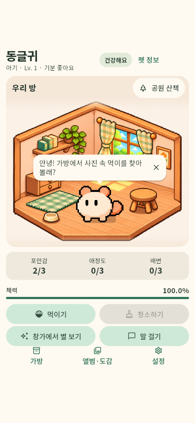
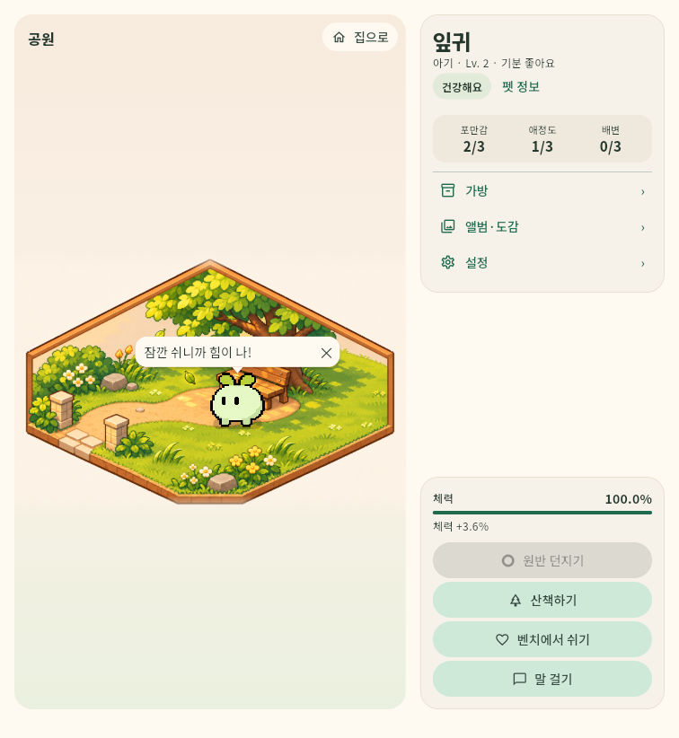
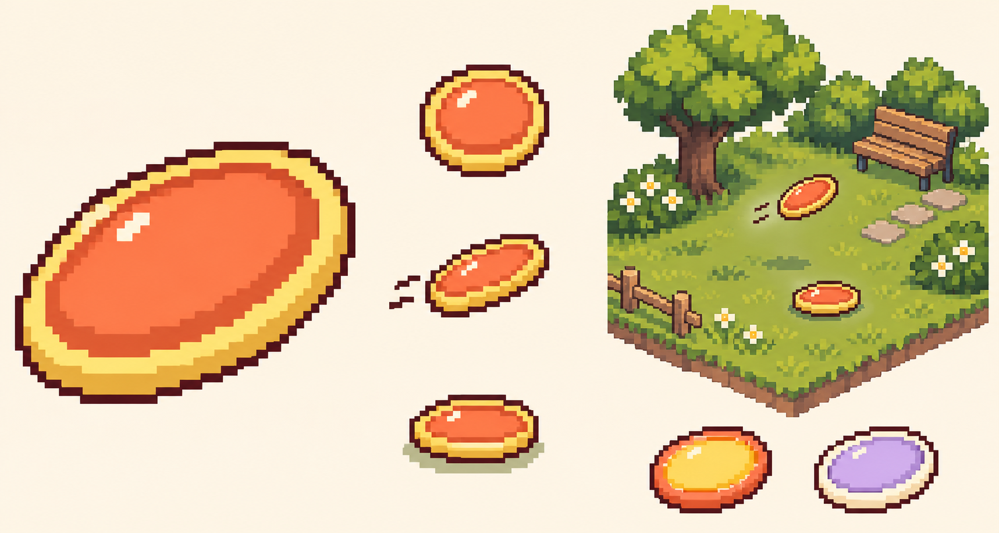
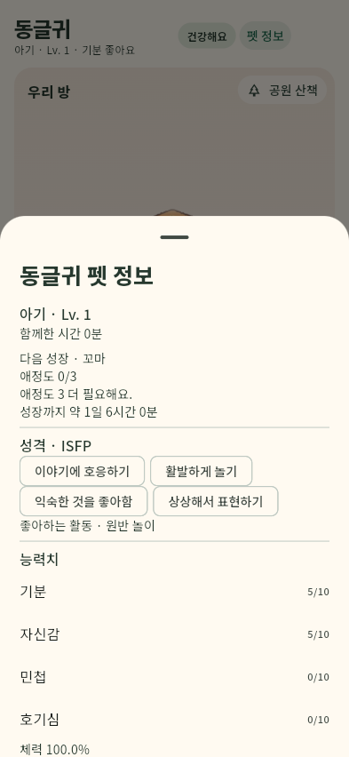

# 돌보고 이야기하며 키우는 로컬 LLM 펫 기획서

작은 방에서 펫을 돌보고, 같이 놀고, 말을 건다. 사진에서 발견한 물건으로 함께 놀면 펫이 그 일을 기억한다. **첫 시연에서는 펫 한 마리에게 방에서 사진 속 사과를 먹이고, 공원에서 사진으로 얻은 원반을 던져 논 뒤, 다음 날 펫이 그 원반을 기억해 다시 놀자고 하는 흐름을 보여준다.**

첫 버전은 **Android와 iOS를 모두 대상으로** 한다. 동글귀 전용 Flutter 프로젝트에서 Kanana 모델 다운로드와 기기 내 추론을 사용한다. 한국어로 대화하는 도트 펫 세 종류를 발견할 수 있고, 2.5D 도트 방에서는 한 번에 한 마리를 키운다.

## Android와 iOS의 구현 범위

2.5D 방, 스프라이트, 아이템 가방, 돌보기와 생존 규칙, 추억과 선택 모델은 Flutter에서 공유한다. 직접 촬영, 앨범에서 선택, 기기 내 인식, 앱이 다시 열릴 때의 상태 복원은 두 플랫폼에서 각각 점검한다. 사진 분석 결과는 같은 형식의 객체 이름, 위치, 신뢰도로 변환해 공통 아이템 규칙에 전달한다.

첫 시연은 Android 폰 한 대와 iPhone 한 대를 기준으로 한다. iOS는 Mac의 Xcode 서명 빌드 또는 동글귀 TestFlight 워크플로를 사용해 실기기에 설치한다. 모델을 준비한 각 기기에서 사진 선택부터 다음 날의 추억 인사까지 비행기 모드로 재현하고, 사진 탐지와 대사 생성 시간을 따로 측정한다.

새로 설치한 사용자는 모델을 받기 전에도 방에 들어가 부화, 기본 먹이, 톡 눌러 돌아보기, 보유 물건으로 놀기를 할 수 있다. 동글귀의 다운로드 안내에 약 1.52GB 용량과 진행 상태를 보여주고, 받는 동안에도 방으로 돌아갈 수 있다. 다운로드를 중단하고 앱을 다시 열면 돌보던 펫과 다운로드 진행을 복원한다. 모델을 받기 전에도 선택지로 대화할 수 있다. 저장한 제목과 상태를 바탕으로 기본 대사를 보여주고, 모델 준비가 끝나면 질문이나 교감에 맞는 답장을 기기에서 생성한다.

## 첫 시연에서 보여줄 이틀

동글귀 한 마리, 2.5D 방과 공원, 사진 한 장에서 얻는 사과·원반·추억 카드로 진행한다. 첫 펫은 포만감 2칸으로 시작한다. 시연용 저장 상태에서 원반의 최대 내구도를 4로 고정해 이틀 연속 같은 원반을 쓸 수 있게 한다. 일반 획득에는 기존 무작위 내구도 규칙을 적용한다.

| 시점 | 사용자 행동 | 펫의 반응 |
| --- | --- | --- |
| 첫날 저녁 | **가방 → 아이템 얻기**에서 **사진 찍기** 또는 **앨범에서 선택**을 누른다. 사진 속 사과와 원반을 각각 누르고 추억 제목을 ‘공원 소풍’으로 확인한다. | **가방에 담기**를 누르면 선택한 자리에서 도트 아이콘이 가방 쪽으로 이동한다. 사과·원반을 얻고 추억이 저장된다. 획득 결과에 **원반 · 내구도 4/4**가 보인다. |
| 같은 방문에서 먹이기 | 메인 화면의 **먹이기**를 눌러 사과를 준다. | 펫이 받아먹고 포만감이 2칸에서 3칸으로 오른다. 첫 돌보기로 애정도 1을 얻고 사과 한 개가 줄어든다. |
| 같은 방문에서 놀기 | 방에서 **공원 산책**으로 이동한 뒤 공원의 **원반 던지기**를 누른다. 펫이 원반을 받아오면 공원에서 앱을 닫는다. | 체력 32와 내구도 1을 쓰고 민첩·자신감·기분이 1씩 오른다. 그날 첫 놀이로 애정도 1을 얻는다. 이 원반으로 함께 논 사실이 ‘공원 소풍’ 추억에 연결된다. |
| 다음 날 오전 9시쯤, **15시간 뒤** | 공원에서 앱을 다시 열고 펫이 먼저 말을 걸면 말풍선에서 **던져줄게 · 어제 뭐가 좋았어? · 같이 쉬자** 중 하나를 고른다. | 포만감 1칸, 배변 1개, 건강함이다. “어제 소풍 사진에서 꺼낸 원반으로 놀았지? 또 던져줄래?”라고 말을 건다. 던지기를 고르면 가방을 다시 열지 않아도 그 원반으로 논다. |
| 다음 날 저녁 6시쯤, **24시간 뒤** | 펫이 도움을 청하면 **집으로** 돌아가 먼저 먹이를 하나 준다. | 포만감 0칸, 배변 1개, 굶주린 지 6시간이다. 포만감이 1칸으로 회복되면 먹는 동작 직후 “이제 좀 나아졌어. 어제 그 원반으로 놀았지?”라고 말을 걸고, 놀이가 가능한 상태라면 말풍선에 **공원으로 가기 · 어제 뭐가 좋았어? · 같이 쉬자**를 보여준다. 공원에서 원반 놀이를 시작할 수 있다. |
| 같은 날 재방문 | 위 시나리오에서 추억 인사를 들은 뒤 앱을 다시 연다. | 같은 추억 인사와 놀이 제안을 자동으로 반복하지 않는다. 아직 위기 중이면 필요한 돌봄과 남은 시간이 보인다. |

같은 소풍 시연에서 **기다려**를 고른 뒤 원반을 던지면, 받아온 순간 배운 행동으로 기록한다. 첫날 마지막 먹이를 **18시쯤** 준다. 15시간과 24시간 시나리오는 각각 같은 첫날 상태에서 독립 실행한다. 24시간 시나리오에는 오전 접속이나 중간 돌봄이 없다. 개발 중에는 테스트용 시계로 두 흐름을 반복하고, Android와 iPhone 첫 시연에서 두 시간 간격을 모두 확인한다.

첫 시연의 원반 경로를 검증한 뒤, 첫 버전에서는 부화 당일부터 창가에서 별 보기와 공원 탐색도 할 수 있게 한다. 책·인형, 캐릭터 수집과 멀티엔딩은 이 활동에 이어 붙인다. 추억 선호 학습은 기본 선택 규칙을 기준으로 별도 비교한다.

## 모바일 메뉴와 화면 이동

앱을 열면 **방**이 바로 보인다. 방과 공원의 2.5D 비율을 유지하고 배경 가장자리의 빈 부분을 줄여 펫과 가구가 화면을 더 많이 채우게 한다. 장면 위에는 현재 장소와 **공원 산책** 또는 **집으로** 버튼을 둔다. **포만감·애정도·배변**은 장면과 함께 보이는 상태 줄에 `2/3`처럼 표시한다. 키·몸무게와 다음 성장 단계까지의 시간은 펫 정보에서 확인한다.

| 화면 | 배치 |
| --- | --- |
| **일반 iPhone·Android** | 펫 이름·레벨·기분·건강과 장면을 위에 두고, 장면 아래에 상태·체력·현재 장소의 바로 쓰는 행동을 배치한다. 가방·앨범·도감·설정은 보조 메뉴로 둔다. |
| **접힌 iPhone Duo** | 시스템 막대 아래의 iOS 네이티브 툴바에 **말 걸기 · 가방 · 앨범·도감 · 설정**을 둔다. 방의 먹이기·청소와 공원의 원반·산책·벤치 행동은 각각 해당 장면 아래에 바로 표시한다. 네이티브 툴바가 없는 화면은 일반 iPhone 배치를 사용한다. |
| **펼친 iPhone Duo** | 왼쪽에 방이나 공원, 오른쪽 한 패널에 펫 상태, 체력과 장소별 행동, 가방·앨범·도감·설정 순으로 배치한다. |

화면 배치는 사용할 수 있는 공간을 기준으로 바꾼다. 프로토타입은 안전 영역 안의 너비가 논리 픽셀 620 이상이면 장면과 조작 영역을 나란히 놓는다. 게임 화면과 가방·아이템 확인 시트는 시스템 막대와 홈 표시 영역을 피한다. [Apple의 iPhone Duo 디자인 가이드](https://developer.apple.com/design/human-interface-guidelines/designing-for-iphone-duo)

홈 표시 영역 위에 추가로 20 논리 픽셀을 비워 버튼과 화면 가장자리 사이에 한 줄 여백을 둔다. 펫과 대화하는 동안에도 메인 화면의 여백을 유지한다.

| 좁은 화면의 방 | 넓은 화면의 공원 |
| --- | --- |
|  |  |

| 메인 화면 버튼 | 누른 뒤 동작 |
| --- | --- |
| **먹이기 · 청소하기** | 집 화면에서 바로 실행한다. 먹이 목록에서 수량별 포만감을 비교하고 **예상 시간 보기**로 배변과 위험 시각을 확인한다. 청소하기와 배변 직접 누르기는 같은 청소 동작을 연다. |
| **원반 던지기 · 산책하기 · 벤치에서 쉬기** | 공원에서 할 수 있는 행동이다. 공원 화면에서 각각 바로 실행한다. 원반과 산책에는 필요한 체력을 사용하고 완료하면 능력치 변화를 보여준다. |
| **말 걸기** | 펫이 돌아보고 장면 안의 말풍선에 첫 대사와 응답 선택지 2~3개를 보여준다. 하나를 누르면 펫의 다음 대사나 행동으로 이어진다. 대화 중에도 장면, 상태 표시, 기존 메뉴를 쓸 수 있다. |
| **가방** | 목록 상단의 **아이템 얻기**에서 "사진에서 먹이와 물건을 찾아요" 안내를 본다. 여기서 **사진 찍기**나 **앨범에서 선택**으로 가져온 다음 원하는 물건을 가방에 담는다. 먹이거나 노는 행동은 메인 화면이나 장면 속 물건에서 실행한다. |
| **펫 정보** | 펫 이름 근처에서 바로 연다. 함께한 시간·다음 성장 조건, 네 글자의 성향 코드와 설명, 현재 능력치와 체력 회복까지 남은 시간을 확인한다. |
| **앨범·도감** | 사진과 글에서 만든 추억, 발견한 아이템과 캐릭터를 확인한다. |
| **설정** | 모델 관리, 시연 시계, **펫 초기화**를 연다. 초기화는 새 종류를 고른 뒤 확인하면 실행된다. |

Flutter에서 화면 배치와 기능 이름을 공유하고, iOS의 iPhone 스타일과 Android의 Material 3 스타일을 따른다. 가방은 게임 화면 위에 시트로 열리고, 닫으면 같은 장면으로 돌아온다. [Apple 버튼 가이드](https://developer.apple.com/design/human-interface-guidelines/buttons) · [Android 하단 패널 가이드](https://developer.android.com/develop/ui/compose/components/bottom-sheets)

방 바닥의 배변을 누르거나 메인 화면의 **청소하기**를 선택하면 약 3초 동안 빗자루와 청소 진행 상태를 보여준다. 완료 시 바닥의 배변을 한 번에 치우고 배변 표시를 `0/3`으로 바꾼다. 청소 중 다시 눌러도 한 번만 처리한다. 위기에는 화면 위쪽이나 오른쪽 조작 영역에 원인별 남은 시간을 표시한다. 방에서는 기한이 가까운 돌봄으로 바로 연결하고, 공원에서는 **집으로 이동**을 보여준다. 좁은 세로 화면에서 내용을 스크롤해도 위기 안내는 화면 위에 남는다. **펫 정보**는 성장·성격과 **기분 · 자신감 · 민첩 · 호기심**을 한 화면에 보여준다. 키와 몸무게는 펫 정보에 추가할 항목이다.

**첫 시연에서는 가방에서 사진 속 물건을 눌러 아이템을 얻고, 같은 방문에 먹이고 노는 흐름을 검증**한다. 다음 날 펫의 머리 위 말풍선에는 전날 사용한 아이템에 대한 추억이 나타난다. 펫이 원반 놀이를 제안하면 공원에서는 **던져줄게**, 방에서는 **공원으로 가기**를 행동 선택지로 보여준다. 각 대화는 2~3개 응답을 펫의 말풍선 안에만 표시하며, 펼친 iPhone Duo에서도 펫이 보이는 왼쪽 장면에 놓는다. 앨범·도감과 지난 펫의 콘텐츠, 글 간식, 전체 대화와 엔딩은 첫 버전 확장에서 연결한다. 푸시 알림과 여러 기기 동기화는 후속 범위다.

## 프로토타입 종합 점수를 높이는 작업 순서

| 순서 | 개선 | 완료를 확인하는 방법 |
| --- | --- | --- |
| 1 | 오프라인 실행과 생성 중 돌봄 | Android에서 사진을 가져와 먹이고 원반을 던진 뒤 앱을 종료·재실행한다. 모델 답장 도중 먹이기를 열어도 늦은 답장이 돌봄을 덮거나 체력을 쓰지 않는지 확인한다. iPhone Duo와 Android 실기기에서 모델 지연, 발열, 배터리는 따로 측정한다. |
| 2 | 첫 아이템까지 안내 | 첫 인사의 **가방 열기**에서 찍기나 앨범을 열고, 아이템을 담은 직후 **지금 사과 주기**와 **이 원반 들고 공원 가기**를 쓴다. 처음 하는 5명 중 4명이 설명 없이 첫 획득과 첫 사용을 끝내는 것을 목표로 한다. |
| 3 | 배운 행동과 엔딩 | 원반이나 솔방울 엔딩에서 가르친 날짜와 펫이 자발적으로 다시 해본 날짜를 확인한다. 플레이어가 자신이 한 행동과 본 엔딩을 연결해서 설명할 수 있는지 본다. |
| 4 | 두 번째 펫의 첫날 | 기념품을 공원으로 가져가거나 방에서 굴리기·찾기를 선택한다. 활발한 펫은 공원 행동을 먼저 제안하고 느긋한 펫은 방 행동을 먼저 제안한다. 한 펫이 같은 기념품의 보상을 다시 받지 않는지 저장·복원으로 확인한다. |
| 5 | 세 성장 단계와 마지막 인사 | 아기와 꼬마·성체의 발, 귀, 잎, 꼬리 실루엣이 다르고 깜빡임을 이어서 보여준다. 사망 시 빈 그릇 또는 청소 도구가 남은 방을 보고 남은 추억을 열 수 있다. |
| 6 | 돌봄 직후 떠올리는 추억 | 실제 사진 원반을 사용한 뒤 15시간과 24시간에 각각 돌아온다. 건강하면 바로 회상하고, 배고프면 먼저 먹인 뒤 그때의 장소와 행동을 한 문장으로 알려준다. |
| 7 | 사진과 놀이의 연결 | 원반 식별자와 실제 착지점을 기록한다. 앨범에 더 최근에 가져온 사진이 있더라도 실제 사용한 원반을 떠올리고, 원반이 소진됐을 때는 추억을 듣거나 쉰다. 재사용은 해당 원반이 남아 있을 때 가능하다. |

Android 에뮬레이터에서 비행기 모드와 Wi-Fi 끄기를 확인한 상태로, 앨범에서 테스트 사진을 가져와 원반을 담고 공원에서 사용했다. 앱을 강제 종료한 후에도 사진 기록과 착지점, 놀이 횟수와 장소가 복원됐다. 같은 첫날 저장본에서 시연 시계를 각각 옮겼을 때, 15시간 뒤에는 사진과 착지점을 바로 기억했고 24시간 뒤에는 먹인 후 기억했다. 보류 중 모델 답장 취소, 사흘째 엔딩, 두 번째 펫의 방·공원 행동은 자동 테스트로 확인한다. 실기기에서의 로컬 모델 성능과 처음 하는 사용자의 성공률은 후속 측정 항목이다.

성장 스프라이트는 프로젝트의 꼬마·성체 시안을 참조해 내장 이미지 생성으로 만든 투명 아틀라스를 사용한다. 세 캐릭터의 기본·깜빡임을 단계별로 분리한다. 방과 공원에서는 발이 지면에 붙은 위치에서 성장 모습을 바꾸며, 이별 장면은 기존 방 배경을 사용한다. [성장 스프라이트](../assets/pet/pet-growth-atlas.png)

<details>
<summary>성장 스프라이트 생성에 사용한 프롬프트</summary>

```text
Use case: background-extraction and identity-preserve
Asset type: one original game sprite atlas for the Donglgewi mobile pet game.
Input image 1 is the original project design guide for juveniles. Input image 2 is the original project design guide for adults. Use their existing character appearances as exact visual guides.
Recreate only the default and closed-eye poses as one transparent PNG. Twelve isolated sprites in a precise grid of four equal columns and three equal rows with generous transparent gutters. Row 1 is peach round-eared Donglgewi, row 2 is lime two-leaf Yeopgwi, row 3 is deep purple gold-star-tailed Byeolkkori. The four columns are juvenile open eyes, juvenile blink, adult open eyes, adult blink. Each open/blink pair must have precisely the same silhouette, size, planted-foot baseline, body position, colors, and outer edges, with only the eyes changing. Center each sprite in its grid cell.
Match the project's crisp old-school hard-edge pixel art, charcoal outline, 3/4-front view, simple flat palette, readable around 80 pixels across. Juvenile has taller legs and narrower body. Adult has fuller silhouette, larger distinctive ears and clearly developed tail or leaves matching the reference. Preserve the three distinct species.
Full genuine alpha transparency everywhere around each character. Omit all labels, cell borders, lettering, cards, backdrop, glows and ground shadows. Single game-ready atlas, landscape 4:3 layout, generous padding between sprites, no contact between sprites.
```

</details>

### UX/UI 개선 순서와 통과 기준

| 순서 | 변경 | 확인할 기준 |
| --- | --- | --- |
| 1 | 방과 공원의 장면 배율 | 배경 비율과 오브젝트 위치를 함께 유지하면서 펫을 키운다. 펫, 배변, 샛길의 돌, 원반 착지점을 장면에서 누를 수 있다. |
| 2 | 펫의 말풍선 | 응답 2~3개와 닫기 버튼에 내부 스크롤 없이 접근한다. 짧거나 큰 글씨의 화면에서는 같은 장면 안에 응답 공간을 따로 확보한다. 말풍선은 닫힐 때 위로 조금 움직이며 사라지고 오른쪽 조작은 즉시 사용할 수 있다. |
| 3 | 펼친 Duo의 조작 순서 | 오른쪽 패널에서 펫 상태 다음에 장소별 행동, 마지막에 가방·앨범·설정을 읽을 수 있다. 접혔을 때 iOS가 제공하는 오른쪽 툴바로 가방과 대화를 연다. |
| 4 | 사진 아이템의 첫 진입 | 처음 보는 펫 인사가 가방을 알려주고, 가방을 열자마자 **아이템 얻기** 안내와 버튼을 찾을 수 있다. 촬영과 앨범은 같은 아이템 확인 화면으로 간다. |
| 5 | 돌봄 경고와 먹이 비교 | 급한 원인과 남은 시간, 바로 할 행동을 함께 표시한다. 먹이 목록에서 수량과 먹인 뒤 포만감을 한눈에 비교한다. 모든 선택이 위생 위험이면 경고를 목록 위에 한 번 표시한다. **예상 시간 보기**를 펼치면 공복, 배변, 돌보지 않았을 때의 위험 시각을 수량별로 읽을 수 있다. |
| 6 | 전화기 크기와 전환 검증 | 좁은 세로 화면과 200% 글씨에서 말풍선 선택지와 닫기, 위기 시간, 먹이 결과가 보인다. 모의 Duo에서 접기·펼치기 후 대사 선택이 유지되고 닫는 중에도 오른쪽 가방 버튼이 열린다. 실제 Duo에서는 한 손으로 돌봄과 가방을 열고 화면 확대 및 VoiceOver 초점 순서를 확인한다. |

## 사진에서 아이템 찾기

첫 인사의 **가방 열기** 또는 메인 화면의 **가방 → 아이템 얻기**에서 촬영이나 앨범을 연다. 두 경로 모두 같은 **아이템 확인** 화면으로 이어진다. 사진 분석이 오래 걸리면 직접 고르는 화면을 먼저 사용할 수 있다. 담은 뒤에는 가방에서 방의 사과 먹이기나 해당 원반으로 공원 놀이를 시작할 수 있다. 촬영을 취소하면 사진과 아이템을 처리하지 않는다. 카메라를 쓸 수 없으면 앨범에서 사진을 선택할 수 있다.

1. **찾기** — 기기에서 인식한 글자와 장면 분류를 추억 제목 제안에 활용한다. Android는 ML Kit, iOS는 Apple Vision 경로를 재사용한다. 사진 속 사과와 원반을 따로 찾고 위치를 표시하는 데는 두 플랫폼의 MediaPipe Object Detector에서 동일한 EfficientDet-Lite0 모델을 첫 후보로 시험한다. [Google AI Edge 객체 탐지 문서](https://developers.google.com/edge/mediapipe/solutions/vision/object_detector)
2. **고르기** — 사진 미리보기에서 감지된 물건에 테두리를 표시하고, 장면에서 만든 추억 한 장과 먹거리·물건 후보를 최대 하나씩 제안한다. 예를 들어 사과는 먹거리, 원반은 물건으로 바꾼다. 게임에서 지원하는 탐지 라벨만 자동 제안에 쓰고, 사용자는 저장 전에 후보를 빼거나 이름을 고칠 수 있다.
3. **담기** — 확인한 아이템을 가방에 넣는다. 감지에 실패하면 사진을 미리 보며 **직접 고르기**로 음식이나 물건이 있는 부분을 가리키고, 지원 목록에서 해당 아이템을 선택할 수 있다. 수동 선택에도 사진당 먹거리·물건 하나씩이라는 같은 한도를 적용한다. 추억 제목은 직접 적을 수 있고, 먹을 만한 물건을 고르기 어려우면 기본 사진 간식을 선택할 수 있다. 글은 최대 500자까지 받고 글 간식과 짧은 추억을 만들 수 있다.

### 사진에서 눌러 꺼내는 화면

사진 속 물건을 누르면 짧게 테두리가 강조되고 사진 아래에 선택한 게임 아이템이 보인다. 탐지 위치가 없으면 **직접 고르기**를 눌러 사진에서 물건이 있는 자리를 찍고, 사과·원반 중 해당하는 것을 고른다. 두 경로 모두 선택 표시를 실제 누른 자리에 보여준다.

**가방에 담기**로 저장이 완료되면 선택한 자리에서 도트 아이콘이 떠올라 가방 표시로 날아간다. 획득 결과에는 아이템 이름과 수량을 표시하고, 원반은 **내구도 4/4**처럼 최대 내구도를 확인할 수 있게 한다. 획득 화면에서 장면으로 돌아가 방에서 펫에게 먹이거나 공원에서 원반을 던질 수 있다. 이동 효과를 줄이는 설정이 켜져 있으면 정지된 획득 표시를 사용한다.

현재 프로토타입은 사진 아래 후보 선택과 원반 획득을 지원한다. 사진 위 위치 선택과 도트 아이콘 이동은 이번 기획의 개선 항목이다. 사과와 원반의 기존 아이콘을 재사용하고 이 과정에서 LLM을 호출하지 않는다.

기본 먹이·사과·원반으로 첫 시연을 구성한다. 확장 아이템은 사진에서 구별하기 쉽고 새로운 행동을 여는 순서로 추가한다. 책은 함께 읽기, 곰인형은 곁에 두고 쉬기, 솔방울은 공원의 첫 찾기 놀이에서 얻어 방에 놓을 수 있게 한다. 글 간식은 글 입력 흐름에서 얻는 기존 후보로 유지한다.

## 아이템을 쓰는 법과 성장

| 종류 | 예시 | 사용하는 위치와 행동 |
| --- | --- | --- |
| 추억 | 공원 소풍 | **같이 떠올리기**를 누르면 펫이 추억을 한마디로 이야기한다. 이후 첫 인사의 후보로도 남는다. |
| 먹거리 | 기본 먹이, 사과, 글 간식 | 집 화면의 **먹이기**를 누르면 포만감이 1칸 오른다. 그날 첫 돌보기라면 애정도도 1 오른다. 먹인 아이템 한 개가 가방에서 줄어든다. 포만감이 가득 찼으면 다음에 먹일 수 있다. |
| 물건 | 원반, 책, 곰인형 | 원반은 공원 화면에서 던지고, 내구도가 남은 동안 반복 사용한다. 책·곰인형은 방에 해당 물건을 보여주고 **같이 읽기 · 옆에 두기**로 연결한다. |

원반을 한 개 얻을 때마다 최대 내구도를 1~5 중에서 뽑는다. 확률은 1회 10%, 2회 20%, 3회 35%, 4회 25%, 5회 10%다. 공원에서 평소에 던지면 먼저 얻은 원반부터 쓴다. 추억 인사의 **원반 던지기**는 그 인사에서 가리킨 원반을 쓴다. 펫이 원반을 받아오면 내구도가 1 줄고, 0이 된 원반은 가방에서 사라진다. 가방에는 각 원반의 남은 내구도와 최대 내구도를 함께 표시한다.

가방에 아이템을 담는 순간에는 발견 애니메이션을, 실제 먹이는 순간에는 받아먹는 모습을 보여준다. 첫 시연에서는 먹이기와 원반 놀이로 애정도가 각각 오르는 것까지 확인한다.

아이템은 공용 게임 아이콘과 짧은 이름으로 표시한다. 사진 원본과 글 전체는 펫 기록에 보관하지 않으며, 분석용 임시 사본은 완료나 취소 후 정리한다. 추억 제목은 최대 60자이고, 추억과 관련 인사는 30일을 넘기면 정리한다. 먹거리는 먹이거나 직접 정리할 때까지, 물건은 직접 정리할 때까지 남는다. 누적 성장도 유지된다.

## 성장 곡선과 레벨

성장은 **부화 후 함께 지낸 시간과 누적 애정도**를 함께 본다. 나이는 앱을 닫아 둔 동안에도 흐르고, 애정도는 실제로 함께한 행동에서 얻는다. 꼬마가 되기 전에는 애정도가 높을수록 성장 시점이 빨라진다. 성체는 건강하고 48시간과 애정도 5를 채웠을 때 자란다. 외형이 바뀌는 순간에는 펫이 건강해야 한다. 아래 시간과 애정도는 첫 버전의 초기값이다.

| 레벨 | 부화 후 성장 시간 | 최소 누적 애정도 | 최대 포만감 | 최대 체력 | 화면에서 보이는 변화 |
| --- | --- | --- | --- | --- | --- |
| Lv. 1 | 부화 직후 | 0 | 3칸 | 384토큰 | 아기 모습으로 시작한다. |
| Lv. 2 | 부화 직후 | 1 | 3칸 | 448토큰 | 첫 애정도 1점을 얻으면 솔방울을 방 어디에 둘지 고를 수 있다. |
| Lv. 3 | 24시간에서 최단 18시간 | 3 | 4칸 | 512토큰 | 꼬마가 되고 공원 나무 샛길과 새 탐색 지점을 이용할 수 있다. |
| Lv. 4 | 36시간 | 5 | 4칸 | 576토큰 | 공원의 두 번째 원반 착지점이 열린다. 펫 정보에서 성체까지 남은 시간과 애정도를 확인할 수 있다. |
| Lv. 5 | 48시간 | 5 | 5칸 | 640토큰 | 성체가 되어 보폭과 착지가 달라진다. 건강하면 마무리 장면을 선택할 수 있다. |

성장할 때는 포만감의 최대치가 한 칸 늘고, 채워져 있던 칸 수와 다음 감소 시각은 그대로 유지된다. 예를 들어 아기가 `포만감 2/3`에서 꼬마가 되면 `2/4`로 바뀐다. 새로 열린 칸에는 먹이로 채울 수 있다.

| 외형 변화 | 최소 애정도일 때 | 애정도에 따른 단축 |
| --- | --- | --- |
| 꼬마 | 애정도 3 → 부화 후 24시간 | 3점을 초과한 1점마다 3시간 단축. 애정도 4면 21시간, 5 이상이면 최단 18시간이다. |
| 성체 | 애정도 5 → 부화 후 48시간 | 48시간이 지나 조건을 충족하면 그때 자란다. |

남은 시간은 현재 애정도에 따른 성장 시간에서 부화 후 경과 시간을 빼서 구한다. 예를 들어 부화 후 22시간 된 건강한 아기는 애정도 3일 때 2시간이 남고, 놀이로 4점이 되는 순간 성장 시간이 21시간으로 줄어 바로 꼬마가 된다. 같은 행동을 그날 여러 번 해도 기존 하루 애정도 한도가 적용된다.

애정도는 다음 세 종류에서 **하루 각각 1점씩, 최대 3점**을 얻는다. 날짜별로 완료한 종류를 저장한다.

- **돌보기** — 실제로 먹이를 주거나 바닥을 치웠을 때.
- **놀이** — 원반 놀이, 책 같이 읽기, 별 보기 중 하나를 마쳤을 때.
- **교감** — 펫을 톡 눌러 돌아보는 반응을 보거나 대화를 한 번 나눴을 때.

**돌보기**에서는 기본 먹이와 보유한 간식을 바로 쓸 수 있고, 그날 처음 방에 들어올 때 기본 먹이 재고를 현재 성장 단계의 포만감 최대치까지 보충한다. 아기는 3개, 꼬마는 4개, 성체는 5개까지다. 기본 먹이와 사진 간식은 돌보기 점수가 같다. 같은 날 같은 종류의 행동을 반복하면 행동 자체는 계속 할 수 있고 애정도는 그날 첫 완료에서만 오른다. 애정도 계산과 성장 단계 변경은 게임 로직으로 처리해 기존 도트 동작을 재사용하고 LLM을 추가로 호출하지 않는다.

메인 화면에는 애정도 기준에 도달하기 전까지 **애정도 2/3**처럼 현재 점수와 필요한 점수를 표시한다. 기준에 도달하면 **애정도 4**처럼 누적 점수를 표시한다. 펫 정보에서는 **꼬마까지 1시간 · 애정도로 3시간 단축**처럼 남은 시간과 이미 줄어든 시간을 보여준다. 최소 애정도가 부족하면 필요한 점수도 함께 표시한다. 성장 직전에 현재 건강을 확인하고, 아프다면 돌본 뒤 조건을 다시 확인한다. 외형 변화는 같은 단계에서 한 번만 재생한다. 성체가 된 뒤에는 계속 키우거나 열린 엔딩을 고를 수 있다.

### 키와 몸무게 기록

펫 정보에는 **현재 키, 현재 몸무게, 성장 기록**을 함께 보여준다. 같은 종과 성장 단계라도 개체마다 체격이 다르다. 아래 동글귀의 초기 범위는 이웃한 단계끼리 일부 겹친다. 예를 들어 키 9.8 cm인 아기가 키 9.3 cm인 꼬마보다 클 수 있다.

| 성장 단계 | 키 범위 | 기준 몸무게 범위 |
| --- | --- | --- |
| 아기 | 7.0~10.0 cm | 0.32~0.58 kg |
| 꼬마 | 9.0~14.0 cm | 0.52~1.02 kg |
| 성체 | 13.0~19.0 cm | 0.95~1.65 kg |

부화할 때 키와 기준 몸무게가 각 범위의 어느 지점에 해당하는지 하나씩 무작위로 정해 저장한다. 꼬마와 성체가 될 때도 그 위치를 새 단계의 범위에 그대로 적용한다. 예를 들어 키가 항상 범위의 중간인 동글귀는 **8.5 → 11.5 → 16.0 cm**로 자란다. 같은 펫은 단계마다 키와 기준 몸무게가 증가하며, 앱을 다시 열 때마다 같은 값이 나온다.

기준 몸무게는 포만감 2칸일 때의 값이다. 포만감이 기준에서 한 칸 달라질 때 현재 몸무게는 0.05 kg만큼 변한다. 펫 정보에는 내 펫의 현재 수치를, 도감에는 종류와 성장 단계별 범위를 보여준다.

부화와 외형 변화 때 날짜·단계·키·기준 몸무게를 성장 기록에 한 줄씩 남긴다. 예전 성장 기록은 이후 먹이에 따라 달라지지 않는다. 엔딩을 맞은 뒤에도 지난 펫에서 성장 기록을 볼 수 있다. 계산은 게임 로직에서 처리하며, 외형은 기존 성장 단계별 도트 프레임을 재사용한다. 키와 몸무게는 성장의 변화를 보여주는 정보이며, 성장 조건은 시간·애정도·건강으로 판정한다.

## 며칠 동안 할 수 있는 놀이와 수집

사진은 새 물건을 발견하는 데 쓰고, 한 번 얻은 물건은 다음 날에도 플레이에 쓰인다. 첫 시연은 방에서 돌본 뒤 공원으로 이동해 원반 놀이를 한다.

| 콘텐츠 | 사용자와 펫이 하는 일 | 다시 할 이유 |
| --- | --- | --- |
| 원반 던지기 | 첫 시연에서는 공원의 가까운 잔디로 던진다. 펫은 잔디밭을 달려가 뛰어 받은 뒤 걸어 돌아온다. | 다음 날 펫이 같은 원반으로 놀자고 한다. Lv. 4부터 벤치 너머 경로도 고를 수 있다. 익숙해진 원반 옆에서 펫이 기다리는 모습을 볼 수 있다. |
| 책 같이 읽기 | 책을 방의 정해진 자리에 놓으면 펫이 옆으로 걸어와 대기한다. 사용자가 책 이름이나 오늘 읽은 한 줄을 남기면 글 추억으로 저장할 수 있다. | 다음 날 펫이 그 제목으로 먼저 말을 걸 수 있다. 같은 책으로 다른 날의 이야기를 남길 수 있다. |
| 곰인형 옆에 두기 | 방의 정해진 자리 한 곳에 인형을 놓는다. 펫은 성향과 아이템 사용 기록에 따라 한가할 때 옆에 와서 기존 대기 동작으로 쉰다. | 내가 가져온 물건과 펫 성격에 따라 평소 펫이 머무는 곳이 달라진다. |
| 별 보기 | 부화 직후부터 창가에서 함께 별 모양 하나를 찾는다. 모양은 기본 도안 세 개에서 순서대로 바뀌고, 이름을 붙여 추억으로 남길 수 있다. | 찾은 모양은 당일 바로 앨범에 남는다. 하루에 한 모양을 볼 수 있고, 세 모양을 모으면 별꼬리가 열린다. |
| 솔방울 찾기 | 공원에서 처음 **산책하기**를 마치면 바로 열린다. 펫이 일정한 방향을 보고 멈추면 벤치 옆, 나무 밑, 길가 중 한 곳을 누른다. | 솔방울을 찾으면 가방에 담고 발견 추억이 남는다. 방에 가져가 창가나 러그 옆에 놓을 수 있다. 펫이 솔방울 쪽으로 걸어와 머무는 모습으로 발견 결과가 남는다. |

가방의 **발견한 물건**에서는 원반, 책, 곰인형, 솔방울의 처음 발견한 종류와 사용법을 확인한다. 모으는 목표는 아이템 수량 대신 새로 할 수 있는 행동이다. 처음 얻는 날에만 종류를 기록하므로 같은 물건을 반복 사진으로 가져와도 도감 항목이 늘어나지 않는다.

새 놀이에는 방과 방향별 스프라이트를 재사용한다. 추가 그림 범위는 책·인형·솔방울 아이콘과 별 모양 도안이며, 이동·배치·별 모양 선택·추억 저장·도감 갱신은 모두 게임 로직에서 처리한다. 책이나 별 추억은 이후 기존 인사와 대화에서 사용할 수 있다.

### 추억이 다음 놀이로 이어지는 흐름

1. 사진에서 꺼낸 원반으로 놀이를 완료하면 **추억 ID, 원반 ID, 놀이 날짜**를 기기에 남긴다. 같은 날 여러 번 던져도 원반별로 놀이 기록을 한 건만 남긴다. 완료 처리에서 체력·내구도·보상과 함께 기록한다.
2. 그 원반이 남아 있고 펫이 놀 수 있는 상태라면, **어제 뭐가 좋았어? · 같이 쉬자**에 공원의 **던져줄게** 또는 방의 **공원으로 가기**를 더한다. 공원으로 이동한 뒤 펫과 이어서 같은 원반을 던질 수 있다. 실제로 던지기 직전에 앱이 원반과 건강·체력을 다시 확인한다. 같이 쉬기를 고르면 짧은 대기 동작으로 이어진다.
3. 원반을 다 썼거나 체력이 부족하면 어제의 기억을 말하고 **어제 뭐가 좋았어? · 같이 쉬자**를 보여준다. 공원 벤치에서 회복할 수 있으면 **벤치에서 쉬기**를 세 번째로 넣을 수 있다. 인사 뒤 건강이나 원반 상태가 바뀌면 선택지를 갱신한다. 돌봄이 급해지면 제안을 닫고 필요한 돌봄을 먼저 보여준다.

하루 첫 인사는 앱에 남아 있는 추억과 배운 행동으로 즉시 표시한다. 선택지 결정과 원반 실행은 게임 로직으로 처리한다. 추억을 다시 묻는 대화 응답을 고르면 로컬 LLM을 한 번 호출할 수 있다.

### 첫날부터 셋째 날까지 열리는 콘텐츠

새로 할 수 있는 놀이가 처음 외형이 바뀌는 시점에 몰리지 않도록 첫 방문 중에 발견과 변화가 이어지게 한다. 장소마다 첫 활동의 결과를 그 자리에서 보거나 방에 가져와 확인할 수 있다.

| 언제 | 열리는 활동 | 다음에 달라지는 장면 |
| --- | --- | --- |
| **첫 방문** | 방에서는 창가에서 별 모양을 찾고, 공원에서는 산책한다. 사진으로 원반을 얻은 경우 공원에서 원반도 던질 수 있다. | 찾은 별이 앨범에 즉시 추가된다. 첫 산책을 마치면 그 방문에서 바로 **솔방울 찾기**가 열린다. |
| **첫날, 발견 직후** | 공원에서 찾은 솔방울을 방에 가져와 창가나 러그 옆을 고른다. | 다음에 방을 열면 펫이 솔방울이나 창가를 먼저 살피는 모습을 볼 수 있다. 획득과 배치는 첫 방문 안에 끝낼 수 있다. |
| **둘째 방문일** | 전날에 함께한 활동을 펫이 먼저 꺼낸다. 같은 놀이를 이어가거나, 방에서 두 번째 별을 찾거나, 공원에서 이미 열린 놀이를 고를 수 있다. | 전날 던진 원반, 발견한 솔방울, 함께 본 별 중 실제로 경험한 일이 말풍선과 선택지에 반영된다. |
| **셋째 방문일 전후** | 부화 후 48시간과 애정도 5를 채운 건강한 펫은 성체가 되고, 성장 엔딩을 고를 수 있다. 별 모양 세 개를 찾았다면 별꼬리도 도감에서 발견한다. | 내가 가르친 행동이나 함께 찾은 별이 엔딩에 다시 나온다. 사용자가 새 펫을 고르면 방에 기념품 하나가 남는다. |

방의 별 보기와 공원 산책은 사진 없이 시작할 수 있다. 솔방울 찾기는 첫 산책 완료를 한 번만 저장해 그 자리에서 열고, 물건을 놓으면 기존 걷기·돌아보기 프레임으로 반응한다. 별·솔방울 발견과 배치에는 추가 LLM 요청을 쓰지 않는다. 솔방울을 놓는 행동은 별도의 애정도 반복 보상에 포함하지 않는다.

### 짧게 들어와도 할 일이 있는 방

| 시점 | 화면에서 일어나는 일 |
| --- | --- |
| **방을 열었을 때** | 펫이 쉬거나 방을 걸으며 성격을 보여준다. 톡 누르면 기존 방향 전환과 대기 동작으로 반응한다. 돌봄이 급할 때는 첫 화면에서 필요한 행동과 남은 시간이 보인다. |
| **돌봄을 마쳤을 때** | 방의 **먹이기 · 청소하기**로 필요한 돌봄을 끝낸다. 펫이 회복하면 미뤄 둔 추억 인사가 이어지고, 바로 할 수 있는 놀이가 있으면 함께 보여준다. |
| **지금 함께 놀 때** | 추억 인사에 이어지는 놀이를 먼저 보여준다. 그 밖의 방문에서는 최근 두 번 완료한 것과 다른 활동 중 지금 가능한 것을 고르고, 후보가 여럿이면 펫의 성향을 반영한다. |
| **한 번 놀고 난 뒤** | 원반을 받아오면 공원에서 **한 번 더 던지기**를 바로 눌러 놀 수 있다. 가방을 다시 열 필요 없이 원래 위치에서 다음 놀이를 시작한다. Lv. 4부터는 착지점을 바꿔 다른 길로 뛰게 할 수 있다. |
| **같은 날 다시 왔을 때** | 첫 인사를 들은 펫은 다시 인사하는 대신, 장소와 놓인 물건에 따라 방의 창가·인형이나 공원의 원반·벤치 곁에서 기존 걷기와 대기 동작을 보인다. |

놀이 제안과 재시작 버튼, 방 안의 이동은 게임 규칙과 기존 도트 프레임으로 처리한다. 시작에 필요한 체력을 확인하고, 놀이를 끝내면 사용한 체력과 오른 능력치를 게이지 아래에 표시한다. 애정도는 하루 종류별 첫 완료에서만 올라간다.

### 집에서 공원으로 산책

방의 문을 톡 누르면 **공원 산책**을 시작한다. 공원은 방과 같은 2.5D 시점의 한 화면이다. 입구에서 벤치와 나무를 지나 작은 잔디밭으로 이어지는 짧은 길이 있고, 펫은 길을 따라 걷거나 벤치 곁에 잠깐 머문다. **집으로**를 누르면 원래 방으로 돌아온다.


공원 아이들링은 펫이 벤치 옆에 잠깐 멈춰 꼬리를 느리게 흔드는 모습이다. 배경에서는 나뭇잎이나 풀 끝이 가끔 흔들린다. 펫의 대기 프레임과 배경의 짧은 반복 동작은 서로 다른 박자로 재생한다.

#### 장소별 행동

| 어디서 | 행동 | 장소에 따라 달라지는 점 |
| --- | --- | --- |
| **집에서만** | 밥자리에서 먹이기, 배변 청소, 책 읽기, 인형이나 솔방울 놓기, 창가에서 별 보기, 러그에서 밤잠 자기 | 펫을 돌보고, 쉬는 자리와 방에 두는 물건을 정한다. |
| **공원에서만** | 원반 던지기, 산책하기, 솔방울 찾기, 벤치 옆에서 쉬기 | 원반을 던지면 펫이 잔디밭을 가로질러 받아온다. 첫 산책을 마친 뒤 해당 방문에서 솔방울을 찾을 수 있다. 낮잠 시간에는 벤치 옆에 몸을 말고 잔다. |
| **두 곳에서** | 펫 톡 누르기, 말 걸기 | 대화와 건강 상태는 이어진다. |

공원에서도 같은 펫, 가방, 포만감·애정도·배변 상태를 공유한다. 장소를 옮겨도 돌봄 타이머는 이어진다. 먹이거나 청소할 때는 **집으로** 돌아오며, 급한 돌봄이 필요한 경우에는 공원에서도 상태와 남은 시간을 볼 수 있다. 사용자가 찍은 사진에서 기억한 소풍과 게임 속 산책은 각각 발생한 날짜와 이름으로 저장한다. 다음 날 펫은 “어제 벤치 옆에서 쉬었지. 오늘도 나갈래?”처럼 실제 산책 기록을 먼저 꺼낼 수 있다.

공원 화면에서 **산책하기**를 누르면 입구에서 벤치로 이어지는 길을 다시 걷는다. **벤치에서 쉬기**로 벤치 옆에서 약 3초 쉬면 체력 32까지 회복한다. 체력 회복은 10분에 한 번 적용한다. 원반 놀이는 공원 화면의 **원반 던지기**에서 시작한다. 공원으로 들어가는 이동은 장소 전환으로 처리한다. 산책 추억은 **산책하기**를 마쳤을 때 남긴다.

첫 시연에서는 **가까운 잔디**로 던져 펫이 잔디를 가로질러 받아오게 한다. **Lv. 4**부터는 장면에 **가까운 잔디 · 벤치 너머**의 두 경로와 착지점을 표시한다. 가까운 착지점을 누르면 바로 던진다. 먼 착지점을 누르면 펫이 몸을 낮추고 약 0.7초 뒤 “준비됐어!”라고 말한다. 착지점의 **지금 던지기**를 누르면 벤치 앞을 돌아 더 높이 뛰어 받아온다. 준비 후에도 플레이어가 던질 때까지 기다린다. 기존 이동·점프·대기 동작을 쓰고 두 경로의 보상과 비용은 같다. 준비 중 닫으면 체력과 내구도는 그대로다.

#### 원반 디자인 시안



기본 원반은 잔디에서 잘 보이는 **주황색 면과 연노랑 테두리**로 잡는다. 시안 가운데는 위에서 본 가방 아이콘, 기울어진 비행 모습, 낮은 타원과 그림자로 표현한 착지 모습이다. 노랑과 보라는 색상 후보로 두고, 내구도는 색 대신 가방의 수치로 보여준다.

새 그림은 공원 바닥·나무·벤치에 집중한다. 걷기·대기·달리기·점프와 원반 놀이 로직은 공유하고 공원용 이동 경로와 착지점만 지정한다. 장소 이동과 산책 기록 자체는 LLM을 호출하지 않는다.

## 캐릭터를 발견하고 모으기

첫 펫은 크림색 몸에 살구색 귀와 짧은 꼬리가 달린 **동글귀**다. 32×32 도트에서 시작하는 둥근 몸을 공통으로 쓰고, 귀와 꼬리 모양으로 나머지 두 캐릭터를 구분한다. 아래 이름과 발견 조건은 첫 버전의 초안이다.

| 캐릭터 | 생김새와 말투 | 발견 조건 |
| --- | --- | --- |
| 동글귀 | 둥근 귀와 도톰한 꼬리. 장난기가 많아서 원반을 보면 먼저 놀자고 말한다. | 첫 펫으로 만난다. |
| 잎귀 | 연두색 잎처럼 끝이 갈라진 귀. 새로운 것을 보면 궁금한 점을 한마디씩 묻는다. | 펫과 책을 읽고 첫 책 추억을 남긴다. |
| 별꼬리 | 남색 몸에 별 모양 꼬리 끝. 말수가 적고 차분하게 그날의 장면을 이야기한다. | 서로 다른 별 모양 세 개를 함께 본다. |

프로토타입에서는 **설정 → 펫 초기화**에서 동글귀·잎귀·별꼬리 중 하나를 고른다. 이어지는 확인을 승인하면 현재 펫의 성장·가방·추억을 초기화하고 선택한 펫을 부화시킨다. 도감에는 지금 키우는 종류와 직접 키워본 종류가 남는다. 위 표의 발견 조건과 엔딩 이후 지난 펫 기록은 수집 콘텐츠를 붙이는 버전의 규칙으로 사용한다.

세 종류는 성장 단계별 몸통 프레임과 발 위치, 걷기·뛰기·점프 타이밍을 공유한다. 귀와 꼬리만 프레임의 공통 기준점에 붙이고 색을 바꿔 표시한다. 캐릭터의 성격은 기존 대사 요청에 함께 넣고, 해금과 도감 갱신은 게임 로직으로 처리한다.

### 아기 펫 3종의 아이들링 시안


동글귀는 둥근 귀, 잎귀는 작은 새싹 귀, 별꼬리는 금빛 꼬리 끝으로 구분한다. 프로토타입은 세 종류 모두 대기 중 약 6초 간격으로 약 0.15초 눈을 감는다. 눈을 감는 프레임은 열린 눈과 같은 발 위치를 사용한다.

### 아기 펫 3종의 8방향 걷기 시안


화살표는 화면에서 펫이 이동하는 방향이다. 정면·앞 대각선·옆면·뒤 대각선·뒷면의 **5가지 원본 방향**을 만들고, 반대쪽 옆면과 대각선 **3가지**는 좌우 반전해 쓴다. 걷다가 멈추면 마지막으로 향하던 방향을 유지한 채 대기 동작으로 이어진다.

### 자라면서 바뀌는 실루엣

아기는 덩어리처럼 둥글고 팔다리가 짧다. 꼬마가 되면 다리와 귀·꼬리의 윤곽이 뚜렷해진다. 성체는 몸통이 넓어지고, 캐릭터마다 알아볼 수 있는 귀와 꼬리 모양이 완성된다. 앱을 다시 열어 크기 비교를 하지 않아도 실루엣으로 성장 단계를 알아볼 수 있게 한다.

| 종류 | 아기 | 꼬마 | 성체 |
| --- | --- | --- | --- |
| **동글귀** | 찹쌀떡 같은 몸, 낮게 붙은 둥근 귀, 조그만 꼬리 | 두 귀가 위로 서고 다리가 또렷해진다. | 둥근 귀가 양옆으로 넓어지고 살구색 꼬리가 도톰해진다. |
| **잎귀** | 연두색 새싹 같은 작은 귀 | 귀 끝이 두 갈래로 갈라진다. | 잎 모양 귀가 좌우로 펼쳐져 걸을 때 실루엣이 길어진다. |
| **별꼬리** | 꼬리 끝에 둥근 밝은 점 | 꼬리 끝이 도톰해지고 작은 모서리가 나타난다. | 꼬리 끝이 별 모양으로 완성되고, 돌아설 때 별 윤곽이 보인다. |

성장 조건을 채우면 기존 점프 동작을 한 번 보여주고, 착지 프레임에서 다음 단계의 몸통·귀·꼬리로 전환한다. 위치 기준점과 성장 단계별 몸통 틀을 캐릭터끼리 공유한다. 캐릭터를 구분하는 귀와 꼬리 부위만 단계별로 그리며, 장면을 확대하지 않아도 형태 변화가 보이게 한다.

### 꼬마 펫 3종의 아이들링과 8방향 걷기 시안


꼬마 동글귀는 귀가 더 높이 서고 꼬리가 길어진다. 잎귀는 잎 끝의 갈라진 윤곽이 보이고, 별꼬리는 둥근 꼬리 끝에 모서리가 생긴다. 같은 카메라에서 아기보다 다리가 뚜렷하게 보인다.


걷기 시안은 방향별 대표 자세를 한 장씩 보여준다. 아기와 같은 방향 기준과 발 위치를 사용하고, 꼬마는 걸음을 내디딜 때 아기보다 발이 조금 더 벌어진다.

### 성체 펫 3종의 아이들링과 8방향 걷기 시안


성체 동글귀는 넓어진 살구색 귀와 도톰한 꼬리, 잎귀는 잎맥이 보이는 넓은 잎 귀, 별꼬리는 꼬리 끝의 완성된 금빛 별로 구분한다. 대기 중에는 넓어진 몸통이 천천히 오르내리고, 마지막 자세에서 종마다 다른 귀나 꼬리 동작을 보여준다.


걷기 시안에는 화면 기준 8방향의 대표 자세를 담았다. 앞을 향할 때는 얼굴, 뒤로 향할 때는 넓어진 몸통과 꼬리가 잘 보이게 그린다. 실제 걷기에서는 아기·꼬마와 같은 방향 기준과 발 위치를 쓰고, 성체 특유의 넓어진 보폭과 묵직한 착지를 표현한다.

### 부화할 때 정해지는 펫 성격

알이 부화할 때 네 가지 성향에서 각각 한쪽을 무작위로 뽑는다. 16가지 조합이 가능하고, 같은 종류라도 다른 성격으로 태어날 수 있다. 메인 화면의 **펫 정보**에 MBTI 형식의 게임 내 성향 코드와 네 성향의 설명, 좋아하는 활동을 보여준다. 성향은 해당 펫에 한 번 저장해 재실행 후에도 유지한다.



| 성향 | 대사에 드러나는 차이 | 평소 행동에 드러나는 차이 |
| --- | --- | --- |
| 먼저 제안하기 / 이야기에 호응하기 | 할 일을 먼저 제안하거나, 사용자가 방금 한 말을 받아 이야기를 잇는다. | 중앙 쪽 빈 바닥으로 나와 멈추거나, 지금 있는 자리에서 조금 더 머문다. |
| 활발하게 놀기 / 느긋하게 쉬기 | 원반 놀이를 이야기하거나, 차분하게 같이 쉬자고 한다. | 활발한 펫은 자주 걷고 원반을 우선한다. 느긋한 펫은 대기가 길고 책이나 곰인형을 우선한다. |
| 새로운 것에 끌리기 / 익숙한 것에 끌리기 | 낯선 물건에 관심을 보이거나, 함께 자주 쓰던 물건을 반가워한다. | 취향에 맞는 물건이 여럿이면 최근에 얻은 쪽 또는 사용 횟수가 많은 쪽으로 간다. |
| 바로 말하기 / 상상으로 표현하기 | 기분을 구체적으로 말하거나, 일어난 일을 비유로 표현한다. | 말투에 적용한다. |

같은 동글귀가 같은 원반을 발견해도 활발하고 먼저 제안하는 펫은 “원반이다! 저 안쪽까지 던져 볼래?”라고 말하고, 느긋하고 익숙한 것을 좋아하는 펫은 “우리 늘 놀던 원반이네. 네 옆에 앉아서 잠깐 쉬자.”라고 말할 수 있다. 종류별 말투는 기본으로 두고, 부화 성향은 지금 상황에 어떤 방식으로 반응할지 정하는 데 쓴다.

무작위 선택과 프로필 표시는 게임 로직으로 처리한다. 기존 대사 요청에 성향을 짧게 붙이므로 별도 추론이나 전용 애니메이션이 필요 없다. 배고픔과 건강이 급하면 성향보다 현재 상태를 먼저 대사에 반영한다. 함께한 활동, 펫의 성향, 실제로 생활한 방의 환경은 성장 엔딩에도 반영한다.

## 2.5D 도트 방과 펫의 움직임

작은 방 하나를 **고정된 3/4 시점**으로 비스듬히 내려다본다. 바닥과 벽이 함께 보이고, 펫은 가만히 눈을 깜빡이다가 방 안쪽이나 문 앞까지 스스로 걸어 다닌다. 방과 가구, 펫, 아이템을 같은 도트 크기의 2D 스프라이트로 그린다. 걷기와 달리기는 화면에 투영된 이동 방향에 맞춰 **8방향** 중 하나를 보여준다. 자유 이동에서 대각선으로 갈 때는 인접한 가구 모서리를 통과할 수 없다. 첫 시연의 밥자리는 방의 지정한 칸을 쓰고, 원반 놀이는 공원의 지정 경로를 따른다.


집에서는 펫이 눈을 깜빡이고 숨을 쉬다 가끔 귀를 움직인다. 창가의 커튼 끝은 펫과 다른 박자로 천천히 흔들린다. 밥그릇은 앞쪽 왼편, 의자는 오른쪽 통로에 둬 먹이기와 방 안 자유 이동 때 움직이는 위치를 찾기 쉽다.

펫의 발이 닿는 바닥 위치로 가구와 펫의 표시 순서를 정한다. 펫이 의자 뒤를 지나면 등받이에 가려지고, 앞으로 돌아오면 다시 드러난다. 펫은 의자 자리를 피해 빈 바닥으로 돌아간다. 펫이 뛰어오르면 몸 그림만 위로 올라가고 그림자는 바닥에 남아, 방 안으로 걸어가는 움직임과 공중에 뜨는 움직임을 구분할 수 있다.

### 첫 시연용 방의 배치와 이동

바닥은 **7열 × 5행**으로 잡는다. 제작용 평면에서 A→G는 왼쪽에서 오른쪽, 1→5는 뒷벽에서 화면 앞쪽이다. 플레이 화면에는 격자나 좌표를 그리지 않는다.

```text
뒷벽
     A  B  C  D  E  F  G
 1   .  .  .  .  .  .  .
 2   .  .  .  .  .  .  .
 3   #  .  .  .  #  .  .
 4   .  .  .  .  .  .  .
 5   .  밥  먹  대  .  .  .
화면 앞
```

| 지점 | 위치와 쓰임 |
| --- | --- |
| **밥자리** | 밥그릇은 **B5**, 펫이 먹는 칸은 바로 옆 **C5**다. 방 화면에서 **먹이기**를 누르면 B5를 짧게 표시하고 펫이 C5로 걸어와 먹는다. |
| **기본 대기점** | **D5**. 먹기를 마치면 C5에서 한 칸 걸어와 쉰다. |
| **가구** | 서랍장 **A3**, 의자 **E3**는 펫이 밟지 않는 칸이다. 의자 뒤쪽 통로 **E2**는 통과할 수 있다. |

방에서 펫이 한 바퀴 걸을 때는 **D5 → E5 → F5 → F4 → F3 → F2 → E2 → D2 → D3 → D4 → D5**로 움직인다. 의자의 오른쪽을 지나고 E2에서 등받이에 잠깐 가려졌다가 D3에서 다시 나타난다. 밥을 먹으러 갈 때는 빈 칸을 따라 C5로 이동한다.

| 동작 | 화면에서 보이는 모습 | 재생 시점 |
| --- | --- | --- |
| 대기 | 제자리에서 숨을 쉬고 가끔 눈을 깜빡인다. | 걷기나 상호작용이 끝난 뒤 반복한다. |
| 걷기 | 향하는 쪽을 바라보고 발을 번갈아 움직인다. | 방 안의 가까운 지점으로 스스로 이동할 때 재생한다. 목적지에서는 다시 대기한다. |
| 달리기 | 보폭을 넓혀 빠르게 달린다. | 원반을 쫓아갈 때 재생한다. 원반에 도착하면 점프로 이어진다. |
| 점프 | 몸을 낮췄다가 뛰어올라 착지한다. | 원반을 받을 때나 성장 순간에 한 번 재생한다. |
| 먹기 | 먹이를 받아 씹고 삼킨다. | 먹이 사용이 확정되면 한 번 재생한다. |
| 잠자기 | 몸을 말고 눈을 감은 채 천천히 숨을 쉰다. | 밤잠이나 낮잠 시간이 되었을 때, 진행 중인 돌보기나 놀이를 마친 뒤 시작한다. |
| 아픔과 회복 | 몸을 웅크리고 느리게 움직이다가, 회복하면 고개를 들고 일어선다. | 굶주림이나 위생 악화가 화면에 드러날 때 재생한다. |

원반 놀이는 **던지기 → 달려가기 → 뛰어 받아오기 → 걸어서 돌아오기** 한 세트로 구성한다. 행동 도중 펫이 아픈 상태가 되면 재생을 멈추고 아픈 모습으로 바뀐다. 회복하면 기본 움직임으로 돌아가고, 죽으면 마지막 화면의 정지 스프라이트가 표시된다. 상태와 위치는 게임 로직에서 결정하고, 도트 프레임은 그 결과를 화면에 보여준다.

성장 단계마다 실루엣과 발 위치가 자연스럽게 이어지도록 스프라이트를 그린다. 아기 때는 종종걸음으로, 다 자라면 보폭이 넓고 착지에 무게가 느껴지게 한다. 스프라이트 시트에는 동작과 방향별 프레임, 반복 여부, 바닥 기준점을 정의한다. 화면에서는 정수 배율과 최근접 보간을 사용해 도트 경계를 선명하게 유지한다.

### 첫 버전의 짧은 교감 동작

- **톡 누르면 돌아보기** — 대기 중이거나 스스로 걷는 펫을 터치하면, 잠깐 멈추고 터치한 쪽을 바라본다. 몸 한가운데를 누르면 화면 앞쪽을 본다. 기존 방향 전환과 대기 프레임으로 짧게 반응하고, 이후 원래 행동으로 돌아간다.
- **좋아하는 물건 옆에서 기다리기** — 자유롭게 돌아다닐 때 지금 있는 장소에서 쓸 수 있는 물건을 살펴본다. 공원에서는 원반을, 방에서는 책과 곰인형을 살펴본다. 원반은 소유하고 놀이를 세 번 마치면 후보가 되고, 책과 곰인형은 방의 정해진 자리에 놓여 있을 때 후보가 된다. 활발한 펫은 원반을, 느긋한 펫은 책과 곰인형을 먼저 살핀다. 선호하는 종류가 없으면 다른 후보를 본다. 후보가 여러 개면 새것을 좋아하는 펫은 가장 최근에 얻은 물건을, 익숙한 것을 좋아하는 펫은 함께 사용한 횟수가 가장 많은 물건을 고른다.

활발한 동글귀는 공원에서 세 번 이상 함께 쓴 원반의 도트 아이콘 옆으로 걸어가 잠깐 기다린다. 느긋한 동글귀는 집에서 자주 쓰던 책이나 곰인형 곁에, 공원에서는 벤치 옆에 와서 조금 더 오래 쉬고 눈을 깜빡인다. 자율 대기로는 벤치 체력 회복을 적용하지 않는다. 물건끼리 사용 횟수가 같으면 먼저 얻은 물건을 고르고, 후보가 없으면 평소 이동 경로를 따른다. 돌봄이 급하거나 자는 중에는 이 행동을 미룬다.

돌아보기, 이동 위치, 기다리는 시간은 게임 로직에서 결정한다. 건강하고 기분이 좋을 때 톡 누르면 펫이 돌아보고 짧은 하트 효과와 좋아하는 말풍선을 보여준다. 8초 동안 네 번째로 누르면 잠깐 쉬게 해달라는 말풍선이 나오고, 그 구간에 기분이 한 점 내려간다. 기분이 3 이하이거나 불편한 상태면 낮은 기분이나 필요한 돌봄을 짧은 대사로 알려준다. 이 반응은 게임 규칙과 기본 대사를 사용한다. 물건을 치우거나 가방에서 없애면 해당 자리는 이동 후보에서 빠진다.

## 밤잠과 낮잠

수면은 **밤잠과 낮잠으로 나눠서**, 기기의 현지 시각에 맞춰 보여준다. 아래 시간과 구간은 첫 버전 초기값이다.

| 성장 단계 | 밤잠 | 낮잠 | 하루 총 수면 |
| --- | --- | --- | --- |
| 아기 | 23:00~06:00 | 11:30~12:00, 15:00~15:30 | 8시간 |
| 꼬마 | 23:30~06:00 | 14:00~14:30 | 7시간 |
| 성체 | 00:30~06:00 | 14:00~14:30 | 6시간 |

밤잠은 집의 러그에서 자고, 낮잠은 집의 러그나 공원의 벤치 옆에서 잔다. 수면 시간이 시작될 때 놀이·대화·돌보기가 진행 중이면 그 행동을 마친 뒤 잠든다. 그 구간이 이미 끝났다면 다음 수면 구간까지 깨어 있는다.

자는 펫을 톡 누르면 깨워서 바로 돌보거나 놀 수 있다. 사용자가 깨운 구간에서는 다시 잠들지 않고 다음 구간에 평소대로 잔다. 굶주림이나 위생 악화가 발생하면 필요한 돌봄을 먼저 표시한다. 자는 동안에도 포만감·배변·사망 기한과 대화 체력 회복은 기존 시간 규칙을 따른다.

## 굶주림과 위생 그리고 펫의 죽음

펫이 배고프면 배를 잡고, 바닥에 똥이 쌓이면 피해서 걷는다. 위험해지면 움직임이 느려지고, 무엇을 해줘야 하는지와 남은 시간이 화면에 표시된다. 펫이 처음 아파졌을 때는 그 원인에 맞게 먼저 도움을 청한다. 아래 시간은 초기값이다. 하루 한 번 돌보는 경우와 하루를 건너뛰는 경우를 각각 시간 이동과 실기기 체험으로 확인한 뒤 조정한다.

| 상태 | 발생 조건 | 돌보는 방법 |
| --- | --- | --- |
| 굶주림 | 포만감의 최대치는 아기 3칸, 꼬마 4칸, 성체 5칸이다. 부화 직후에는 2/3에서 시작한다. 부화 또는 마지막 식사 이후 6시간마다 한 칸씩 줄어든다. 0칸이 되면 굶주림으로 아프다. | 먹이 하나를 주면 한 칸이 회복된다. 가방에 먹거리가 없고 포만감이 0이면 응급 사료로 한 칸을 채울 수 있다. 응급 사료도 실제로 먹이면 그날 돌보기로 기록한다. |
| 위생 악화 | 방에 배변칸이 최대 3개 있다. 식사마다 배변이 한 번 예정되고, 배가 부를수록 가장 가까운 배변이 빨라진다. 첫 칸부터 청소 기한이 생기고, 한 칸씩 더 찰 때마다 앞당겨진다. 3칸이 차면 아픈 상태가 되어 긴급 경고를 표시한다. | **청소하기**로 세 칸을 모두 비우면 현재 위생 기한이 해제된다. 이미 예정된 배변은 식사 기록에 따라 발생한다. |
| 죽음 | 포만감 0이 **18시간 연속** 지속되거나, 배변을 남겨둔 채 아래 위생 기한에 도달하면 죽는다. 두 문제가 겹치면 먼저 기한에 도달한 원인을 표시한다. | 기한 안에 원인을 해결하면 그 원인의 위험 시간이 초기화된다. 두 원인이 동시에 있다면 먹이와 청소가 모두 필요하다. |

### 배변이 쌓일수록 앞당겨지는 위생 기한

| 치우지 않은 배변 | 새 배변 시점에 적용하는 남은 시간의 상한 |
| --- | --- |
| 1개 | 48시간 |
| 2개 | 24시간 |
| 3개 | 8시간 |

첫 배변에서 48시간 기한을 시작한다. 이후 빈 칸이 하나 더 찰 때는 **기존 기한을 2시간 앞당긴 시각**과 **표의 상한으로 계산한 시각** 중 더 빠른 쪽으로 정한다. 바뀐 기한이 이미 지났다면 그 배변 시각에 사망을 처리한다. 3칸이 찬 뒤 도착한 예정 배변은 그때 처리한 것으로 기록하고, 칸 수와 기존 기한을 그대로 둔다. 방의 배변 수 옆에 남은 시간을 표시한다.

| 먹인 직후 포만감 | 가장 가까운 배변까지 초기 시간 |
| --- | --- |
| 최대치보다 2칸 이상 적음 | 6시간 |
| 최대치보다 1칸 적음 | 4시간 |
| 현재 성장 단계의 최대치에 도달 | 2시간 |

먹이를 주면 이미 기한에 도달한 배변을 먼저 반영하고, 대기 중인 배변에 한 번을 추가한다. 다음 배변은 기존 예정과 새 포만감으로 계산한 시각 중 이른 쪽을 사용한다. 직전 배변 처리 시각부터 최소 3시간은 간격을 두고, 남은 배변도 3시간 간격으로 배치한다. 포만감 0에서 한 방문에 세 끼를 거의 연달아 먹이면 **2·5·8시간 뒤**에 하나씩 생긴다. 포만감이 저절로 줄어드는 동안에는 이미 정해진 배변 시각이 바뀌지 않는다.

가득 찬 상태에서 더 먹이지 않으면 굶주림으로 아프기까지 아기는 18시간, 꼬마는 24시간, 성체는 30시간이 걸린다. 위생 문제가 없다면 굶주림 사망은 각각 마지막 식사 후 36·42·48시간이다. 앱을 닫아도 시간이 흐른다. 앱을 다시 열면 저장된 시각부터 배변, 포만감 감소, 사망 기한을 시간순으로 계산한 뒤 돌보기나 첫 인사를 열어준다. 같은 상태를 다시 읽을 때 배변이나 사망이 중복 처리되지 않도록 마지막 처리 시각과 상태를 함께 저장한다.

포만감을 **3시간마다 1칸** 줄이고 굶주림 유예를 **18시간**으로 두는 안은 실기기 비교용으로 남겨둔다. 이 값에서는 아기가 배를 채운 9시간 뒤에 굶주려서, 첫 시연의 15시간 재방문도 바로 추억을 듣는 대신 먹인 뒤 추억을 듣는 흐름이 된다. 현재 첫 시연 검증은 6시간 감소 규칙으로 진행한다.

### 얼마나 먹일지의 선택

배를 가득 채우면 공복까지 여유가 생기지만, 곧 배변이 시작되고 여러 끼를 연달아 먹이면 세 칸이 빠르게 찬다. 한두 끼만 주면 배변 부담이 작고 방을 깨끗하게 유지하기 쉽지만, 다음 식사가 늦어지면 공복이 먼저 위험해진다. **포만감이 조금 남아 있고 위생이 괜찮으면 펫은 건강하게 자랄 수 있다.** 성장 조건은 시간·애정도·건강이며, 포만감을 항상 최대로 유지할 필요는 없다.

아래는 깨끗한 방에서 포만감이 0인 아기에게 먹이고, 이후 돌아오지 않는 경우의 초기값이다.

| 이번에 준 먹이 | 다음 배변 | 다시 공복이 되는 시점 | 먼저 오는 사망 위험 |
| --- | --- | --- | --- |
| 한 끼 | 6시간 뒤 | 6시간 뒤 | 굶주림으로 24시간째 |
| 두 끼 연달아 | 4·7시간 뒤 | 12시간 뒤 | 굶주림으로 30시간째 |
| 세 끼 연달아 | 2·5·8시간 뒤 | 18시간 뒤 | 위생 악화로 16시간째 |

먹이 목록에서는 수량과 먹인 뒤 포만감을 먼저 보여준다. **예상 시간 보기**를 누르면 각 수량의 예상 공복 시각, 다음 배변 시각, 돌보지 않을 때 가장 먼저 오는 사망 시각과 원인이 펼쳐진다. 현재 배변과 예정된 소화 기록을 복제하고 실제 타이머 규칙을 적용해 계산한다. 이미 위생이 위급하면 청소도 안내한다.

깨끗한 방에서 포만감이 0인 펫에게 세 끼를 연달아 주면 위생 기한은 먹인 시점 기준 **50 → 29 → 16시간째**로 앞당겨진다. 첫날 한 끼를 먹인 뒤 24시간 만에 돌아와 기존 배변 1칸을 남기고 세 끼를 주면, 두 번째 새 배변이 생기는 이번 방문 **5시간째**에 3칸이 찬다. 청소하지 않으면 이번 방문 **13시간째**에 사망한다.

첫 시연에선 첫날 사과 한 개를 주고, 15시간 뒤엔 건강한 상태에서 어제 추억을 나눈다. 24시간 뒤엔 공복을 돌보고 나서 추억을 듣는다. 24시간 간격으로 방문할 때마다 청소하고 공복에서 두 끼를 주면 다음 방문까지 생존한다. 두 끼를 준 뒤 기한은 30시간째여서 하루 간격에 6시간 가까운 여유가 생긴다. 이미 저장된 공복 기한은 그 상태의 돌봄을 마치면 다음 공복부터 새 규칙이 적용된다.

부화 직후와 6·12시간째에 먹여 매번 포만감을 채우고 청소하지 않으면, **부화 후 2·8·14시간째**에 배변칸이 찬다. 위생 사망은 **부화 후 22시간째**이며, 부화 이후 한 번도 먹이지 않는 경우에는 굶주림으로 30시간째 사망한다.

펫이 죽으면 평소 돌보기 화면 대신 원인에 해당하는 마지막 장면을 보여준다. 지난 펫의 추억은 남은 보관 기간 동안 읽을 수 있다.

## 사흘 동안 배운 행동과 성장 엔딩

첫 번째 개발 범위는 **첫날 가르친 행동이 둘째 날에 돌아오고 셋째 날에 장면으로 남는 흐름**이다. 말풍선과 기존 도트 동작을 쓰고, 학습 기록·다음 날 행동·엔딩 재생·기념품에 추가 LLM 호출은 없다.

| 단계 | 플레이와 구현 |
| --- | --- |
| 첫날 공원 | 원반을 가지고 **원반 던지기**를 누르면 말풍선에 **바로 던지기 · 기다려**가 뜬다. **기다려**를 누르면 펫이 몸을 낮춰 기다린다. 이어 **던져줄게**를 누르고 펫이 원반을 완전히 받아온 뒤에만 배운 날짜를 저장한다. 이때 그날 첫 교감이면 애정도 1점을 받는다. |
| 둘째 날 공원 | 배운 날 이후 건강한 상태로 처음 공원에 오거나 공원에서 앱을 열면, 펫이 같은 자세로 먼저 기다린다. 빨리 써 버린 원반이 있어도 배운 모습은 보인다. 던질 수 없으면 쉬거나 다음에 놀 수 있고, 이미 보여준 행동은 저장해 같은 펫에게 한 번 자동 재현한다. |
| 셋째 날 | 부화 후 48시간, 애정도 5, 건강 상태를 충족하면 성체가 된다. **성장 엔딩 보기**에서 열린 장면을 고르고 짧은 도트 장면을 본다. 기록한 장면은 다시 볼 수 있다. |
| 다음 펫 | 엔딩이 기록되면 마지막 기념품 하나를 보관한다. 다음 펫의 방 바닥에서 기념품을 누르면, 활발한 펫은 곁으로 달려와 뛰고 느긋한 펫은 천천히 걸어와 멈춘다. 새 펫의 학습과 성장은 처음부터 시작한다. |

| 선택 가능한 성장 엔딩 | 조건 | 마지막 장면과 기념품 |
| --- | --- | --- |
| **마지막 원반** | 성체가 된 펫에게 기다려를 가르쳤고, 이후 공원에서 스스로 기다리는 모습을 봤다. | 몸을 낮춰 기다린 뒤 원반을 받아온다. 작은 원반이 남는다. |
| **우리가 찾은 솔방울** | 찾아봐를 배웠고 다음에 공원에서 먼저 단서를 보였다. | 처음 단서를 찾아낸 곳으로 펫이 걸어간다. 작은 솔방울이 남는다. |
| **우리 별자리** | 창가의 별 세 가지를 발견한 성체다. | 반짝별·꼬리별·쌍둥이별이 떠오른다. 별 장식이 남는다. |
| **창가의 오후** | 건강한 성체다. | 펫이 창가로 걸어간다. 작은 발자국이 남는다. |

사용자는 기록한 뒤에도 계속 키울 수 있다. 다음 펫을 고르면 확인 절차를 거친다. 도감의 키워본 종류와 최근 기념품 하나를 이어받는다. 같은 엔딩을 다시 봐도 기념품은 한 번만 남는다.

첫 시연은 설정의 **시연 시계**로 24시간 뒤와 48시간 뒤를 이어서 확인한다. 24시간 시점에는 청소하고 먹이 두 개를 줘 다음 날까지 이어간다. 기존 15시간과 24시간 추억 시연은 독립적으로도 확인한다. 플레이테스트에서는 별도 설명 없이 5명 중 4명이 펫이 배운 행동을 기억했다고 말하고, 3명 이상이 다음 펫을 스스로 시작하는 것을 목표로 삼는다.

후속 엔딩에서는 실제 돌봄, 성격, 방에서 지낸 기록을 종합해 열린 장면을 추천하는 규칙과 **빈 밥그릇 · 조용해진 방** 사망 장면을 연결한다.

## 밸런스 조정 순서와 시연 기준

| 순서 | 작업 | 통과 기준 |
| --- | --- | --- |
| 1 | 재방문 여유와 먹이 예고 | 첫날 사과를 먹인 펫은 15시간 뒤 건강하고 24시간 뒤 돌봄으로 회복한다. 24시간마다 청소와 두 끼로 셋째 날까지 생존한다. 두 번째 돌봄 이후 29시간 59분에는 살고, 30시간에는 굶주림 기한에 도달한다. 청소 한 번을 거른 별도 흐름은 배변 3칸의 위생 기한에 도달한다. 먹이 화면이 먼저 오는 위험 시각과 원인을 실제 계산과 동일하게 보여준다. |
| 2 | 반복 놀이 성장 속도 | 같은 날 원반을 다섯 번 받아도 민첩과 자신감은 한 번만 오른다. 가까운 잔디와 먼 착지점은 같은 원반 놀이로 계산한다. 벤치 길과 샛길은 각각 첫 산책 보상을 받는다. 체력·내구도·학습 조건은 놀이를 끝낼 때 적용하고, 첫 보상 기록은 재실행해도 남는다. |
| 3 | 성격과 대화 보상 | 실제 말풍선에서 격려나 아쉬움을 고를 수 있다. 성격별 적용 능력치, 확률 경계, 반복 지겨움, 체력 차감을 자동 검증한다. 같은 날 다양한 화제에서 4회 이상 대화 보상이 적용될 수 있고, 같은 화제에서 같은 칭찬의 상승 기회는 한 번이다. |

첫날 18시에 사과를 주고 24시간 뒤 청소와 두 끼를 한 시험에서 다음 방문은 24시간 뒤와 약 29시간 뒤 모두 생존했다. 두 번째 돌봄 이후 하루를 건너뛰면 부화 54시간째에 굶주림으로 사망했다. 두 번째 방문에서 청소를 건너뛰고 두 끼를 준 별도 시험은 부화 41시간째에 위생 악화로 사망했다. 위생 기한 전에 청소하고 먹이면 해당 상황에서도 회복한다.

## Lv. 2~4에서 달라지는 방과 공원

성장하면서 같은 장소에서 새로 볼 수 있는 것과 할 수 있는 일이 생기는지를 검증한다. 첫 시연에는 기존 방·공원 배경과 걷기·점프·대기 도트 동작을 사용한다.

| 작업 순서 | 열리는 시점 | 플레이와 통과 기준 |
| --- | --- | --- |
| 1. 공원 샛길 발견 | 꼬마가 되는 Lv. 3 | 처음 샛길을 걸을 수 있을 때 펫이 입구의 낮은 돌 앞으로 가서 나무 쪽으로 고개를 돌린다. 돌 위가 반짝이고, 돌 자체를 누르면 뛰어넘어 나무 뒤 풀밭으로 간다. 벤치 길에서 이미 솔방울을 찾은 날에도 나무 뒤에서 한 번 더 찾을 수 있다. |
| 2. 원반 던지는 호흡 | Lv. 4 | 가까운 잔디는 착지점을 한 번 눌러 바로 던진다. 벤치 너머는 펫이 자세를 잡은 뒤 **지금 던지기**로 이어진다. 자세를 잡는 동안은 대기하고, 준비 신호 뒤에는 원하는 때 던진다. 체력과 내구도는 놀이를 마쳤을 때 한 번 차감한다. |
| 3. 방의 솔방울 자리별 행동 | Lv. 2에서 첫 솔방울을 얻은 뒤 | 가방에서 솔방울을 **창가 · 러그 옆** 중 한 곳에 둔다. 다음 방 방문에서 펫이 솔방울 곁에 머문다. 창가면 **별 보러 갈까?**를 물어 별을 함께 보고, 러그 옆이면 **러그에서 같이 앉을래?**를 물어 곁에 앉는다. 두 제안은 장면 속 말풍선에서 고른다. |

샛길 안내 동작은 펫마다 한 번만 보여주고, 이후에도 조건을 충족하면 돌을 누를 수 있다. 샛길과 기본 길의 발견 기회는 각각 날짜별로 한 번이며, 같은 종류의 놀이에서 얻는 애정도는 기존 하루 한도를 따른다. 방의 제안은 자리마다 하루 한 번이며 돌봄과 어제 추억을 우선한다. 기존 배경과 도트 동작을 쓰며 안내와 제안에 추가 LLM 호출은 없다.

자동 검증은 같은 펫의 Lv. 2 창가·러그 제안과 같은 날 중복 방지, Lv. 3의 돌 탭과 추가 탐색, Lv. 4의 먼 착지점 준비·취소·완료를 확인한다. 접힌 iPhone Duo 크기의 화면에서도 착지점을 확인한다. 레벨 디자인 95점의 실기기 체험 기준은 처음 하는 5명 중 4명이 도움 없이 돌을 눌러 샛길을 발견하고 벤치 산책과 다른 점을 말하는 것이다.

## 두 번째 펫에서 달라지는 경험

목표는 사흘짜리 원반 경로와 탐색 경로를 모두 완주했을 때, 두 펫이 배운 행동과 다음 방에 남긴 물건을 플레이어가 구분하는 것이다. 별도의 새 지도나 모델 호출 없이 방과 공원, 기존 도트 프레임을 사용한다.

| 순서 | 개발 항목 | 통과 기준 |
| --- | --- | --- |
| 1 | **찾아봐 가르치기** | 첫 산책을 마치면 솔방울 찾기가 열린다. 벤치 옆·나무 밑·길가에서 단서를 따라 올바른 자리를 눌러야 배운다. 한 펫이 먼저 배운 행동은 기다려 또는 찾아봐 한 가지다. 둘째 날 이후 건강한 첫 공원 방문에 같은 행동을 한 번 보여준다. |
| 2 | **성격별 말풍선 선택지** | 활발한 펫은 가능한 원반 놀이, 호기심이 많은 펫은 가능한 찾기, 느긋한 펫은 벤치 휴식을 우선 제안한다. 한 차례에 2~3개 응답이 말풍선 안에 뜨고, 키보드 없이 오른쪽 툴바와 게임 버튼을 사용할 수 있다. 질문을 골랐을 때 로컬 모델을 한 번 호출하고, 반복된 답장은 최근 대사 기록으로 걸러낸다. |
| 3 | **실제로 해 본 행동이 나오는 엔딩** | 원반 엔딩에는 배운 자세와 실제 사용한 원반의 사진 추억 제목, 솔방울 엔딩에는 처음 배웠던 찾기 장소가 나온다. 별자리 엔딩에는 플레이어가 저장한 별 이름들이 나타난다. 부화 후 48시간과 애정도 5를 충족한 건강한 성체에서 장면을 고른다. |
| 4 | **기념품으로 다음 놀이 열기** | 다음 펫이 방에서 물건을 누르면 성격에 따라 움직임과 응답 순서가 바뀐다. 기념 원반은 한 번 연습 원반으로 쓰고, 기념 솔방울은 다음 펫의 공원 탐색을 일찍 연다. 각 사용은 새 펫당 한 번만 적용되고 방의 기념품은 다시 볼 수 있다. |
| 5 | **먹이 주기 전에 결과 비교** | 사과 한 개와 가능한 기본 먹이 수량마다 먹인 뒤의 포만감, 예상 공복 시각, 다음 배변 시각, 청소 전 배변 수를 보여준다. 실제 돌봄 계산을 미리 실행해 화면의 수치와 적용 결과를 맞춘다. |

사용자 검증은 두 경로를 미리 설명하지 않고 각각 체험하게 한다. 5명 중 4명이 두 펫의 행동 차이를 스스로 말하고, 3명 이상이 다음 펫을 자발적으로 시작하는 것을 목표로 삼는다. 자동 테스트에서는 시연 시계로 두 경로의 엔딩과 기념품 사용을 확인한다.

## 여러 날의 기억을 고르는 규칙

- **기록**은 추억을 저장했을 때, 함께 별을 봤을 때, 공원에서 산책했을 때, 처음 솔방울을 찾았을 때 기록을 만든다. 사건 ID, 종류, 확인한 제목, 발생 시각과 당시 기기의 현지 날짜를 담는다. 사진에서 얻은 원반으로 놀이를 완료하면 사진 추억에 원반 ID와 놀이 날짜를 연결한다. 사진 촬영 날짜를 모르면 저장일을, 함께 논 날을 말할 때는 놀이 날짜를 기준으로 표현한다.
- **후보**는 펫 화면을 여는 날을 기준으로 1~30일 전 사건이다. 최근 두 번의 인사에서 이미 꺼낸 사건을 뺀다. 남은 사진 추억 중 획득한 원반으로 전날 함께 논 기록이 있으면 첫 시연에서는 그 추억을 우선 꺼낸다. 그 밖에는 사진 추억, 글 추억, 별 보기, 공원 산책, 솔방울 발견 중 종류별로 가장 최근 사건을 남긴 뒤 가장 최근에 저장한 사건을 고른다. 후보가 없으면 현재 상태로 인사한다.
- **표시**는 날짜별로 한 번이다. 건강하면 첫 진입에서 인사한다. 첫 진입에 아프면 먼저 도움을 요청하고, 오늘의 추억 인사를 대기 상태로 저장한다. 원인이 모두 해결되면 마지막 돌봄 동작 직후 별도 입력 없이 그 인사를 꺼낸다. 이날 이미 추억 인사가 표시됐다면 이후 회복 시 반복하지 않는다. 당일 앱을 다시 열어도 대기 상태나 표시한 인사는 유지된다. 날짜가 지나면 새 날짜의 후보를 계산한다.
- 인사를 생성하는 동안 같은 요청은 공유한다. 완성된 대사와 참조한 사건 ID를 저장한 뒤 화면에 띄운다. 저장 전 앱이 종료되면 다음 진입 때 건강 상태와 날짜를 다시 확인해 시도한다.

펫 상태, 가방, 추억, 날짜별 인사와 학습 상태는 앱 내부 저장소에 보관한다. 사진 확인 한 번에 담는 아이템은 같은 저장 작업으로 처리한다. 먹이는 가방 수량 차감, 포만감과 성장 갱신, 배변 예정 시각을 함께 저장한다. 두 작업 모두 요청 ID로 중복 실행을 막는다. 펫 초기화는 확인을 거친 뒤 선택한 종류를 아기 단계에서 시작한다. 현재 펫의 가방·추억·성장 기록을 초기화하고 키워본 종류와 내려받은 모델을 보존한다.

## 사용자 반응으로 배우는 선택 모델

첫 시연에서 다음 날의 기억이 잘 전달되는지 확인한 뒤, **컨텍스추얼 밴딧**과 가장 최근 추억을 고르는 기본 규칙을 비교한다. 밴딧은 실제로 꺼낸 추억에 대한 반응으로 다음 선택을 학습한다. 하루 첫 인사 중 사용자가 평가할 수 있는 추억 인사가 얼마나 나오는지, 두 선택 방식이 실제로 서로 다른 주제를 고르는지 함께 확인한다. [Li 외, 컨텍스추얼 밴딧과 LinUCB](https://arxiv.org/abs/1003.0146)

| 항목 | 프로토타입 동작 |
| --- | --- |
| 입력과 행동 | 후보의 행동 종류, 며칠 전 사건인지, 오늘 펫의 상태를 입력으로 쓴다. 첫 방문에서 인사에 쓸 추억 한 건을 고른다. 먹이 제목이나 원문은 선택 모델에 넣지 않는다. |
| 보상 | 추억 인사에만 피드백 버튼을 표시한다. **이런 추억 좋아요**는 +1, **덜 듣고 싶어요**는 −1이다. 버튼을 누르지 않은 방문에서는 학습을 건너뛴다. |
| 선택과 탐색 | LinUCB로 좋은 반응이 예상되는 후보와 아직 반응을 충분히 모으지 못한 후보를 함께 평가한다. 탐색은 앱이 걸러낸 실제 기억 후보 안에서만 한다. |
| 기기 내 학습 | 인사를 표시할 때 ID와 당시 입력을 저장한다. 피드백을 받으면 해당 인사의 입력으로 모델을 한 번 갱신한다. 피드백 수락과 모델 갱신을 함께 저장해 재방문이나 연속 탭에서 중복 반영을 막는다. |

두 플랫폼에서 **Kanana가 대사를 생성한다.** 밴딧 비교 실험에서는 작은 선택 모델이 피드백을 받을 때 갱신된다. LLM 자체가 말투나 답장을 배우는 후속 실험에서는 같은 상황에 대한 답장 후보를 비교하고, 사용자가 선호한 말투에 보상을 준다. 먼저 개발 환경에서 보상으로 소형 어댑터를 학습시키고, 적용 전후의 한국어 대사와 기억 정확도를 비교한다. 이후 Android와 iOS에서 어댑터 적용과 추론 속도를 각각 검증하고, 기준 기기의 메모리와 발열을 측정해 기기 내 학습 가능성을 판단한다.

## 상태에 따라 말이 달라지는 펫

펫이 말을 할 때 로컬 LLM은 펫의 기본 성격과 함께 **성장 단계, 포만감, 기분, 건강, 바닥의 똥 개수, 방금 한 행동**을 받는다. 먹이기와 청소처럼 상태를 바꾼 행동에는 변화 전후 값도 보낸다. 관련된 추억과 가방 아이템은 각각 한 건까지, 오늘 이미 말한 대사는 최근 두 줄까지 참고한다. 지금 있는 물건과 기분을 소재로 삼고, 최근에 한 말의 표현을 반복하지 않도록 요청한다.

| 상황 | 모델이 할 수 있는 말 |
| --- | --- |
| 몹시 배고플 때 사과를 받음 | “아, 이제 배에서 꼬르륵 소리가 좀 잦아들었어.” |
| 어느 정도 배가 찼을 때 같은 사과를 받음 | “아삭 소리 들었어? 천천히 씹으면 더 맛있어.” |
| 위생 문제로 처음 아픔 | “바닥 좀 치워줄래? 깨끗한 데서 쉬고 싶어.” |
| 청소를 받고 회복함 | “이제 발 디딜 데가 생겼다! 한 바퀴 걸어볼래.” |
| 꼬마로 자란 직후 | “어? 아까보다 원반을 더 멀리서 잡을 수 있을 것 같아!” |
| 건강하고 원반이 가방에 있을 때 | “그 원반 아직 있지? 오늘도 공원에서 던져 볼까?” |

**자동으로 말하는 시점**은 하루 첫 방문, 새로운 위기 진입, 미뤄 둔 인사가 있을 때 회복한 직후다. 같은 원인의 위기 중에는 화면을 다시 열어도 경고 말풍선을 반복하지 않고, 필요한 돌봄은 상태 표시에서 확인할 수 있다. 먹이기, 청소, 놀이, 성장에 반응하는 말은 한 행동에 짧게 한 번만 나온다. 회복 뒤 꺼낼 추억이 있으면 별도의 돌봄 반응 말풍선을 띄우기 전에 추억 인사를 보여준다. “이제 좀 낫다”처럼 짧은 회복 반응은 같은 말풍선에 담을 수 있다.

**게임 로직**은 건강, 아이템 효과, 인사 시점과 함께 상태 표시, 남은 시간, 실행 가능한 놀이를 결정한다. **선택 모델**은 추억을 이야기할 때 후보 한 건을 고르고, **로컬 LLM**은 저장한 제목과 실제 놀이 기록을 바탕으로 한국어 대사를 만든다. 추억을 말할 때 앱이 저장 시점과 제목을 보여주고, 말풍선 안에 표시할 응답도 고른다.

먹이기와 청소에 따른 상태 변화와 애니메이션은 즉시 시작한다. 모델이 늦거나 실패하면 현재 상태에 맞는 짧은 기본 대사를 표시한다. 첫 인사와 놀이 반응은 앱의 기본 대사를 사용한다. 사용자가 대화 응답을 고르면 모델 답장에 7초를 주고, 시간이 지나면 상황에 맞는 기본 대사를 보여준다. 포만감이나 건강이 달라지는 등 대사의 전제가 바뀌면 늦게 도착한 응답은 표시하지 않는다. 펫이 죽으면 진행 중인 생성도 취소한다. 선택에 대한 답장 생성이 실패하면 해당 선택에 맞는 기본 대사를 표시한다.

### 펫이 같은 말이나 화제를 반복할 때

- **문장 확인** — 앱은 실제로 보여준 최근 6개 대사를 화제와 함께 기기에 남긴다. 띄어쓰기·문장부호를 정리했을 때 같은 답장이 나오면, 아직 보이지 않은 상황별 기본 대사를 골라 표시한다. 같은 화제에 맞는 새 대사도 없으면 자발적 반응에서는 돌아보기나 눈 깜빡임으로 이어가고, 사용자가 고른 질문에는 짧게 답한다.
- **화제 확인** — 펫이 먼저 건네는 말은 최근 두 번의 자발적 발화에 사용한 추억·놀이·상태와 발화 목적을 참고해 고른다. “원반 던질까?”와 “또 원반으로 놀래?”는 같은 원반 놀이 제안으로 센다. 같은 일이 계속되면 다른 추억이나 지금 하는 행동을 고른다.
- **현재 상황이 우선** — 사용자가 같은 추억을 다시 물으면 짧게 답할 수 있다. 건강이 악화되거나 위기 원인이 바뀌면 필요한 돌봄 안내를 표시하고, 같은 위기가 이어지는 동안에는 상태 표시를 유지한다. 반복 확인과 기본 대사 선택에 로컬 LLM을 추가 호출하지 않는다.

## 방과 공원에서 고르는 대화 응답

**말 걸기**를 누르거나 펫이 먼저 말을 걸면, 장면 속 말풍선에 펫의 대사와 지금 고를 수 있는 **2~3개의 응답**을 보여준다. 사용자는 하나를 누른다. 행동을 고르면 펫이 바로 움직이고, 질문이나 공감을 고르면 펫이 답한다. 대화가 이어질 때는 다음 말풍선에 새 응답 2~3개가 나타난다. 한 차례를 마치거나 말풍선을 닫으면 펫은 평소 동작으로 돌아간다.

응답 2~3개를 대사 아래에 배치하고 내부 스크롤 없이 누를 수 있게 한다. 말풍선은 펫을 기준으로 위나 아래의 여유 공간에 붙는다. 화면이 짧거나 글자가 크면 장면 위쪽의 별도 공간으로 옮긴다. 대사는 최대 두 줄로 미리 보여주고 대사를 누르면 전체를 읽을 수 있다. 펼친 iPhone Duo에서도 말풍선과 응답은 펫이 있는 왼쪽 장면에 놓인다. 시스템 키보드를 띄우지 않고, 오른쪽 툴바와 기존 게임 버튼은 대화 여부와 무관하게 현재 게임 상태에 따라 동작한다. 장면이 다시 배치돼도 같은 선택지를 유지하고, 화면 전환이나 위기에는 현재 제안을 닫는다.

| 상황 | 말풍선에 표시할 응답 예 |
| --- | --- |
| **공원에서 전날 원반을 떠올림** | **던져줄게**를 고르면 놀이를 시작한다. **어제 뭐가 좋았어?**를 고르면 어제의 추억을 답한다. **같이 쉬자**를 고르면 펫이 곁에서 잠깐 앉는다. |
| **방에서 전날 원반을 떠올림** | **공원으로 가기**, **어제 뭐가 좋았어?**, **같이 쉬자** 중 고른다. 이동한 뒤 공원에서 원반을 던질 수 있다. |
| **체력이 부족하거나 원반이 소진됨** | **어제 뭐가 좋았어?**, **같이 쉬자**를 보여준다. 체력 8~11에서는 추억에 맞는 기본 답장을 하고 8 미만이면 잠깐 쉬자고 한다. |
| **원반을 받아온 직후** | 말풍선의 **잘했어! · 조금 아쉬웠어 · 다른 얘기 하자**로 교감한다. 원반이 남아 있으면 공원 행동의 **한 번 더 던지기**로 이어갈 수 있다. |

앱은 현재 장소, 건강과 기분, 남은 체력, 최근 화제, 보유한 아이템에 따라 후보를 고른다. 행동은 선택 순간에 실행 가능 여부를 다시 확인하고, 한 번의 선택으로 한 번만 처리한다. 모델이 준비되기 전에도 기본 대사로 같은 선택 흐름을 쓸 수 있다. 대기 중에는 펫이 돌아보거나 작은 `…` 말풍선을 띄운다. 질문이나 공감처럼 답장이 필요한 경우에만 한 번의 로컬 LLM 요청으로 대사를 만든다. 원반 놀이와 이동, 옆에서 쉬기에는 기존 동작과 기본 대사를 사용한다.

로컬 LLM에는 고른 응답의 뜻과 펫의 상태, 관련 추억·물건, 최근 여섯 턴과 마지막으로 마친 행동을 전달한다. 선택지 텍스트와 실행 동작은 앱이 정한다. 펫의 답장·추억 인사·돌봄 반응은 한 번에 하나의 말풍선을 쓴다. 급한 돌봄이 생기면 위기 안내를 먼저 보여주고 대기 중인 답장을 취소한다. 현재 말풍선은 화면 전환 때 정리한다. 최근 답장 여섯 개는 같은 대사를 걸러내는 데 쓰고, 별도로 저장한 추억은 원래 기억 규칙을 따른다.

### 놀이와 대화에 쓰는 체력

놀이와 대화는 하나의 체력 게이지를 공유한다. 부화 시 체력 384로 시작하고, 레벨이 오를 때마다 최대치와 현재 체력이 64씩 늘어 성체에서 최대 640이 된다. 체력은 생존 상태와 포만감과 별도로 관리한다. 놀이 비용은 소모 지점에서 고정해 레벨이 오르면 같은 놀이가 더 작은 비율을 소모한다.

| 놀이 | 완료 시 체력 차감 | 완료 시 능력치 변화 |
| --- | --- | --- |
| 원반 던지기 | 32 | 날짜별 첫 완료에서 민첩 +1, 자신감 +1, 기분 +1 |
| 공원 산책하기 | 16 | 날짜별로 벤치 길과 샛길 각각의 첫 완료에서 호기심 +1, 기분 +1 |

민첩과 호기심은 0, 기분과 자신감은 5에서 시작한다. 네 능력치 모두 0~10 범위에 두고 완료 후 실제로 오른 수치를 표시한다. 이미 보상을 받은 날에 같은 놀이를 다시 하면 체력·원반 내구도만 계속 적용되며, 놀이 완료 안내에 오늘 보상을 받았다고 표시한다. 체력이 부족하면 해당 버튼을 잠시 비활성화하고, 누르거나 길게 눌러 비용이나 필요한 체력을 확인할 수 있다. 공원으로 이동하거나 벤치에 앉는 행동은 놀이 비용 없이 실행한다.

체력은 메인 화면의 행동 버튼 위에 가로 게이지로 표시한다. 대화하는 동안에도 `체력 100.0%`처럼 **소수점 한 자리**까지 확인할 수 있다. 게임 내부는 정수 단위로 저장하고 화면에 보여줄 때만 반올림한다. 모델 답장을 화면에 표시하면 토큰 1개당 체력 1을 쓴다. 예를 들어 Lv. 1에서 18토큰짜리 답장이 표시되면 **100.0% → 95.3%**가 된다.

| 응답 종류 | 출력 한도 | 차감 기준 |
| --- | --- | --- |
| **짧은 교감·상태 질문** | 최대 32토큰 | 표시한 토큰 수만큼 차감한다. |
| **추억을 더 듣는 질문** | 최대 64토큰 | 표시한 토큰 수만큼 차감한다. |
| **격려·아쉬움·기본 답장** | 정해진 한마디 | 표시하면 체력 8을 쓴다. |

예를 들어 28토큰과 50토큰 답장을 이어서 받으면 총 78토큰을 쓴다. 토큰은 현재 로컬 모델의 토크나이저로 세며, 선택지 자체와 대화 이력, 화면에 표시하지 않는 모델 지시와 행동 정보는 체력을 쓰지 않는다. 실제로 답장을 표시할 때 한 번 차감한다. 추론이 실패한 뒤 기본 답장을 실제로 표시하면 그 답장의 체력 8만 쓴다. 닫거나 취소해서 답장을 표시하지 않았으면 체력을 쓰지 않는다.

기기의 처리량은 별도로 관리한다. 고른 선택지, 최근 대화, 모델 지시와 행동 정보까지 포함한 요청 전체가 모델 입력 한도에 들어오도록 오래된 대화부터 줄이고, 답장과 행동 출력을 위한 공간을 남긴다. 이 처리용 한도는 대화 체력 계산과 독립적이다.

마지막 차감 이후 30분마다 체력 64가 현재 레벨의 최대치까지 회복한다. 앱을 닫아 둔 시간도 반영한다. 공원의 벤치에서는 약 3초 쉬고 체력 32까지 회복할 수 있으며, 회복 간격은 10분이다. 사진에서 얻는 물병은 회복 아이템의 후속 후보다. 답장 한도는 고른 응답의 출력 한도와 남은 체력 중 더 적은 쪽으로 정한다. 남은 체력이 8~11이면 기본 답장을 사용한다. 8보다 적으면 무료로 잠깐 쉬자고 말한다. 먹이기·청소·벤치에서 쉬기·하루 첫 인사·위기 알림은 체력이 부족할 때도 이어진다.

이 값은 첫 버전의 초기안이다. 가득 찬 상태에서 매번 32토큰을 쓴다면 아기는 12번, 성체는 20번 답할 수 있다. 더 짧게 답하면 체력이 천천히 준다. Android와 iOS에서 짧은 답장이 32토큰 안에 자연스럽게 마무리되는지, 체력이 부족할 때의 짧은 답장과 휴식이 자연스러운지 확인한다.

### 응답 선택으로 달라지는 능력치

**말 걸기 → 한마디 해줄게**를 누르거나 원반을 받아온 직후에 **잘했어! · 조금 아쉬웠어 · 다른 얘기 하자**를 고를 수 있다. 답장이 표시되면 체력을 쓰고 선택에 따라 **기분 또는 자신감**이 확률적으로 달라진다. 두 능력치는 5에서 시작하고 범위는 0~10이다. 기분이 낮으면 터치에 쉬고 싶다고 답하고, 자신감이 5 미만이면 활발한 펫도 원반을 먼저 제안하지 않는다. 대화 애정도는 보통 질문이나 격려를 받았을 때 얻는다.

| 선택지의 뜻 | 능력치 변화 확률 |
| --- | --- |
| 펫의 행동을 구체적으로 칭찬하거나 격려함 | +1이 70%, 변화 없음이 30% |
| 추억 질문, 상태 확인, 같이 쉬자고 하기 | 변화 없음 |
| 펫의 행동에 가볍게 아쉬움을 표현함 | −1이 70%, 변화 없음이 30% |
| 같은 화제에서 같은 날 아쉬움을 거듭 표현함 | −2가 70%, −1이 30% |

성격에 따라 적용 대상이 다르다. 같은 원반 놀이 뒤 **잘 받아왔어!**를 골라 상승이 뽑히면 활발한 펫은 자신감 +1, 느긋한 펫은 기분 +1을 받는다. 앱이 응답 종류를 미리 정하고, 행동 선택을 누른 경우 포만감·놀이 체력·보상은 해당 행동의 규칙을 따른다.

#### 같은 응답을 반복하면 지겨워한다

같은 날 같은 화제에서 격려를 되풀이하면 첫 격려만 상승을 추첨한다. 같은 질문이나 격려를 계속 고르면 새것을 좋아하는 펫은 세 번째 선택, 익숙한 것을 좋아하는 펫은 네 번째 선택에 지겨워하며 기분이 1 내려간다. 지겨움에 따른 하락은 날짜별로 한 번이다. 격려와 질문을 각각 세고, 아쉬움을 반복할 때는 아쉬움의 규칙을 적용한다.

화제는 방·공원, 완료한 원반 놀이, 혹은 저장된 추억의 날짜와 제목으로 식별한다. 같은 날의 원반 재도전과 같은 사진 제목의 재등록은 같은 화제로 계산한다. 일반 대화는 체력이 허용하는 동안 이용할 수 있으며 반복 기록은 저장한다. 선택형 격려·아쉬움과 지겨움 반응은 준비된 대사를 쓰고, 일상 질문과 추억 질문은 기존 로컬 모델 경로를 사용한다.

## 제작 순서

1. **동글귀 한 마리와 집·공원 이동** — 방의 C5에서 먹이고 공원으로 이동해 가까운 잔디로 원반을 던진다. Lv. 4에서는 벤치 너머도 고를 수 있게 한다.
2. **사진에서 가방까지 연결** — Android와 iOS에서 직접 찍은 사진과 앨범의 소풍 사진을 사용해 자동 탐지와 직접 고르기를 확인한다. 회전되거나 구도가 다른 사진, 촬영 취소와 카메라 권한 거절도 확인한다. 사과와 원반을 사진에서 누르고 도트 아이콘이 선택한 자리에서 가방으로 이동하는 장면을 붙인다.
3. **사흘 동안 배운 행동 시연** — 첫날 공원에서 기다려를 고르고 원반을 잡거나, 첫 산책 뒤 찾아봐로 함께 솔방울을 찾는다. 둘째 날 집에서 청소하고 먹이 두 개를 준 뒤 공원에서 스스로 기다리는 모습을 확인한다. 셋째 날 회복 후 선택한 경로의 엔딩을 보고, 새 펫의 방에서 이어받은 기념품으로 다음 놀이를 연다.
4. **다음 날 첫 인사와 선택지 연결** — 첫날 사용한 원반을 사진 추억에 연결한다. 다음 날 Kanana 또는 기본 대사가 어제 일을 꺼내고, 말풍선의 2~3개 응답에서 놀이·추억 대화·쉬기로 이어지는지 확인한다.
5. **Android와 iOS 첫 실기기 시연** — 새 설치에서 모델을 받기 전에도 돌볼 수 있고 다운로드를 이어받는지 확인한다. 모델을 준비한 기기에서 비행기 모드로 15시간과 24시간 재방문을 각각 시연한다. 24시간 시나리오에서는 먹여 회복한 직후 추억과 가능한 놀이가 같은 방문에 나오는지 확인한다.
6. **첫날부터 하는 놀이** — 창가에서 별 보기와 첫 산책 직후 솔방울 찾기를 연결한다. 솔방울을 방에 놓았을 때 펫의 행동이 달라지는지 확인한다. 성향별 원반 대기와 벤치 휴식, 책·인형과 캐릭터·도감, 선택지 대화를 이어 붙인다. 돌봄 간격과 건강하게 마무리하는 경우, 사망 원인별 엔딩을 확인한다.
7. **추억 선호 학습 실험** — 서로 다른 추억 반응을 기록해 후보 선택을 비교한다. 피드백이 적은 경우에도 기본 규칙으로 인사를 이어갈 수 있게 한다.

## 프로토타입 통과 기준

**첫 시연 통과 조건**은 Android와 iPhone 각각에서 사진 속 사과와 원반을 눌러 담고, 같은 방문에 방에서 먹이고 공원에서 놀고, 두 재방문 시나리오에서 펫이 그 원반으로 놀았던 일을 기억하는 것이다. **15시간 뒤에는 바로, 24시간 뒤에는 굶주림을 돌본 직후** 입력 없이 추억을 꺼낸다. 조건이 맞으면 공원 인사에서 같은 원반으로 바로 놀거나, 방 인사에서 공원으로 이동할 수 있다. 사진 자동 인식과 직접 고르기를 각각 확인한다. 아래 표에는 첫 버전 확장과 학습 실험의 검증도 포함한다.

현재 동글귀 내부 테스트의 TestFlight 빌드는 **0.1.0 (22)**이다. 말풍선 선택지, 방과 공원의 새 배치, 사흘 성장과 기념품, 사진에서 가져온 원반과 실제 착지점의 회상, 꼬마·성체의 새 도트 외형을 포함한다. Flutter 자동 테스트 34개와 iPhone Duo용 iOS SDK 검증을 통과했다. Apple의 처리가 완료됐고 동글귀 내부 테스트 그룹에서 설치할 수 있다. [빌드 기록](https://github.com/JordonPark/donglgewi-pet/actions/runs/45579344524)

| 검증 항목 | 통과 조건 |
| --- | --- |
| 화면 이동 | 방에서는 먹이기·청소하기를, 공원에서는 원반 던지기·산책하기·벤치에서 쉬기를 바로 누를 수 있다. **가방 → 아이템 얻기**의 **사진 찍기 · 앨범에서 선택**은 모두 **아이템 확인** 화면을 연다. 확인해 담은 사과와 원반이 가방에 보인다. 첫 시연의 원반은 공원에서 가까운 잔디로 바로 던져진다. |
| iPhone Duo 화면 전환 | 접힌 화면의 대화 응답은 펫의 말풍선에, 펼친 화면에서는 왼쪽 장면에 놓인다. 접거나 펼쳐도 대사와 2~3개 선택지가 유지된다. 대화 중 시스템 키보드가 올라오지 않고 오른쪽 툴바와 게임 버튼을 쓸 수 있다. |
| 2.5D 공간 | 펫이 화면상 8방향으로 이동하고, 뒤쪽으로 걸을 때는 뒷모습이 보인다. 대각선 이동은 가구 모서리를 통과하지 않는다. 의자 뒤에서는 가려지고 앞에서는 보이며, 점프 중에도 그림자가 바닥에 남는다. |
| 방 배치와 이동 | 펫이 방의 C5에서 밥을 먹는다. 방을 한 바퀴 돌 때는 의자 뒤 E2를 거쳐 가구 칸을 밟지 않고 D5로 돌아온다. |
| 도트 애니메이션 | 입력이 없어도 대기와 걷기가 이어진다. 원반을 쓰면 달려가서 뛰어 받은 뒤 돌아온다. 먹기와 성장 동작은 한 번만 재생되고, 놀이 도중 건강이 악화되면 아픈 모습으로 바뀐다. |
| 밤잠과 낮잠 | 아기는 밤잠과 두 차례의 낮잠을 자고, 꼬마와 성체는 낮잠을 한 차례 잔다. 자정을 지나도 밤잠이 끊기지 않는다. 낮잠 장소는 집 러그나 공원 벤치 옆을 사용하며, 톡 깨우면 그 구간에서 재우지 않고 돌보기로 이어진다. 수면 중 건강 경고와 생활 타이머가 동작한다. |
| 짧은 교감 동작 | 건강한 펫을 톡 누르면 돌아보고 하트와 반가운 대사가 뜬다. 8초 안에 네 번째로 누르거나 기분이 낮을 때 누르면 쉬고 싶다는 말풍선이 뜬다. 원반 옆에서 기다리기는 후속으로 연결한다. |
| 성격별 평소 행동 | 같은 공원에서 활발한 펫은 쓸 수 있는 익숙한 원반 옆으로, 느긋한 펫은 벤치 쪽으로 걸어간다. 집에서 책과 인형의 획득 순서와 사용 횟수가 다를 때 새것을 좋아하는 펫과 익숙한 것을 좋아하는 펫이 서로 다른 물건을 고른다. 선택과 이동의 LLM 호출은 0회다. |
| 사진에서 아이템 찾기 | 직접 찍은 사진과 앨범에서 고른 소풍 사진 속 사과와 원반을 각각 눌러 선택한다. 탐지 실패 시 사진 위치를 직접 찍고 같은 아이템을 고를 수 있다. 저장이 끝나면 아이콘이 선택한 자리에서 가방 쪽으로 이동하고 원반 내구도가 표시된다. 취소나 저장 재시도로 가방이 불어나지 않는다. |
| 돌보기와 성장 | 사과 수량과 포만감이 함께 갱신된다. 돌보기·놀이·교감은 하루 종류별 1점만 반영된다. 같은 나이의 건강한 펫에서 애정도가 높으면 남은 시간이 줄고, 꼬마 18시간과 성체 48시간보다 더 빨리 자라지 않는다. 필수 애정도가 부족하거나 아프면 외형이 유지된다. 기본 먹이·별 보기·톡 누르기로도 성체가 될 수 있고, 재시작이나 중복 탭으로 애정도나 단계가 중복 반영되지 않는다. |
| 키와 몸무게 | 같은 단계의 서로 다른 펫은 범위 안에서 다른 체격을 가질 수 있고, 큰 아기와 작은 꼬마의 수치가 겹칠 수 있다. 같은 펫의 키와 기준 몸무게는 단계마다 오른다. 먹이면 현재 몸무게가 변하며, 성장 기록은 재시작과 엔딩 뒤에도 확인할 수 있다. |
| 반복 놀이와 수집 | 새 사진 없이 원반, 책, 인형을 다시 쓸 수 있다. 같은 종류를 또 발견해도 도감은 한 번만 갱신되고, 별 모양은 같은 날 고정되고 날짜가 바뀌면 바뀐다. 버튼으로 시작한 배치·읽기 기록·별 보기는 기존 도트 동작으로 완료되고 LLM 호출을 추가하지 않는다. |
| 장소별 행동과 공원 산책 | 집 화면에서는 먹이기와 청소를, 공원 화면에서는 원반 던지기·산책하기·벤치에서 쉬기를 바로 누를 수 있다. 가방에서는 보유 아이템과 아이템 얻기를 찾을 수 있다. 장소를 오가도 펫 상태·가방·돌봄 타이머가 유지된다. **산책하기**로 마친 그날 첫 산책이 추억으로 남고, 다음 날 인사에서 꺼낼 수 있다. |
| 놀이 보상 | 원반 완료 시 체력 32, 산책 완료 시 체력 16을 쓴다. 원반과 두 산책길은 각각 날짜별 첫 완료에만 능력치를 올린다. 취소하거나 체력이 부족하면 비용과 보상을 적용하지 않는다. 재실행 후에도 같은 날짜의 첫 보상 여부를 기억한다. |
| 원반 내구도 | 사진에서 새 원반을 담을 때 내구도 1~5를 한 번 정한다. 원반 던지기를 완료할 때만 남은 횟수를 차감하고, 다 쓰면 다음 원반이 선택된다. 재실행해도 순서와 내구도가 유지된다. |
| 눈 깜빡임·펫 초기화·하단 여백 | 대기 중 자연스럽게 눈을 감았다 뜬다. 초기화 확인을 취소하면 현재 펫이 이어지고, 확인하면 다른 캐릭터를 부화시키며 도감에 키워본 종류가 남는다. 키보드가 닫힌 메인 화면 하단은 시스템 안전 영역에 더해 20 논리 픽셀을 비운다. |
| 짧은 방문의 재미 | 건강한 상태와 돌봄 후 회복한 상태에서 모두 인사를 듣고 바로 놀거나 쉴 수 있다. 원반을 받은 뒤에는 **한 번 더 던지기**로 이어진다. 체험자 5명 중 3명 이상이 별도 지시 없이 인사에서 원반 놀이를 시작하거나 다른 활동을 고르는 것을 초기 목표로 삼는다. |
| 첫날부터 열리는 놀이 | 새 펫으로 날짜를 넘기지 않고 별 보기, 공원 산책을 할 수 있다. 첫 산책 직후 솔방울을 한 번 찾아 방에 놓을 수 있고, 방으로 돌아왔을 때 펫이 놓인 물건을 살핀다. 서로 다른 별 모양 세 개와 Lv. 4 두 번째 착지점은 각 조건을 충족할 때 열린다. |
| 캐릭터 수집 | 동글귀로 시작해 첫 책 추억을 남기면 잎귀가, 서로 다른 별 모양 세 개를 보면 별꼬리가 열린다. 발견 직후 도감에서 외형과 동작을 미리 볼 수 있다. 미리보기는 LLM을 호출하지 않으며, 새 펫을 선택해도 도감이 유지된다. |
| 성장 외형 | 같은 카메라와 배율에서 아기·꼬마·성체의 실루엣을 구분할 수 있다. 성장할 때 기존 점프 한 번과 함께 몸통, 귀, 꼬리 외형이 바뀌고 발 위치는 바닥에 맞는다. 재시작 뒤에도 바뀐 모습이 유지된다. |
| 부화 성격 | 테스트용으로 서로 다른 성향을 뽑은 두 동글귀가 동일한 원반 상황에서 다른 방식으로 말한다. 앱을 재시작해도 각 펫의 성향이 유지되고, 부화와 프로필 표시에는 LLM 호출이 추가되지 않는다. |
| 돌봄과 죽음 | 포만감 최대치는 성장할 때 3→4→5칸으로 늘고, 현재 채워진 칸은 유지된다. 배변칸은 3개까지 차고, 새로 찬 칸마다 위생 기한이 짧아진다. 아기에게 깨끗한 방에서 세 끼를 연달아 먹이면 배변은 2·5·8시간째에 생기며, 청소하지 않으면 16시간째 사망한다. 부화 직후부터 배가 찰 때마다 먹이고 청소하지 않은 경우 위생 사망의 최단 시간은 부화 후 22시간이다. 청소하면 위생 기한이 해제되고, 굶주림 기한은 별도로 유지된다. |
| 먹이 선택과 균형 | 포만감 0인 아기에게 깨끗한 방에서 한 끼 또는 두 끼를 준 경우 굶주림 기한이 먼저 오고, 세 끼를 연달아 준 경우 위생 기한이 먼저 온다. 포만감이 최대치보다 낮아도 펫이 건강하고 시간·애정도 조건을 충족하면 자란다. 먹이 선택 화면의 예상 시각이 실제 적용한 타이머와 일치한다. |
| 사흘 동안 배운 행동 | 원반을 받아오는 데 성공한 뒤에만 기다려를 배운다. 같은 날에는 스스로 다시 보여주지 않고 이후 건강한 첫 공원 방문에서 한 번 보여준다. 앱을 다시 열어도 학습과 재현 기록이 남는다. 셋째 날 원반 엔딩을 보면 기념품 하나를 얻고 다음 펫이 방에서 성격에 맞게 반응한다. |
| 멀티엔딩 | 지금 구현은 실제 원반 대기나 별 기록에 따라 열린 장면을 보여준다. 원반과 별 조건을 모두 채우면 두 장면이 열리고, 추천 이유가 실제 기록과 맞는다. 건강한 성체는 열린 장면을 고르거나 계속 키울 수 있다. 사망 원인별 장면은 별도 범위이고, 성장 엔딩을 재생해도 기념품이 중복되지 않는다. |
| 재방문 밸런스 | 24시간마다 청소하고 공복에서 두 끼를 주면 사흘째 돌봄이 가능하다. 두 번째 돌봄 이후 30시간에 굶주림 기한에 도달하며, 그 방문에 청소를 건너뛰면 위생 기한이 더 먼저 온다. |
| 기록과 만료 | 원본 사진이나 글 전체가 펫 기록에 남지 않는다. 30일을 넘긴 추억과 인사를 정리한 뒤에도 가방의 먹거리·물건과 누적 성장 단계는 유지된다. |
| 기억의 정확성 | 어제와 3일 전 기록에는 실제 행동과 정확한 날짜 표현이 나온다. 오늘이나 31일 전 기록만 있거나 모든 후보를 최근 두 번의 인사에 이미 사용했다면 오늘 인사가 나온다. |
| 먼저 말 걸기 | 15시간 뒤에는 바로, 24시간 뒤에는 먹여 회복한 직후에 어제 원반으로 놀았던 일을 말한다. 건강하고 체력과 내구도가 남아 있으면 공원의 말풍선에서 기록에 연결된 원반을 쓴다. 방에서는 말풍선에서 공원으로 이동한다. 원반이 여러 개 있어도 해당 원반을 쓰며, 내구도 1로 어제 놀이를 마친 경우에는 추억만 남고 그 원반을 다시 던지는 버튼은 뜨지 않는다. 위기 중에는 인사가 대기하고, 같은 날 앱을 다시 열어도 자동으로 반복하지 않는다. |
| 레벨별 공간 변화 | Lv. 2에서 솔방울 자리를 바꾸고 방에 다시 들어오면 펫이 소품 곁에서 자리별 활동을 제안한다. 위치와 방문 기록은 재실행 뒤에도 유지된다. Lv. 3에서는 펫이 돌 앞으로 가고, 돌을 누르면 기본 길을 탐색한 날에도 나무 뒤에 새 지점이 열린다. |
| 공원 원반의 착지점 선택 | Lv. 4에서 가까운 잔디를 누르면 바로 던지고, 벤치 너머를 누르면 대기 자세와 준비 신호 뒤에 던진다. 준비 중에는 취소할 수 있고 이때 체력과 내구도는 그대로다. 두 착지점은 달리기 거리와 점프가 다르고, 완료 시에만 같은 체력과 내구도를 차감한다. |
| 상태별 대사 | 같은 사과를 몹시 배고플 때와 어느 정도 배가 찼을 때 각각 먹이면, 대사 내용이 두 상황을 구분한다. 위생 악화와 회복도 구분하고, 없는 아이템의 사용을 제안하거나 이미 해결된 문제를 늦게 말하지 않는다. 같은 상태를 반복 시험할 때 펫의 성격을 유지하며 표현이 달라지는지 표본을 읽어 확인한다. |
| 펫 대사의 반복 방지 | 모델이 최근 대사를 띄어쓰기나 문장부호만 바꿔 반환하면 같은 문장을 대신할 응답을 고른다. 같은 원반을 대상으로 문장이 다른 두 자동 제안은 같은 화제로 처리한다. 사용자가 같은 추억을 다시 선택하면 답할 수 있고, 건강 상태가 악화되면 필요한 안내가 나온다. 앱을 다시 열어도 최근 발화 기록이 남고 추가 LLM 호출은 0회다. |
| 캐릭터 말풍선 | Android와 iPhone에서 **말 걸기 → 2~3개 중 하나 선택 → 펫의 대사 또는 행동**을 같은 장면에서 이어간다. 여러 턴에도 선택지는 말풍선 안에만 표시되고, 하나를 고르거나 닫으면 현재 응답은 사라진다. 펫이 화면 가장자리로 이동해도 대사와 선택지가 장면 안에 보인다. |
| 대화와 행동 | 사용자가 공원에서 **던져줄게**를 고르면 원반 놀이가 시작되고, 방의 **공원으로 가기**를 고르면 공원으로 이동한다. 소진된 원반이나 부족한 체력으로는 놀이를 제안하지 않는다. 같은 선택지를 연속 탭해도 행동과 보상은 한 번만 반영된다. |
| 대화 체력 | 메인 화면의 체력 게이지는 대화 중에도 소수점 한 자리 퍼센트를 표시한다. Lv. 1에서 18토큰을 쓰면 100.0%에서 95.3%가 되고, 28·32·33·50토큰 답장은 각 토큰 수 그대로 차감한다. 레벨 상승 시 최대치와 현재 체력이 64토큰씩 늘고 재시작으로 중복 지급되지 않는다. 기본 답장을 표시하면 8을 쓰며 취소해서 답장을 표시하지 않으면 비용이 없다. 쉬는 동안에도 돌보기와 첫 인사가 동작하고, 초기값 30분마다 64토큰씩 현재 레벨 최대치까지 회복한다. |
| 대화에 따른 능력치 | 처음 하는 추억 질문과 상태 확인은 능력치를 바꾸지 않는다. 격려와 아쉬움 선택은 성격에 따른 능력치에 확률을 적용한다. 테스트용 난수로 같은 날 서로 다른 대화 네 번에 변화가 연속 적용되는지와 0~10 범위를 확인한다. |
| 성격과 반복 대화 | 같은 화제를 반복할 때 다른 취지의 응답도 함께 제시한다. 첫 칭찬은 성향에 따라 다른 능력치에 영향을 주며, 같은 화제·응답 ID를 반복하면 성향에 따라 세 번째나 네 번째에 지겨워한다. 하루 한 번만 지겨움 하락을 적용한다. |
| 학습 효과 비교 | 사진 추억 선호와 글 추억 선호를 각각 학습한 두 상태에 동일한 새 후보를 넣고, 가장 최근 추억을 고르는 기본 규칙과 비교한다. 앱 재시작 후에도 결과가 유지되고 무응답과 반복 탭은 추가 갱신을 일으키지 않는다. |
| 생성과 응답성 | 첫 인사에서 모델 다운로드를 기다리지 않고 말풍선과 돌보기 버튼을 쓸 수 있다. Android와 iPhone에서 선택지에 대한 모델 답장을 기기별로 시험한다. 모델 오류나 제한 시간이 지나면 기본 답장을 표시한다. |
| 사용자가 알아차리는 기억 | 5명에게 기억 기능을 미리 설명하지 않고 이틀 흐름을 체험하게 한다. 4명 이상이 펫이 먼저 꺼낸 사진이나 전날 함께 던진 원반을 스스로 언급하는 것을 목표로 한다. “어떤 순간에 펫이 어제 일을 기억한다고 느꼈나요?”라고 물어 구체적인 대사나 장면을 기록한다. |
